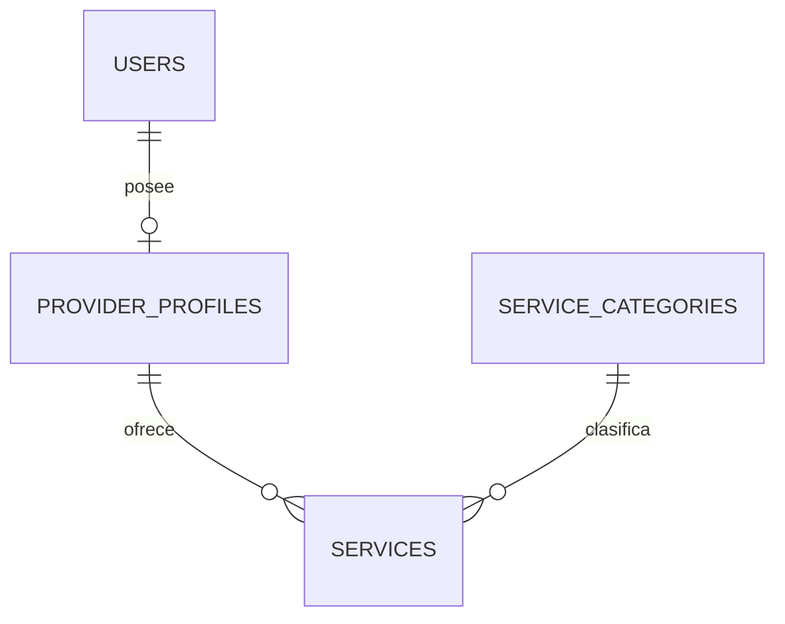

# Tekora — Etapa 3A: catálogo de servicios y directorio

## Base y alcance

La rama `codex/etapa-3a-catalogo-servicios` parte de `origin/main` en `681ab141a32d4f1fd5d0e869e25da8e8a8db9aa0`. Se confirmó en Git y GitHub la integración del PR #3. La suite inicial pasó con 78 pruebas y 732 aserciones.

Esta entrega permite crear, editar, publicar, pausar, retirar a borrador y republicar servicios de un perfil central. Añade catálogo público, búsqueda, filtros, paginación y fichas públicas de prestadores. Mantiene Laravel 12, Blade, CSS/JavaScript y los recursos visuales de MindBloom; no incorpora dependencias ni un framework frontend.

No incluye precios, cobros, reservas, contrataciones, solicitudes, reseñas, chat, notificaciones, verificaciones, fotografías, ubicación, calendarios o disponibilidad. No conecta servicios con las citas anteriores ni vincula `User` con `Profesionista`.

## Tablas, migraciones y relaciones

Las dos migraciones nuevas son aditivas; no cambian las 26 anteriores. Una instalación pasa de 26 a **28 migraciones**.

| Migración | Estructura |
| --- | --- |
| `2026_10_28_000000_create_service_categories_table.php` | `service_categories`: ID, `name` (120), `slug` único (120), `description` nullable, `is_active` booleano (true), `sort_order` entero (0), timestamps. Índice por estado/orden. |
| `2026_10_28_000001_create_services_table.php` | `services`: ID, FK `provider_profile_id`, FK `service_category_id`, `title` (160), `description`, `modality`, `status` y timestamps. Índices por perfil/estado/ID, categoría/estado/ID y estado/modalidad/ID. |

Las modalidades son `remote`, `onsite`, `both`; los estados son `draft`, `published`, `paused`. El estado por defecto en la base y el formulario es borrador. Se usan enums de PHP y validación de servidor; SQLite también comprueba los valores mediante las restricciones que generan las columnas enum.



`ProviderProfile::services()` y `ServiceCategory::services()` son relaciones uno a muchos. `Service::providerProfile()` y `Service::category()` son sus inversas. No hay propietario `Profesionista`, `user_id` duplicado ni referencias a citas en `services`.

Las FK restringen el borrado de perfiles/categorías referenciados: no eliminan servicios en cascada. No se añade una interfaz de eliminación física. Una publicación se retira volviendo a borrador o pausándola. Una eliminación futura de cuentas que tengan servicios necesitará una política explícita.

Los `down()` eliminan exclusivamente `services` y después `service_categories`. Revertirlos pierde los datos nuevos del catálogo; no es un procedimiento de actualización ni debe ejecutarse sin respaldo y autorización. Se probaron solo en SQLite en memoria.

### Categorías iniciales

`ServiceCategorySeeder` crea cinco categorías: reparación de celulares, computadoras y mantenimiento, soporte técnico, desarrollo web y software/servicios digitales.

```powershell
php artisan db:seed --class=ServiceCategorySeeder
```

Es un comando explícito, independiente del seeder general de demostración. Utiliza `firstOrCreate` por slug: no elimina categorías, no renombra registros existentes, no modifica su orden/descripción ni reactiva categorías desactivadas. Puede repetirse. Las migraciones no ejecutan seeds ni publican perfiles/servicios automáticamente. Sin categorías activas, el formulario explica que todavía no hay categorías disponibles.

## Propiedad, permisos y estados

Se añade `provider.services.manage` a la matriz de permisos existente, exclusivamente para el rol `provider`. No modifica asignaciones ni concede `admin`. `ServicePolicy` exige identidad `User` del guard `web` y rol vigente para gestionar servicios. Crear requiere además perfil propio; editar/publicar/pausar exige que el servicio pertenezca a ese perfil. Un administrador sin esos requisitos tampoco puede gestionar servicios ajenos.

`ServiceRequest` y `ServiceStatusRequest` validan títulos, descripción, categoría activa, modalidad y estado. Se rechazan campos de propiedad y privilegios (`user_id`, `provider_profile_id`, `profesionista_id`, `roles`, `role`, `is_admin`, `permissions`, `id`). El modelo solo admite asignación masiva de los cinco campos de contenido/clasificación y estado. La creación usa la relación del perfil obtenido desde la sesión.

La acción de estado acepta únicamente el estado y vuelve a validar los datos al publicar/republicar. Una categoría que se desactiva bloquea la publicación; el propietario todavía puede pausar o retirar a borrador, y elegir otra categoría activa al editar. La desactivación no modifica ni borra el servicio.

Las escrituras utilizan middleware web, sesiones y CSRF. Los formularios HTML vuelven a la pantalla correspondiente mediante redirecciones 303, con confirmación o errores que conservan la entrada. No se agrega una API nueva ni se modifica el contrato JSON de los endpoints anteriores.

## Regla pública y privacidad

`Service::publiclyVisible()` es la regla común del catálogo, sus detalles y las fichas públicas:

1. El servicio tiene estado `published`.
2. Su categoría está activa.
3. El usuario propietario de su `ProviderProfile` conserva el rol `provider`.

La ficha de un prestador aparece solo si tiene al menos un servicio que cumple esa regla. Pausar/retirar el último servicio, desactivar su categoría o revocar el rol lo retira de todas las rutas públicas. No se cambia su estado almacenado. Reactivar categoría/rol vuelve a mostrar servicios que sigan publicados; no constituye un sistema de suspensión permanente ni de moderación.

Un borrador/pausado devuelve **404 en la URL pública**, incluso para el propietario. La edición privada sigue disponible para su propietario autorizado. No se convierte `/perfiles-profesionales/{providerProfile}` en pública: conserva guard y policy de 2B.

Las fichas públicas muestran nombre público, titular, biografía y servicios visibles. El formulario advierte de esta publicación antes de guardar. No se cargan datos de autenticación para renderizar fichas ni se muestran correo, nombre legal de cuenta, edad, género, tokens, contraseña o ID de `User`. Las URLs usan IDs de recursos públicos de servicio/perfil, que no conceden acceso a las rutas privadas. Blade escapa el contenido; no se interpreta HTML de títulos, descripciones o biografías.

Publicar es una decisión voluntaria de la cuenta, **no una verificación profesional**. Las pantallas lo indican. Los cambios posteriores a nombre público, titular o biografía se reflejan en la ficha si esta continúa visible; no hay una segunda copia del perfil.

## Búsqueda y consultas

`/servicios` busca una frase en título y descripción, de hasta 120 caracteres. Usa parámetros enlazados; `%`, `_` y `!` se tratan literalmente. No se interpola entrada del usuario como SQL ni se permite elegir columnas/orden SQL.

El filtro de categoría utiliza su slug activo. Remoto incluye `remote` y `both`; Presencial incluye `onsite` y `both`; Remoto y presencial selecciona `both`. Los filtros se combinan y se conservan al paginar. Hay 12 resultados por página, con orden estable de ID descendente; se valida el número de página entre 1 y 10000. Los filtros inválidos devuelven una pantalla 422 con enlace para limpiarlos, sin bucles de redirección.

Categoría y nombre público se precargan, evitando una consulta por tarjeta. La prueba compara una página pequeña con una llena y confirma el mismo número de consultas (hasta seis). Los índices apoyan estado, categoría, modalidad y propietario. El texto utiliza `LIKE`; para un volumen mayor queda pendiente un índice de búsqueda específico. Su comparación de mayúsculas/acentos depende de SQLite y no promete búsqueda lingüística completa.

El directorio y los servicios de cada ficha también se paginan de 12 en 12. El directorio ordena por nombre público e ID y cuenta únicamente servicios visibles. No tiene filtros adicionales en esta etapa.

## Rutas y pantallas

| Método y ruta | Pantalla/acción | Acceso |
| --- | --- | --- |
| `GET /servicios` | Catálogo con tarjetas, búsqueda/filtros y estado vacío | Público |
| `GET /servicios/{service}` | Detalle de un servicio visible | Público; 404 si no es visible |
| `GET /prestadores` | Directorio de prestadores con publicaciones visibles | Público |
| `GET /prestadores/{providerProfile}` | Nombre, titular, biografía y servicios publicados | Público; 404 si no cumple la regla |
| `GET /cuenta/servicios` | Mis servicios, estados y acciones | `auth:web` + policy `viewAny` |
| `GET /cuenta/servicios/crear` | Formulario de creación | `auth:web` + policy `create` |
| `POST /cuenta/servicios` | Crear desde el perfil propio | Form Request + policy + CSRF |
| `GET /cuenta/servicios/{service}/editar` | Formulario de edición propio | Policy `update` |
| `PUT /cuenta/servicios/{service}` | Editar datos y estado | Form Request + policy + CSRF |
| `PATCH /cuenta/servicios/{service}/estado` | Publicar, pausar o retirar a borrador | Policy `publish`/`pause`, validación y CSRF |

La navegación compartida incorpora Explorar servicios/prestadores y Mis servicios según policy. La pantalla de Prestador enlaza a Crear servicio cuando ya tiene perfil. Cliente enlaza al catálogo; el login permite explorarlo sin sesión. El registro y cambio Cliente/Prestador siguen usando una sola cuenta.

Los layouts, tarjetas y paginación son componentes Blade reutilizables. Las páginas públicas no cargan el layout privado ni muestran controles administrativos. Se mantienen colores, logo y recursos existentes; se revisan escritorio y móvil.

## Compatibilidad con MindBloom

Se conservan cuentas, hashes de contraseña, asignaciones, perfil central, tabla/guard `Profesionista`, acceso heredado, directorio anterior, citas, disponibilidad, bloqueos, Google y módulos de comunidad. La nueva relación `ProviderProfile::services()` es aditiva.

No se fusionan identidades por correo ni por ID. Un profesional antiguo puede explorar como visitante, pero su guard no autoriza la gestión central de servicios. Publicar en Tekora no crea citas ni inserta al perfil en el directorio antiguo. Sigue pendiente la estrategia aprobada de vinculación descrita en 2A.

Se verificaron sin cambios respecto del inicio los hashes de `.env`, `database/database.sqlite`, `config/auth.php`, los cuatro archivos de manifiestos/locks y las 26 migraciones históricas. No se ejecutaron migraciones, seeds o pruebas contra la base existente.

## Validación

Se trabajó en una copia temporal sin `.env`, sin base persistente ni archivos de usuarios. PHP 8.2.35 / PHPUnit 11.5.24; el bootstrap fuerza `APP_ENV=testing`, SQLite `:memory:` y sesión/caché/correo de pruebas.

| Verificación | Resultado |
| --- | --- |
| Suite inicial de main | 78 pruebas, 732 aserciones correctas |
| Suite completa 3A | **110 pruebas, 1132 aserciones correctas** |
| Nuevos casos | 32: 12 de gestión, 11 de catálogo público, 7 de categorías/migración y 2 con CSRF activo |
| Chromium, nueve vistas Blade con fixtures en memoria, escritorio y móvil | 18 combinaciones, sin desbordamiento horizontal ni errores JavaScript |
| Compilación de producción con `npm run build` | Correcta; conserva avisos Sass/Bootstrap |
| Compilación Blade y sintaxis PHP | Correctas en 194 archivos, incluidas las vistas compiladas |
| `node --check public/js/account.js` | Correcto |

Las 78 pruebas anteriores siguen pasando. Solo se ajusta el selector de archivos del ensayo de migración de 2A para que siga ejecutando exactamente sus 24 migraciones de partida, sin incluir las posteriores de 3A. No se elimina ningún caso ni se relajan sus aserciones.

Los casos nuevos comprueban categorías idempotentes/únicas, varias publicaciones con un solo perfil, validación, propiedad, roles, administración restringida, revocación, estados, categorías inactivas, filtros combinados, búsqueda literal/inyección, paginación, privacidad, escape de HTML y consultas sin N+1. Las pruebas CSRF usan la clase de soporte existente para activar realmente la comprobación conservando SQLite en memoria. Incluyen el recorrido registro → login → activación → perfil → borrador → publicación → cambio a Cliente → logout → descubrimiento como visitante.

La actualización se prueba en otra conexión SQLite `:memory:` con **26 migraciones registradas como aplicadas** y fixtures de usuarios/roles/perfil, profesional con el mismo correo y distinta contraseña, tokens, citas, disponibilidad, bloqueos, publicaciones, comentarios, likes y sesión. Se migran solo las dos pendientes; se comparan filas y columnas de todas las tablas anteriores, se comprueban relaciones/FK y se ensayan reversión exclusiva del catálogo y reaplicación. Ninguna operación usa una base persistente.

Chromium revisa HTML generado por Laravel con fixtures aislados y recursos locales; comprueba filtros seleccionados, estado inicial borrador, tokens en formularios y menú móvil. Es una revisión visual/DOM, mientras los recorridos funcionales se prueban por HTTP en Laravel. Windows/Laragon no se ejecutó en esta máquina Linux.

## Laragon / Windows con PowerShell

### Copia nueva para revisar el PR

Requisitos: PHP 8.2+ compatible con `composer.lock`, extensiones del README (incluidas PDO SQLite y SQLite3), Composer 2, Node 22/24 LTS y Git. Usar el PHP de Laragon y una carpeta nueva.

```powershell
Set-Location C:\laragon\www
git clone --branch codex/etapa-3a-catalogo-servicios --single-branch https://github.com/Fernando261/tekora-project.git tekora-etapa3a
Set-Location .\tekora-etapa3a
where.exe php
php --version
php --ini
php -m | Select-String 'PDO|pdo_sqlite|sqlite3|mbstring|dom|xml|openssl'
composer install
npm.cmd ci

if (-not (Test-Path .\.env)) {
    Copy-Item .\.env.example .\.env
    php artisan key:generate
}

# No necesita base local: la suite fuerza SQLite en memoria.
php .\vendor\bin\phpunit --do-not-cache-result
```

Resultado esperado: 110 pruebas y 1132 aserciones. Para abrir la web, revisar **solo el entorno de esta copia nueva**: `DB_CONNECTION=sqlite`, sin `DB_URL` que lo sustituya y `DB_DATABASE` sin definir para el archivo predeterminado, o con ruta absoluta a la base nueva. Mantener SQLite; no se valida MySQL en esta etapa.

Solo para una instalación nueva sin datos:

```powershell
if (Test-Path .\database\database.sqlite) {
    throw 'La base ya existe. No la borres: sigue el procedimiento de actualización.'
}
New-Item -ItemType File -Path .\database\database.sqlite | Out-Null
php artisan migrate
php artisan migrate:status
php artisan db:seed --class=ServiceCategorySeeder
php artisan storage:link
npm.cmd run build
php artisan route:list --except-vendor
php artisan serve
```

Habrá 28 migraciones aplicadas y cinco categorías. `storage:link` puede necesitar modo de desarrollador/permisos de enlaces en Windows. No es necesario ejecutar el seeder general de demostración.

### Recorrido manual

1. Sin sesión, abrir `/servicios` y `/prestadores`; comprobar sus estados vacíos.
2. Registrarse como Cliente, iniciar sesión y activar Prestador. Completar el perfil profesional; Cliente debe conservarse.
3. Abrir Mis servicios → Crear servicio. Guardar título, descripción, categoría y modalidad como borrador.
4. Comprobar que aparece en Mis servicios y devuelve 404 desde su URL pública, también en una ventana privada.
5. Publicarlo. Buscarlo en `/servicios` por texto, categoría y modalidad. Consultar detalle y ficha pública del prestador sin iniciar sesión.
6. Editar el servicio y crear otro con el mismo perfil. Comprobar que los dos pertenecen a la misma cuenta.
7. Pausar una publicación: debe desaparecer del catálogo y devolver 404. Retirar la última a borrador: también debe ocultarse la ficha pública. Republicar para volver a mostrarla.
8. Crear una segunda cuenta prestadora y probar la URL de edición y el envío de cambios al servicio anterior: deben rechazarse con 403.
9. Con una cuenta solo Cliente, comprobar que no aparece Mis servicios y que la ruta devuelve 403. Verificar que `/administracion/roles` sigue restringida.
10. Cambiar Cliente/Prestador sin logout; el catálogo y la gestión deben usar la misma identidad. Comprobar el acceso antiguo de MindBloom en un entorno aislado con fixtures, sin vinculación automática.

### Actualización segura desde una instalación de 2B

Primero ensayar en una copia aislada/restaurable. La publicación de este PR no autoriza por sí sola un despliegue: revisar el cambio antes de actualizar una instalación usada por otras personas.

1. Revisar `git status`, conservar cambios locales y anotar la versión anterior. Detener escrituras de la aplicación y workers durante el respaldo/actualización. No sobrescribir `.env`, cambiar `APP_KEY` ni usar los pasos de instalación nueva.
2. Identificar la ruta SQLite realmente configurada y respaldarla de forma consistente, junto con `.env`, `storage/app/public` y `public/uploads` si existen. La API de backup de SQLite incluye los cambios confirmados que estén en WAL; copiar únicamente el archivo principal mientras hay escrituras no ofrece esa garantía. Guardar los respaldos fuera del repositorio y comprobar su restauración.
3. El siguiente ejemplo crea un respaldo SQLite consistente en Windows. Ajustar `$catalogDb` a la ruta efectiva antes de ejecutarlo; no es una orden que se haya ejecutado en esta entrega:

```powershell
$catalogDb = Join-Path (Get-Location).Path 'database\database.sqlite'
$backupDir = Join-Path 'C:\tekora-backups' ('antes-3a-' + (Get-Date -Format 'yyyyMMdd-HHmmss'))
New-Item -ItemType Directory -Path $backupDir -ErrorAction Stop | Out-Null
Copy-Item .\.env (Join-Path $backupDir '.env') -ErrorAction Stop
foreach ($folder in @('storage\app\public', 'public\uploads')) {
    if (Test-Path $folder) {
        Copy-Item $folder (Join-Path $backupDir ($folder.Replace('\', '-'))) -Recurse -ErrorAction Stop
    }
}
$backupScript = Join-Path $backupDir 'backup-sqlite.php'
@'
<?php
if (!extension_loaded('sqlite3') || !is_file($argv[1]) || file_exists($argv[2])) {
    throw new RuntimeException('Check SQLite3, source path and unused target.');
}
$source = new SQLite3($argv[1], SQLITE3_OPEN_READONLY);
$target = new SQLite3($argv[2]);
if (!$source->backup($target) || $target->querySingle('PRAGMA integrity_check') !== 'ok') {
    throw new RuntimeException('Backup verification failed.');
}
$target->close();
$source->close();
'@ | Set-Content -Path $backupScript -Encoding ASCII
php $backupScript $catalogDb (Join-Path $backupDir 'database.sqlite')
if ($LASTEXITCODE -ne 0) { throw 'El respaldo no se verificó. Detener la actualización.' }
```

4. Con código revisado de 3A y las dependencias de sus locks, ejecutar la suite en memoria y revisar primero las migraciones:

```powershell
php .\vendor\bin\phpunit --do-not-cache-result
php artisan migrate:status
php artisan migrate --pretend
```

La base de partida debe mostrar las 26 anteriores aplicadas y exactamente las dos nuevas pendientes. Si no coincide, detenerse y resolver su estado antes de migrar. `--pretend` muestra las sentencias previstas, no sustituye el respaldo ni el ensayo de restauración.

5. En la copia de revisión y posteriormente en un despliegue autorizado, aplicar únicamente las pendientes e inicializar categorías de manera explícita:

```powershell
php artisan migrate
php artisan db:seed --class=ServiceCategorySeeder
php artisan migrate:status
php artisan config:clear
php artisan route:clear
php artisan view:clear
npm.cmd run build
```

6. Confirmar 28 migraciones, revisar conteos/relaciones anteriores y repetir el recorrido de login, perfil, catálogo y acceso heredado. Reanudar la aplicación después de verificar. Un catálogo vacío después de migrar es normal: no se crean servicios automáticamente.

No ejecutar `migrate:fresh`, `db:wipe`, `migrate:reset`, seeds de demostración, rollback ni regeneración de clave sobre una base existente. Si se requiere volver al código anterior, conservar el respaldo y los datos nuevos del catálogo; una reversión de esquema elimina esos datos y requiere un plan separado.

## Dependencias y auditoría npm

No se agregan paquetes ni se cambian `composer.json`, `composer.lock`, `package.json` o `package-lock.json`. Se revisaron sus dependencias existentes y se consultó `npm audit --json --ignore-scripts`, sin `fix`, instalaciones o actualizaciones automáticas. La consulta del 27 de octubre de 2026 (America/Mexico_City) devuelve código 1 porque reporta **13 paquetes afectados: 2 críticos, 10 altos y 1 moderado**. El número puede cambiar con las bases de avisos.

| Paquete en el lock | Versión raíz del paquete | Severidad máxima | Relación |
| --- | --- | --- | --- |
| axios | 1.11.0 | Alta | Directa |
| follow-redirects | 1.15.9 | Moderada | Transitiva |
| form-data | 4.0.4 | Alta | Transitiva |
| immutable | 5.1.3 | Alta | Transitiva |
| lodash | 4.17.21 | Alta | Transitiva |
| nanoid | 3.3.11 | Alta | Transitiva |
| picomatch | 2.3.1 | Alta | Transitiva |
| postcss | 8.5.6 | Alta | Transitiva |
| rollup | 4.46.2 | Alta | Transitiva |
| shell-quote | 1.8.3 | Crítica | Transitiva |
| source-map-js | 1.2.1 | Alta | Transitiva |
| tar | 7.4.3 | Crítica | Transitiva |
| vite | 6.3.5 | Alta | Directa |

Hay correcciones disponibles según npm, pero eso no demuestra compatibilidad del árbol completo. Hace falta un cambio separado de dependencias con revisión de los avisos, versiones, build y regresiones. No se ejecuta `npm audit fix --force`. Las dependencias están declaradas en `devDependencies`, aunque Axios también se compila para el navegador; esa clasificación no equivale a ausencia de riesgo en producción.

Referencias de algunos avisos: [Axios](https://github.com/advisories/GHSA-4hjh-wcwx-xvwj), [shell-quote](https://github.com/advisories/GHSA-w7jw-789q-3m8p), [tar](https://github.com/advisories/GHSA-34x7-hfp2-rc4v), [Vite](https://github.com/advisories/GHSA-p9ff-h696-f583). Para actualizar el diagnóstico local:

```powershell
npm.cmd audit
npm.cmd run build
```

La compilación conserva avisos de deprecación de Sass/Bootstrap. Esta auditoría npm no es una auditoría de Composer ni una revisión exhaustiva de seguridad de la aplicación.

## Limitaciones pendientes

- Administración de categorías, moderación y suspensión permanente requieren una etapa posterior; el rol puede reactivarse voluntariamente como en 2A.
- El catálogo no ofrece contratación, contacto, pago, reservas ni integración con citas antiguas.
- No hay verificación profesional, ranking, búsqueda geográfica o campos ampliados del perfil.
- La vinculación de identidades antiguas sigue pendiente de aprobación; un correo coincidente no es prueba de titularidad.
- Para grandes volúmenes falta diseñar búsqueda de texto especializada. Solo se ha validado SQLite y no se ha ejecutado Laragon/PowerShell en este entorno Linux.
- Permanecen las alertas npm y las deprecaciones de compilación documentadas, sin actualizaciones automáticas.

## Archivos modificados

### Documentación

- `README.md`
- `docs/catalogo-servicios-etapa-3a.md`

### Modelos, enums, permisos y backend

- `app/Enums/Permission.php`
- `app/Enums/ServiceModality.php`
- `app/Enums/ServiceStatus.php`
- `app/Http/Controllers/ProviderServiceController.php`
- `app/Http/Controllers/PublicProviderController.php`
- `app/Http/Controllers/ServiceCatalogController.php`
- `app/Http/Requests/CatalogFilterRequest.php`
- `app/Http/Requests/ServiceRequest.php`
- `app/Http/Requests/ServiceStatusRequest.php`
- `app/Models/ProviderProfile.php`
- `app/Models/Service.php`
- `app/Models/ServiceCategory.php`
- `app/Policies/ServicePolicy.php`
- `app/Providers/AppServiceProvider.php`

### Migraciones y categorías iniciales

- `database/migrations/2026_10_28_000000_create_service_categories_table.php`
- `database/migrations/2026_10_28_000001_create_services_table.php`
- `database/seeders/ServiceCategorySeeder.php`

### Blade y estilos

- `public/css/catalog.css`
- `resources/views/account/client.blade.php`
- `resources/views/account/provider.blade.php`
- `resources/views/catalog/index.blade.php`
- `resources/views/catalog/invalid-filters.blade.php`
- `resources/views/catalog/show.blade.php`
- `resources/views/components/account-layout.blade.php`
- `resources/views/components/account-navigation.blade.php`
- `resources/views/components/catalog-layout.blade.php`
- `resources/views/components/catalog-pagination.blade.php`
- `resources/views/components/service-card.blade.php`
- `resources/views/login.blade.php`
- `resources/views/provider-services/form.blade.php`
- `resources/views/provider-services/index.blade.php`
- `resources/views/public-providers/index.blade.php`
- `resources/views/public-providers/show.blade.php`

### Rutas

- `routes/catalog.php`
- `routes/web.php`

### Pruebas

- `tests/Feature/CatalogMigrationTest.php`
- `tests/Feature/IdentityMigrationTest.php`
- `tests/Feature/PublicCatalogTest.php`
- `tests/Feature/ServiceCsrfTest.php`
- `tests/Feature/ServiceManagementTest.php`
- `tests/Support/CatalogFixtures.php`
