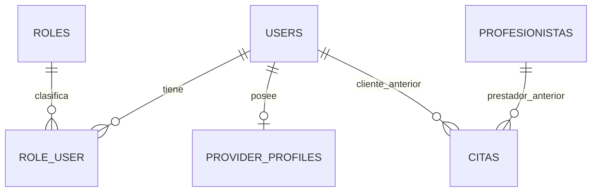

# Tekora — Etapa 2A: identidades y roles

## Base y alcance

La rama `codex/etapa-2a-identidades-roles` parte de `main` en `bd9d37d`, que integra la Etapa 1 mediante el PR #1. Antes de los cambios se ejecutaron sus 33 pruebas y 333 aserciones correctamente.

Esta etapa agrega identidad multirrol y perfil profesional central. Conserva Laravel 12, Blade, las pantallas MindBloom, los guards, contraseñas y relaciones anteriores. No introduce un catálogo de servicios, pagos, contrataciones ni un panel nuevo. Los endpoints nuevos usan el middleware web y sesiones/CSRF de Laravel; sus respuestas JSON no requieren otro frontend.

La vinculación o fusión de cuentas antiguas queda **sin implementar**, pendiente de aprobar la estrategia descrita al final. No se consulta ni migra una base real durante esta entrega.

## Relación actual de identidades, guards y sesiones

| Identidad | Autenticación | Referencias anteriores que se conservan |
| --- | --- | --- |
| `User` / `users` | Guard `web`, contraseña y sesión propios | `posts`, `comments`, `likes`, `reminders`, `citas.user_id`; metadatos `sessions.user_id`. |
| `Profesionista` / `profesionistas` | Guard `profesionista`, contraseña y sesión propios | `citas.profesionista_id`, `profesionista_disponibilidades`, `profesionista_bloqueos`, campos Google. |

Ambos guards comparten la sesión Laravel del navegador, pero usan claves de autenticación distintas. Un ID numérico o correo coincidente no significa que sean la misma persona. `sessions.user_id` es un metadato sin FK en el esquema anterior: no es evidencia válida para vincular cuentas de guards diferentes. El logout conserva la invalidación completa de sesión de la Etapa 1.

No se modifica `config/auth.php`, la tabla de sesiones, `Profesionista`, citas, comunidad, disponibilidad ni las 24 migraciones históricas.

## Arquitectura propuesta e implementada



La identidad central es `User`. Los roles no crean otra identidad ni contienen contraseñas. El perfil profesional es una entidad separada con datos de presentación; su existencia no concede permisos ni significa que esté verificado. En esta etapa no hay vínculo entre `ProviderProfile` y `Profesionista`.

### Nuevas migraciones

| Archivo | Estructuras y garantías |
| --- | --- |
| `2026_10_23_000000_create_roles_and_role_user_tables.php` | `roles`: slug único y nombre; catálogo fijo `client`, `provider`, `admin`. `role_user`: FK a usuario y rol, clave primaria compuesta que evita duplicados, índice por rol y timestamps. No asigna roles a ninguna cuenta existente. |
| `2026_10_23_000001_create_provider_profiles_table.php` | `provider_profiles`: ID, FK `user_id` única, `display_name`, `headline`, `bio` y timestamps. Solo un perfil por cuenta. No copia datos de profesionistas. |

Son cambios aditivos. `up()` no actualiza filas de las tablas antiguas. La instalación pasa de 24 a 26 migraciones.

Los `down()` eliminan únicamente estas nuevas estructuras, en orden inverso, sin borrar identidades ni relaciones antiguas. **Una reversión sí pierde las nuevas asignaciones y perfiles:** respaldarlos antes de cualquier reversión autorizada. No se ejecuta rollback en bases reales; la reversibilidad solo se prueba en memoria.

### Modelos y relaciones

- `User::roles()` y `Role::users()`: relación muchos a muchos con timestamps del pivote.
- `User::providerProfile()`: relación uno a uno; `ProviderProfile::user()`: propietario.
- `User::hasRole(RoleName)` y `User::hasPermission(Permission)`: consultan asignaciones actuales. No reutilizan una colección previamente cargada para decidir permisos.
- `ProviderProfile` solo admite asignación masiva de `display_name`, `headline` y `bio`. Propietario, roles, IDs antiguos y privilegios no se obtienen del formulario.
- `RoleName` define los tres nombres internos estables; no se aceptan roles arbitrarios desde solicitudes.

### Permisos distintos de identidad y perfil

Los permisos se definen en código con `Permission` y se ejecutan mediante Gates y `ProviderProfilePolicy`. No hay permisos individuales, edición de la matriz por HTTP ni dependencia de paquetes RBAC.

| Permiso | Rol que lo concede | Alcance adicional |
| --- | --- | --- |
| `client.appointments.view` | Cliente | Listado nuevo de citas propias; reutiliza el filtrado por usuario existente. |
| `provider.profile.manage` | Prestador | Crear un perfil propio o modificarlo; la policy comprueba propiedad. |
| `provider.profile.review` | Administrador | Consultar perfiles para supervisión. No habilita editar perfiles ajenos. |
| `accounts.roles.manage` | Administrador | Consultar catálogo y administrar solamente roles de negocio. |

No existe un `Gate::before` que convierta al administrador en superusuario. Ser administrador no implica ser cliente o prestador; una cuenta puede tener varios roles explícitos. Gates y policy rechazan identidades `Profesionista`, incluso si su ID coincide con el de un `User` administrador.

### Altas y asignaciones

- Un **registro nuevo en `users`** recibe solo `client`, dentro de la misma transacción que crea la cuenta. Los campos de privilegios enviados por el navegador no se utilizan.
- Usuarios existentes no reciben roles por migración, login, coincidencia de email o mera creación de un perfil. Conservan sus rutas anteriores y pueden activar voluntariamente los roles de negocio desde el nuevo endpoint.
- La activación propia solo acepta `client` o `provider`; siempre actúa sobre la identidad autenticada. Es idempotente y no crea otra cuenta.
- Activar `provider` es el alta de una capacidad de negocio, **no una verificación profesional**. La publicación, verificaciones y suspensión administrativa permanente se diseñarán en etapas posteriores.
- Un administrador puede reemplazar roles de negocio de una cuenta. La operación comprueba permisos también dentro del servicio, conserva datos de identidad y no elimina su perfil al revocar el rol.
- Ese endpoint no agrega ni quita `admin`, incluso al modificar una cuenta que ya es administradora.
- No hay seeder, cuenta predeterminada, comando de bootstrap ni endpoint para conceder `admin`. El primer administrador requiere una selección y autorización manual expresas, fuera de esta entrega. Solo se crean administradores como fixtures de pruebas en memoria.
- La revocación impide inmediatamente los accesos que requieren ese rol. No constituye un bloqueo permanente: los roles de negocio son de alta voluntaria y la cuenta puede volver a activarlos. No usar la revocación de rol como mecanismo de suspensión.

## Endpoints de backend

Todos exigen `auth:web`. Las escrituras mantienen CSRF; no se debe desactivarlo para probarlas. Los errores JSON requieren `Accept: application/json`.

| Método y ruta | Comportamiento y autorización |
| --- | --- |
| `GET /cuenta/identidad` | ID/nombre propios, roles actuales y referencia al perfil. No devuelve contraseña ni datos del guard antiguo. |
| `POST /cuenta/roles` | Activación propia de `client` o `provider`; rechaza `admin`, destinos alternativos y campos de privilegios. |
| `GET /cuenta/citas` | Exige cliente; muestra solo citas propias mediante el controlador/vista anteriores. |
| `POST /perfil-profesional` | Exige prestador; crea el perfil de la cuenta autenticada; devuelve 409 si ya existe. |
| `GET /perfiles-profesionales/{providerProfile}` | Propietario con rol prestador, o administrador con permiso de supervisión. |
| `PUT /perfiles-profesionales/{providerProfile}` | Solo propietario con rol prestador; valida contenido y propiedad en el servidor. |
| `GET /administracion/roles` | Catálogo, solo administrador. |
| `PUT /administracion/usuarios/{user}/roles` | Solo administrador; reemplaza `client`/`provider`, preservando cualquier asignación administrativa. |

El perfil se limita a presentación: no contiene tokens, cédulas, estado de verificación, servicios ni datos de cobro. No hay directorio público de estos perfiles todavía.

### Compatibilidad deliberada

Las rutas anteriores, incluido `/citas`, conservan sus guards y reglas. No se exige un rol nuevo a usuarios históricos para continuar usándolas. `/cuenta/citas` permite comprobar la autorización nueva reutilizando una operación real sin cambiar la navegación.

Esta transición no significa que todas las operaciones antiguas ya dependan de roles. Sustituir progresivamente sus reglas requiere aprobar el tratamiento de cuentas históricas y un plan de activación; bloquearlas ahora rompería la compatibilidad solicitada.

Un nuevo prestador central no inicia sesión automáticamente como `Profesionista`, no aparece en el directorio antiguo ni recibe sus citas. No se simula esa integración.

## Estrategia posterior para cuentas antiguas — propuesta, no implementada

Antes de ejecutar cualquier vínculo se debe aprobar la política de titularidad y resolver datos ambiguos. No se migran contraseñas ni se elige automáticamente una cuenta por email.

1. **Inventario y respaldo aislado.** Identificar por separado IDs de `users` y `profesionistas`, correos repetidos o distintos, duplicados, citas, disponibilidad, bloqueos, tokens y sesiones. Comparar cantidades e integridad con un respaldo restaurable. No usar solo el correo como clave.
2. **Vinculación voluntaria comprobada.** Una persona autenticada en `User` debe demostrar control de la cuenta antigua mediante reautenticación de su guard y un flujo de confirmación. Una sesión o correo coincidente no bastan. Para cuentas inaccesibles, definir recuperación y revisión humana con evidencia antes de crear un vínculo.
3. **Mapa explícito con trazabilidad.** Proponer una tabla nueva de enlaces entre IDs, con quién aprobó, método y fecha. Imponer unicidad del origen y decidir si se admite más de una identidad antigua por usuario central. La base inicial recomendada es un enlace individual revisado; los casos múltiples quedan pendientes de decisión.
4. **Resolver conflictos antes de copiar.** Si existen dos perfiles, decidir qué campos conservar o combinar. Mantener las contraseñas originales mientras ambos accesos existan. No otorgar `admin` por ser profesionista ni por tener datos coincidentes. El rol prestador y la verificación son decisiones independientes.
5. **Migración aditiva de referencias.** Tras aprobar cada enlace, agregar referencias centrales nullable a las entidades que lo necesiten y rellenarlas únicamente desde el mapa aprobado. Conservar las FK antiguas, verificar citas y conteos y disponer de una reversión del enlace. No sobrescribir `citas.profesionista_id` en esta etapa.
6. **Tokens Google y sesiones.** Diseñar cifrado y conservación de claves antes de trasladar credenciales. No copiar tokens a `User` o perfiles públicos. Reautenticar/rotar sesiones al confirmar un enlace, sin reinterpretar los metadatos anteriores como identidad central.
7. **Transición y retirada posteriores.** Habilitar rutas centrales cuando se compruebe equivalencia; mantener acceso anterior durante la transición. Retirar guard/tablas solo en otra etapa aprobada, con respaldo y comprobación de que ninguna referencia dependa de ellos.

**Decisiones pendientes:** evidencia de titularidad, tratamiento de múltiples cuentas antiguas por persona, conflictos de perfiles, recuperación de acceso antiguo, asignaciones iniciales de negocio y verificación. Ninguna se resuelve fusionando registros en esta entrega.

## Windows con Laragon y PowerShell

### Copia nueva de revisión

Abrir la terminal de Laragon o configurar su PHP en el PATH. No sustituir la carpeta donde ya existan cambios locales.

```powershell
Set-Location C:\laragon\www
git clone --branch codex/etapa-2a-identidades-roles --single-branch https://github.com/Fernando261/tekora-project.git tekora-etapa2a
Set-Location .\tekora-etapa2a
where.exe php
php --version
php --ini
php -m | Select-String 'PDO|pdo_sqlite|sqlite3|mbstring|dom|xml|openssl'
composer install
npm.cmd ci

if (-not (Test-Path .\.env)) {
    Copy-Item .\.env.example .\.env
    php artisan key:generate
}

# Las pruebas fuerzan SQLite en memoria; no requieren migrar tu base local.
php .\vendor\bin\phpunit --do-not-cache-result
```

Requisitos generales: PHP 8.2 o superior compatible con el lock, extensiones del README, Composer 2 y Node 22/24 LTS. Habilitar `pdo_sqlite` en el `php.ini` que realmente utiliza Laragon. `npm.cmd` evita depender de la política de ejecución de scripts de PowerShell.

Antes de abrir la aplicación, revisar **el entorno de esta copia nueva**: `DB_CONNECTION=sqlite`, sin un `DB_URL` que lo sustituya; dejar `DB_DATABASE` sin definir para el archivo predeterminado, o usar una ruta absoluta con barras `/`. Mantener SQLite; esta etapa no valida MySQL.

```powershell
if (Test-Path .\database\database.sqlite) {
    throw 'La base ya existe: sigue el procedimiento de respaldo y actualización, no la borres.'
}
New-Item -ItemType File -Path .\database\database.sqlite | Out-Null
php artisan migrate
php artisan migrate:status
php artisan storage:link
npm.cmd run build
php artisan route:list --path=cuenta
php artisan route:list --path=perfiles-profesionales
php artisan serve
```

Usar la URL indicada por `artisan serve`, o la URL de Laragon configurada sobre el directorio `public`. Si `storage:link` requiere permisos, habilitar el modo de desarrollador de Windows. No es necesario crear administradores para ejecutar las pruebas.

### Comprobación manual opcional en la copia aislada

Crear una cuenta de prueba por el formulario existente. Para probar la API desde otra ventana PowerShell sobre `artisan serve`:

```powershell
$base = 'http://127.0.0.1:8000'
$session = New-Object Microsoft.PowerShell.Commands.WebRequestSession
$page = Invoke-WebRequest "$base/login" -WebSession $session -UseBasicParsing
$token = [regex]::Match($page.Content, 'name="_token" value="([^"]+)"').Groups[1].Value
$credential = Get-Credential -Message 'Cuenta de prueba de la copia aislada'
$page = Invoke-WebRequest "$base/login" -Method Post -WebSession $session -UseBasicParsing -Body @{
    _token = $token
    email = $credential.UserName
    password = $credential.GetNetworkCredential().Password
}
# El login regenera la sesión y su token CSRF.
$token = [regex]::Match($page.Content, 'name="_token" value="([^"]+)"').Groups[1].Value
$headers = @{ Accept = 'application/json'; 'X-CSRF-TOKEN' = $token }
Invoke-RestMethod "$base/cuenta/identidad" -WebSession $session -Headers $headers
Invoke-RestMethod "$base/cuenta/roles" -Method Post -WebSession $session -Headers $headers -ContentType 'application/json' -Body '{"role":"provider"}'
Invoke-RestMethod "$base/perfil-profesional" -Method Post -WebSession $session -Headers $headers -ContentType 'application/json' -Body '{"display_name":"Prestador de prueba"}'
Invoke-RestMethod "$base/cuenta/identidad" -WebSession $session -Headers $headers
```

La identidad debe seguir siendo la misma y tener `client`/`provider`. No imprimir ni guardar la contraseña o cookies. Intentar enviar `role=admin` debe producir 422; consultar `/administracion/roles` con esta cuenta debe producir 403. El comportamiento administrativo completo se prueba con fixtures en memoria, sin crear un administrador local automáticamente. Estos ejemplos no han sido ejecutados en Windows durante esta entrega.

### Base existente o modificaciones locales

1. No cambiar de rama forzadamente ni sobrescribir modificaciones. Revisar el PR en el clon nuevo o un worktree; consultar la guía de la Etapa 1 para respaldos y conflictos.
2. Detener servidor/workers, comprobar la conexión y respaldar consistentemente SQLite, archivos y `.env`; conservar `APP_KEY`. Si hay WAL pendiente, usar un mecanismo de backup consistente de SQLite.
3. Ensayar primero sobre una copia aislada del respaldo. Las nuevas migraciones no requieren seeders ni cambios en las cuentas antiguas.
4. El despliegue debe aplicar las migraciones aditivas antes de atender registros con el código nuevo, porque el alta de `User` requiere el catálogo de roles.

```powershell
php artisan config:clear
php artisan route:clear
php artisan view:clear
php .\vendor\bin\phpunit --do-not-cache-result
php artisan migrate:status
php artisan migrate --pretend
# Solo después de revisar el SQL y validar respaldo/ensayo:
php artisan migrate
php artisan migrate:status
```

No ejecutar `migrate:fresh`, `db:wipe`, `migrate:reset`, seeders de demostración ni regenerar `APP_KEY` sobre datos existentes. No ejecutar rollback sobre una base real como prueba de reversibilidad. El agente no ejecuta ninguno de estos cambios sobre tu base.

## Riesgos y límites pendientes

- Sin vinculación histórica aprobada, los dos sistemas de prestadores coexisten y no comparten citas o credenciales.
- Los endpoints nuevos sí comprueban roles; las rutas antiguas mantienen su autorización previa para no bloquear cuentas sin roles.
- No se incluye bootstrap de administradores, verificación profesional, suspensión permanente, interfaz de selección de roles ni historial administrativo de cambios; los timestamps del pivote representan asignaciones actuales, no una bitácora completa.
- MySQL, concurrencia entre peticiones reales, Windows/Laragon y servicios Google/SMTP necesitan validación específica. SQLite no garantiza la misma semántica de bloqueo por fila que otros motores.
- Los pendientes de citas y Google de la Etapa 1 siguen fuera del alcance de identidades.

## Validación ejecutada

| Comprobación | Resultado |
| --- | --- |
| Línea base de `main` antes de modificar código | 33 pruebas y 333 aserciones correctas. |
| Suite completa tras Etapa 2A | 57 pruebas y 492 aserciones correctas: las 33 previas y 24 nuevas. |
| Instalación limpia | Las 26 migraciones se ejecutan en SQLite en memoria; una segunda ejecución no agrega migraciones. |
| Upgrade desde las 24 migraciones anteriores | Filas y columnas de diez tablas antiguas conservadas, incluidas contraseñas, tokens y sesiones ficticios. |
| Reversión/reaplicación de las dos migraciones nuevas | Correcta en memoria; relaciones antiguas intactas. |
| Restricciones de base | FK, unicidad de perfil y clave compuesta de membresía comprobadas. |
| Permisos | Acceso permitido/denegado por rol, propiedad, revocación y separación entre guards comprobados. |
| Escalamiento | Registro manipulado, autoasignación de `admin`, campos de propietario y operaciones administrativas no autorizadas rechazados. |
| Configuración externa de producción/MySQL deliberadamente incorrecta | La suite siguió usando SQLite en memoria. |
| Registro de rutas nuevas | Correcto. |
| Sintaxis PHP | 105 archivos comprobados sin errores. |
| `git diff --check` | Correcto. |

Ejecución con PHP 8.2.35 / PHPUnit 11.5.24, en una copia temporal sin `.env`, sin la base existente ni archivos de usuarios, con red deshabilitada y dependencias montadas solo para lectura. Se verificó por hash que `.env` y `database/database.sqlite` originales no cambiaron. No se instalaron dependencias ni se cambiaron locks.

La única adaptación a las pruebas anteriores es que `InstallationTest` cuenta las migraciones presentes en lugar de exigir exactamente 24; sus comprobaciones originales permanecen. Las nuevas pruebas crean administradores solamente como fixtures de memoria.

No ejecutado: Windows/Laragon, navegador/PowerShell manual, MySQL, servicios externos ni actualización sobre los datos reales del usuario. No hubo cambios de frontend que requirieran una compilación nueva en esta etapa.

## Archivos modificados y añadidos

- `README.md`
- `app/Enums/Permission.php`
- `app/Enums/RoleName.php`
- `app/Http/Controllers/AuthController.php`
- `app/Http/Controllers/IdentityController.php`
- `app/Http/Controllers/ProviderProfileController.php`
- `app/Http/Controllers/RoleMembershipController.php`
- `app/Http/Requests/EnrollRoleRequest.php`
- `app/Http/Requests/ProviderProfileRequest.php`
- `app/Http/Requests/UpdateBusinessRolesRequest.php`
- `app/Models/ProviderProfile.php`
- `app/Models/Role.php`
- `app/Models/User.php`
- `app/Policies/ProviderProfilePolicy.php`
- `app/Providers/AppServiceProvider.php`
- `app/Services/RoleMemberships.php`
- `database/migrations/2026_10_23_000000_create_roles_and_role_user_tables.php`
- `database/migrations/2026_10_23_000001_create_provider_profiles_table.php`
- `docs/identidades-roles-etapa-2a.md`
- `routes/identities.php`
- `routes/web.php`
- `tests/Feature/IdentityMigrationTest.php`
- `tests/Feature/IdentityRolesTest.php`
- `tests/Feature/InstallationTest.php`
