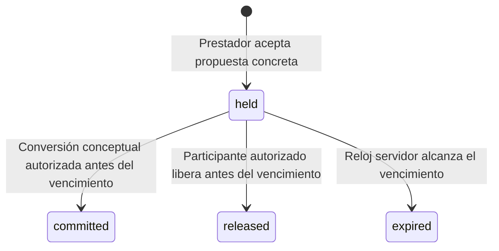

# TEKORA Payments B2.1 — Motor sintético de retenciones

Estado: núcleo de dominio sin integración ni persistencia. Solo archivos nuevos.
Base verificada de main: `ac999cea8f592ce7b94481ee30f602b67d9f5bea`.
Rama local: `codex/payments-b21-synthetic-slot-holds`.

## Diseño consultado y alcance autorizado

Se consultó el documento local `TEKORA-B1-B2-DESIGN.md` antes de implementar:
`/workspace/tekora-payments-design-cfmkgkhk/TEKORA-B1-B2-DESIGN.md`.
SHA-256 del documento consultado:
`eb7085f3f604313b49d23ab6fc9b16e008a3d821ac5645392f8b1c75d518a820`.

Su sección B2.1 permite dominio, reloj inyectable, estados, idempotencia y store
sintético. La autorización actual limita además el trabajo al motor de retenciones.
No se implementan el SQL B1, triggers de proyección, coordinador de reservas real,
eventos financieros, outbox, ledger o autoridad SQLite persistente.

PR #32 no se presupone fusionado. La rama nace de main, no del commit B1. No hay
imports, copias ni dependencias del código `App\Payments`. El nombre de una
cotización en los fixtures es una referencia sintética, no una cotización B1 real.

## Arquitectura implementada

`SyntheticHoldEngine` recibe un `HoldStore` y un `HoldClock` explícitos. No existe
binding productivo, endpoint, comando Artisan, scheduler o controlador nuevo.

| Componente | Responsabilidad |
| --- | --- |
| UtcInterval / HoldTime | Instantes UTC inmutables, microsegundos e intervalos de exactamente 3600 segundos. |
| AcceptedQuoteReference | Identidad sintética de cotización aceptada, solicitud, servicio, prestador y cliente. |
| ReservationProposal | Reserva concreta, versión de propuesta, intervalo y referencia de cotización; huella de intención. |
| HoldActor | Aserción confiable de actor provider/client/system para el modelo. |
| SlotHold / HoldState | Snapshot inmutable, 900 segundos, versión y transiciones. |
| HoldEvent / HoldReceipt | Historial y recuperación de intenciones confirmadas. |
| HoldStore | Contrato abstracto de atomicidad, CAS, identidad, exclusividad, historial e idempotencia. |
| HoldClock / SystemHoldClock | Fuente de tiempo inyectable; implementación UTC sin estado persistente. |
| InMemorySlotHoldStore / MutableSlotHoldClock | Implementaciones exclusivas de tests. |

Los intervalos admiten DateTimeImmutable con offset explícito y los normalizan a
UTC sin perder precisión. No resuelven fechas civiles ambiguas ni consultan IANA,
disponibilidad, revisiones u horizonte de reservas: esas comprobaciones corresponden
al adaptador futuro y a ReservationTime. No se han duplicado esos servicios.
La elegibilidad temporal del servicio (incluida fecha futura y antelación respecto
al inicio) no es una garantía de este motor aislado; debe validarla el adaptador.

Los holds reciben un UUID canónico generado en el servidor. `SlotHold::fromStorage`
permite reconstruir un snapshot desde valores de un adaptador futuro, sin generar
otro ID ni renovar el vencimiento. Valida UUID, duración exacta, versión y coherencia
temporal del estado. No carga una base, no inserta registros ni restaura exclusividad
por sí sola. No usar Reflection/unserialize para eludir sus validaciones.
El adaptador deberá validar también la representación canónica de las fechas
almacenadas antes de parsearlas: la fábrica recibe instantes, no texto SQL original.

`AcceptedQuoteReference` no autentica al cliente ni prueba que una cotización exista
o esté aceptada en B1. El futuro adaptador debe cargar y comprobar esos hechos,
incluido el vínculo exacto con una reserva. B2.1 comprueba la coherencia de las
referencias que recibe, sin consultar una base ni inventar importes o aceptación.

## Autoridad y operaciones

- `accept(proposal, provider, UUID)` acepta la propuesta concreta dentro del modelo
  y crea el hold solo si no hay ocupación incompatible. No acepta una solicitud inicial.
- `release(id, participant, expectedHoldVersion, UUID)` permite liberar un held
  únicamente a su prestador o cliente declarados.
- `commit(id, system, expectedHoldVersion, UUID)` convierte conceptualmente held a
  committed. **No verifica un pago ni confirma una reserva Laravel.**
- `expireDue(system)` registra las expiraciones debidas; repetirlo no añade eventos.

`HoldActor` es una aserción emitida por código confiable: sus fábricas públicas no
son credenciales ni un mecanismo de autenticación. No existe aquí validación de
sesión, revocación de roles o permisos Laravel. El futuro adaptador debe reautorizar
al actor real bajo la transacción persistente y nunca construirlo con datos de una
petición sin validar. El motor verifica identidad/rol declarados para cada operación.

Solo system puede expirar o convertir. System no suplanta al prestador para liberar:
una expiración queda registrada como system con userId null. La liberación manual
registra al cliente o prestador correspondiente.

## Plazo y exclusividad

El servidor toma T al registrar la retención; `expiresAt = T + 900 segundos`,
conservando microsegundos. El reloj se vuelve a muestrear antes de registrar una
retención y antes de decidir una conversión/liberación. No se usa reloj del cliente.
El modelo no mide ni certifica duración de un commit físico o de una llamada HTTP.

A los 899 segundos sigue vigente. A los 900 exactos se registra expired y una
conversión nueva se rechaza. No se redondea el plazo a minutos ni se trunca al
inicio del servicio. Tampoco se impone una antelación mínima todavía no aprobada.

Los estados held y committed ocupan el intervalo de servicio `[inicio, fin)`:
`A.start < B.end && A.end > B.start` significa conflicto. La capacidad es uno por
perfil de prestador, compartida entre sus servicios. El doble en memoria conserva
la relación uno-a-uno usuario/perfil ya observada; no permite cambiarla mediante
otra referencia. No sustituye la verificación de identidad del catálogo real.

Se permiten intervalos consecutivos y el mismo intervalo para prestadores distintos.
La conversión sustituye el snapshot de la misma ocupación, sin eliminarla ni crear
otra fila lógica. Committed sigue bloqueando después de los 900 segundos.

## Máquina de estados propia del motor

Committed, released y expired no se reactivan en B2.1. La cancelación posterior de
un compromiso y la finalización del servicio quedan fuera de este incremento;
committed no se libera por una operación que solo está autorizada para held.
Estos estados no cambian ReservationStatus ni los estados de solicitudes actuales.

Cada transición real añade un evento y aumenta la versión del hold exactamente en
uno. La versión de propuesta queda como snapshot y no se modifica una versión de
reserva real. Un replay no aumenta versiones ni crea eventos nuevos.

## Idempotencia, expiración e historial

- UUID canónico, normalizado a minúsculas; ámbito actor kind + userId (system tiene
  su propio ámbito). La misma intención no se reutiliza entre verbos o reservas.
- La huella de aceptación cubre reserva, versión de propuesta, intervalo UTC exacto,
  cotización, solicitud, servicio, perfil, usuario prestador y cliente.
- La huella de liberación/conversión incluye verbo, hold y versión esperada.
- Mismo UUID y contenido confirmado devuelve la ocupación vigente y conserva sus
  identificadores, T y vencimiento originales. Contenido distinto genera conflicto.
- Una aceptación repetida a partir del vencimiento puede materializar expired,
  pero no crea otra retención ni prolonga el reloj.
- Otra clave no reactiva la misma reserva. Una cotización vinculada tampoco se
  reutiliza para otra reserva. Una nueva intención necesita referencias nuevas.
- Las intenciones fallidas no se registran como éxitos ni reservan una clave para
  siempre. Reintentar después de un fallo estructural usa la misma clave/contenido.
- La aceptación de otra propuesta expira primero holds debidos del mismo prestador.
  No es necesario un worker para liberar dentro del modelo.
- Una acción tardía persiste la expiración legítima y después informa el rechazo.
  No se pierde el evento porque una excepción revierta esa expiración.
- Un resultado financiero tardío no se ingiere en B2.1. Su equivalente conceptual
  (commit tardío) se rechaza y no desplaza al nuevo ocupante. Registrar y conciliar
  eventos financieros reales o simulados completos corresponde a B2.4.

Los snapshots y eventos son readonly, incluidas referencias e instantes. El historial
se conserva al liberar o expirar; no hay API de borrado. El reloj conserva una marca
máxima de operaciones confirmadas por el store: un retroceso detectado falla cerrado
y nunca modifica expiresAt para compensarlo.

## Contrato de almacenamiento y límites

`HoldStore::atomic()` debe serializar decisiones, hacer rollback de fallos
estructurales y agrupar ocupación, historia, intención y observación del reloj.
`insert` debe garantizar unicidad de reserva/cotización/ID e impedir solapes;
`transition` exige CAS y conserva todos los vínculos inmutables. El historial
debe corresponder exactamente a la versión, transición, tiempo y actor.

El doble de tests revierte arrays ante una excepción, rechaza escrituras sin
atomic() y rechaza reentrada en vez de simular un bloqueo entre procesos. Un hook
de tests permite interrumpir antes de publicar el resultado y comprobar rollback.
Esto no es una transacción SQLite, ni prueba aislamiento frente a procesos/Fibers.
Las lecturas del puerto representan registros B2. Un futuro adaptador debe comprobar
también el catálogo efectivo legacy al insertar/transicionar, sin inventar una
cotización para convertir una reserva antigua en SlotHold de B2.

Se requiere en incrementos posteriores, con autorización independiente:

1. Esquema y adaptador persistentes, claves únicas, FK, CHECK, triggers y CAS reales.
2. Catálogo efectivo que incluya reservas legacy; no está implementado en este motor.
3. Pruebas con dos conexiones y procesos, SQLITE_BUSY/LOCKED, WAL y recuperación.
4. Coordinación transaccional con aceptación, estados e historial de reservas.
5. Política de reloj, durabilidad y recuperación de intenciones tras reinicio.

No se afirma resolver concurrencia real, sobrevivir al reinicio ni garantizar
exclusividad sobre reservas existentes. Dos stores en memoria independientes no
comparten datos ni se protegen entre sí. No deben usarse como autoridad productiva.

## Compatibilidad y decisiones todavía pendientes

No se cambian B1, PR #32, las 37 migraciones, triggers, rutas, 21 operaciones API,
estados de reserva, disponibilidad ni ReservationWorkflow/InquiryWorkflow. El motor
no consulta ni escribe esos componentes. Un test utiliza una reserva RAM como
sentinela y comprueba cero SQL durante los comandos del motor.

La cotización de 1800 segundos no controla ni renueva los 900 segundos del hold.
El motor no calcula vigencia de cotizaciones: esa regla y su comprobación deberán
aprobarse e integrarse después, sin acortar un hold ya registrado.

También siguen pendientes margen al inicio del servicio, cancelación de compromisos,
inhabilitación/revocación durante un hold, contrato móvil y permisos reales. No se
introducen políticas legales, fiscales, de proveedor o costos financieros por omisión.

Próximo incremento recomendado: B2.2, revisión específica del esquema y del contrato
del adaptador persistente. No crear/aplicar una migración ni integrar al producto
sin autorización posterior. Resultados en [B21-VALIDATION.md](B21-VALIDATION.md).
