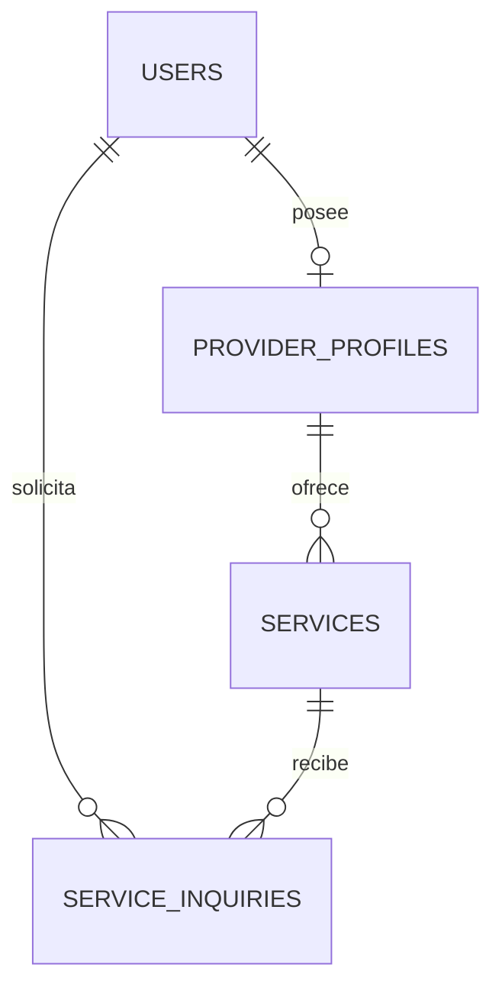

# Tekora — Etapa 3B: solicitudes de servicios

## Base y alcance

La rama `codex/etapa-3b-solicitudes-servicios` parte de `origin/main` en `cd85e907e97f10773c1fac844abfb0da8a89993d`, con el PR #4 confirmado como integrado en GitHub y Git. La suite inicial pasó con 110 pruebas y 1132 aserciones.

Esta entrega permite enviar una necesidad a un servicio publicado, revisarla como prestador, aceptar/rechazar, cancelar mientras esté pendiente y marcarla como finalizada después de aceptarla. Ambas partes consultan seguimiento e historial privados. Mantiene Laravel 12, Blade, CSS/JavaScript, cuenta central y navegación de las etapas anteriores.

No incorpora pagos, reservas, calendario, disponibilidad, chat, correo/notificaciones, contratos automáticos ni resolución administrativa de conflictos. No crea citas antiguas ni vincula identidades por correo o ID.

## Modelo y migración

La entidad se llama **`ServiceInquiry`**, para distinguirla de `App\Http\Requests\ServiceRequest`, que valida las publicaciones del catálogo. Las nuevas clases de validación son `StoreInquiryRequest`, `DecideInquiryRequest` e `InquiryIndexRequest`.

Una migración aditiva lleva la instalación de **28 a 29 migraciones**:

`2026_10_28_000002_create_service_inquiries_table.php`

| Campo de `service_inquiries` | Uso |
| --- | --- |
| `id` | Identificador único de la solicitud |
| `service_id` | FK al servicio central; borrado restringido |
| `client_user_id` | FK al `User` solicitante; borrado restringido |
| `service_title` | Copia del título del servicio al enviar, hasta 160 caracteres |
| `message` | Necesidad del cliente, texto de 10 a 2000 caracteres validado en servidor |
| `status` | `pending`, `accepted`, `rejected`, `cancelled`, `completed`; por defecto pendiente y con restricción de valores |
| `accepted_at`, `rejected_at`, `cancelled_at`, `completed_at` | Fechas nullable de las decisiones permitidas |
| `created_at`, `updated_at` | Envío y última modificación de la solicitud |

Hay índices por cliente/estado/ID y servicio/estado/ID. Un **índice único parcial SQLite** sobre `(service_id, client_user_id)` cuando el estado es `pending` o `accepted` impide dos solicitudes activas incluso si una escritura omite el workflow.

La migración comprueba SQLite antes de crear la tabla. No omite silenciosamente esta garantía en otros motores. **MySQL no está soportado por esta migración**; trasladar el proyecto a otro motor requiere diseñar y probar una restricción equivalente antes de aplicarla.



El receptor se obtiene exclusivamente mediante `Service → ProviderProfile → User`. No se duplica propietario del servicio, contraseña, correo o rol. Se agregan las relaciones `Service::inquiries()` y `User::serviceInquiries()`, y las inversas `ServiceInquiry::service()`/`client()`. No hay relación con `Profesionista` o `Cita`.

Las FK conservan el historial impidiendo borrar físicamente un servicio o cliente referenciado. No se agrega interfaz de eliminación de solicitudes. El `down()` solo elimina la tabla nueva y sus índices; **pierde las solicitudes nuevas**, por lo que no es un procedimiento de actualización ni se debe ejecutar sin un plan de respaldo. La reversibilidad se prueba exclusivamente en memoria.

## Estados y transiciones

| Origen | Acción fija de la ruta | Actor autorizado | Destino / fecha |
| --- | --- | --- | --- |
| Pendiente | Aceptar | Prestador propietario | Aceptada / `accepted_at` |
| Pendiente | Rechazar | Prestador propietario | Rechazada / `rejected_at` |
| Pendiente | Cancelar | Cliente solicitante | Cancelada / `cancelled_at` |
| Aceptada | Finalizar | Prestador propietario | Finalizada / `completed_at` |

Rechazada, cancelada y finalizada son terminales. No existe edición genérica del estado ni del texto de una solicitud enviada. Una cuenta no puede cancelar después de aceptar, finalizar sin aceptar ni reabrir una solicitud terminal.

El historial operativo se obtiene del envío y las marcas de decisión. Este ciclo es acíclico: una solicitud puede tener envío + aceptación + finalización, o envío + rechazo/cancelación. Los reintentos no cambian fechas ni agregan decisiones. No se presenta como un registro general de auditoría administrativa.

Las fechas se almacenan con la convención UTC existente y se muestran en Ciudad de México, identificándolo en las pantallas. La marca finalizada es únicamente operativa: no confirma pago, garantía, satisfacción del cliente ni contrato formal. Aceptar tampoco crea reservas o citas.

## Concurrencia y duplicados

`InquiryWorkflow` concentra las escrituras; las policies se comprueban también dentro del servicio.

- **Envío:** transacción con hasta tres intentos ante conflictos de concurrencia. Vuelve a consultar `Service::publiclyVisible()` dentro de ella, comprueba Cliente y descarta servicios propios. Obtiene identidad de la sesión, asocia el servicio/perfil central y guarda el título y mensaje.
- **Doble clic o repetición:** si ya existe una pendiente/aceptada para ese cliente/servicio, redirige a la original con explicación. Conserva mensaje y fechas originales. El GET del formulario también dirige a la solicitud activa existente.
- **Carrera entre altas:** el índice único parcial es la garantía final; no se confía solo en consultar antes de insertar. Un conflicto se recupera buscando el envío activo original o mostrando un 409 para revisar el panel.
- **Decisiones:** transacción con consulta fresca de identidad/propiedad y actualización SQL condicionada al estado de origen (`WHERE id = ? AND status = ?`). Solo una decisión consume ese estado. Si ninguna fila coincide, responde 409 y enlaza al seguimiento. No se confía en el estado de un objeto cargado antes.
- **Bloqueos de SQLite:** después de los intentos acotados, muestra un conflicto recuperable 409. La interfaz pide consultar el estado antes de volver a enviar o decidir. No promete que todos los envíos simultáneos terminen con éxito.
- **Nuevo ciclo:** después de rechazo, cancelación o finalización puede enviarse otra solicitud, conservando íntegra la anterior. Nunca se elimina el servicio como consecuencia de una decisión.

Se probaron dos conexiones PDO independientes a **la misma SQLite compartida en memoria**: lecturas pendientes obsoletas con decisiones opuestas, unicidad contra una segunda escritura y transacciones de creación solapadas con recuperación posterior. Se comprueba que `PRAGMA database_list` no tenga archivo físico. Esto verifica los conflictos descritos; no es una prueba de carga con múltiples procesos o motores de base de datos.

## Autorización y privacidad

Se añaden dos permisos a la matriz existente, sin modificar asignaciones:

| Permiso | Rol | Alcance |
| --- | --- | --- |
| `client.inquiries.manage` | Cliente | Enviar, consultar las propias y cancelar mientras estén pendientes |
| `provider.inquiries.manage` | Prestador | Panel recibido y decisiones de solicitudes de servicios propios |

`ServiceInquiryPolicy` comprueba `User`, rol vigente y propiedad. Los filtros de los paneles se aplican en SQL a la cuenta autenticada. Administrador no tiene un bypass: necesita el rol y la relación correspondiente para actuar como participante. Otro cliente/prestador no puede leer o decidir solicitudes ajenas, ni siquiera enviando `Accept: application/json`.

Crear exige que el servicio siga publicado, su categoría esté activa y el propietario conserve Prestador. No se permite solicitar servicios propios aunque se tengan ambos roles. Un visitante entra por el login/registro unificado; Laravel conserva el destino del formulario para después del login. Una cuenta antigua sin Cliente debe activarlo voluntariamente desde Mi cuenta.

El modelo solo admite asignación masiva de `message`. Los Form Requests rechazan `client_user_id`, `provider_profile_id`, `provider_user_id`, `service_id`, `user_id`, `profesionista_id`, IDs, roles/permisos, estado, título guardado y marcas temporales enviados por el navegador. Las decisiones se fijan en los defaults de cada ruta, no en un campo `action`, `decision` o `status` manipulable. Los controles de escritura usan CSRF.

Las solicitudes son HTML privado; no se agrega una API pública de consultas. Los errores JSON de autenticación, autorización y validación mantienen esas protecciones. El 409 puede responder un mensaje y URL de seguimiento, después de comprobar autorización, sin serializar datos privados del modelo.

Se muestran solo el nombre público del prestador, la necesidad y las fechas; el prestador autorizado también ve el nombre de la cuenta solicitante. No se muestran correos, edad, género, contraseñas, tokens o credenciales. No hay campos de correo/teléfono, dirección, archivos o enlaces de pago. La descripción es texto libre y se pide no incluir esos datos; no se ofrece detección automática de información personal. Los textos se escapan en Blade, sin interpretar HTML ni convertir enlaces en botones de pago/contacto.

Los datos de solicitudes no se cargan ni muestran en el catálogo público o las fichas de prestadores. El detalle privado usa el título guardado y carga del servicio solo su identificación y perfil de nombre público; no expone su título/descripción actuales si pasó a borrador.

### Límites de envío

El POST de nuevas solicitudes tiene límites Laravel de **5 intentos/minuto y 30/hora por cuenta**, además de **20/minuto por IP**. También cuentan reintentos y envíos inválidos que lleguen a ese middleware. Al excederlos se devuelve 429 con `Retry-After` y una pantalla para revisar solicitudes existentes. No se altera el límite de login anterior. Las decisiones están protegidas por autorización y transición atómica; no crean nuevas solicitudes.

## Cambios de publicación y conservación del historial

Pausar, devolver a borrador, desactivar categoría o perder Prestador impide nuevas solicitudes. Las existentes no se eliminan. El cliente con rol vigente conserva su seguimiento y puede cancelar una pendiente aunque el servicio ya no sea público.

El prestador con rol vigente y propiedad conserva el acceso y las decisiones sobre solicitudes anteriores, incluso si pausó el servicio. Si pierde Prestador, sus accesos/decisiones se rechazan hasta que tenga nuevamente el rol; sus registros no se borran. Cambios en la publicación no cambian por sí solos el estado de sus solicitudes.

El título guardado mantiene el contexto original; el enlace a la publicación actual solo aparece si esta sigue siendo pública. El nombre público mostrado es el del perfil actual, no una segunda copia de identidad. No se introduce transferencia de servicios, suspensión permanente, moderación ni resolución de conflictos.

## Rutas y pantallas

Todas las rutas nuevas requieren `auth:web` y están separadas de `/citas` y `/solicitudes-citas`.

| Método y ruta | Pantalla/acción |
| --- | --- |
| `GET /cuenta/solicitudes` | Mis solicitudes del Cliente, filtro de estado y 12 por página |
| `GET /cuenta/solicitudes/recibidas` | Solicitudes de servicios propios del Prestador, filtro y paginación |
| `GET /cuenta/solicitudes/servicios/{service}/crear` | Formulario de necesidad o redirección a la solicitud activa |
| `POST /cuenta/solicitudes/servicios/{service}` | Confirmar envío pendiente, con CSRF y límites |
| `GET /cuenta/solicitudes/{inquiry}` | Detalle privado, estado, fechas e historial |
| `PATCH /cuenta/solicitudes/{inquiry}/aceptar` | Prestador: pendiente → aceptada |
| `PATCH /cuenta/solicitudes/{inquiry}/rechazar` | Prestador: pendiente → rechazada |
| `PATCH /cuenta/solicitudes/{inquiry}/cancelar` | Cliente: pendiente → cancelada |
| `PATCH /cuenta/solicitudes/{inquiry}/finalizar` | Prestador: aceptada → finalizada |

La navegación compartida y las experiencias Cliente/Prestador enlazan a sus paneles según permisos. Una cuenta con ambos roles consulta enviados/recibidos sin cambiar de identidad. El detalle público añade Solicitar servicio; sigue siendo público, pero el formulario exige sesión. Los filtros inválidos tienen pantalla 422, los conflictos 409 y el límite 429. Las escrituras correctas redirigen 303 con mensajes claros.

Los componentes Blade reutilizan estado, fechas y controles de decisión. El menú lateral permite desplazamiento también en escritorio de poca altura para mantener accesibles todos los enlaces y logout. Se conservan logo, colores y layouts; no hay rediseño completo.

## Pruebas y resultados

La validación se ejecutó en una copia temporal sin `.env`, base persistente o archivos subidos. PHP 8.2.35 / PHPUnit 11.5.24; las conexiones de pruebas son SQLite en memoria y el bootstrap mantiene correo, caché y sesión de pruebas.

| Comprobación | Resultado |
| --- | --- |
| Suite inicial de main | 110 pruebas, 1132 aserciones correctas |
| Suite completa | **143 pruebas, 1573 aserciones correctas** |
| Nuevos casos | 33: 22 de flujo/permisos, 2 con CSRF activo, 3 de concurrencia y 6 de esquema/actualización |
| Compilación Blade y sintaxis PHP | Correctas en 220 archivos, incluidas las vistas compiladas |
| `node --check public/js/account.js` | Correcto |
| `npm run build` | Correcto; conserva deprecaciones Sass/Bootstrap |
| Chromium: diez vistas a 1440×1000 y 390×844 | 20 combinaciones, sin desbordamiento horizontal ni errores JavaScript |
| Navegación a 1440×650 | Logout y enlaces accesibles mediante desplazamiento del menú |

Los 110 casos anteriores se conservan. Solo se ajusta el selector del ensayo de actualización 3A para que migre hasta sus 28 archivos y no incluya 3B; no se eliminan ni relajan sus aserciones.

Los casos nuevos cubren envío válido/no autenticado/sin rol/propio/no público, estado inicial, duplicados activos, nuevas solicitudes después de terminales, aislamiento, filtros/paginación, matriz completa de cinco estados y cuatro acciones, repetición y fechas, decisiones opuestas, campos manipulados, privacidad/escape, roles vigentes, conservación ante ediciones/visibilidad/revocación, experiencia dual, límites y guard heredado con correo coincidente.

CSRF se activa realmente mediante la clase de soporte existente, sin cambiar `APP_ENV=testing` ni la conexión en memoria. Se comprueban rechazos, token inválido/rotado, que el token no sustituya propiedad/permisos y el recorrido visitante → registro/login → solicitud → login del prestador → aceptar → finalizar → consulta del cliente. No se crean citas.

La actualización usa otra conexión `:memory:` con **28 migraciones registradas como aplicadas** y fixtures de clientes, roles, perfil, categoría/servicio publicado, profesional antiguo con correo coincidente y contraseña distinta, tokens, citas, disponibilidad, bloqueos, publicaciones, comentarios, likes y sesiones. Aplica solo la pendiente, compara todas las filas/columnas anteriores, comprueba relaciones/FK y prueba reversión exclusiva de 3B y reaplicación. No cambia registros anteriores.

La revisión visual usa HTML Blade generado con fixtures en memoria y recursos locales; comprueba controles por rol/estado, tokens del formulario, estados vacíos, conflicto e historial. Complementa las pruebas HTTP; no es una prueba de backend en un navegador contra una base persistente. Windows/Laragon no se ejecutó en esta máquina Linux.

Se verificaron intactos los hashes de `.env`, `database/database.sqlite`, `config/auth.php`, manifiestos/locks y los 28 archivos históricos de migración. No se ejecutaron comandos de migración o seed sobre la base existente.

## Probar en Laragon / Windows con PowerShell

### Copia nueva de revisión

Usar PHP 8.2+ compatible con el lock, extensiones del README (PDO SQLite y SQLite3 incluidas), Composer 2 y Node 22/24 LTS. Abrir la terminal de Laragon o seleccionar su PHP en el PATH.

```powershell
Set-Location C:\laragon\www
git clone --branch codex/etapa-3b-solicitudes-servicios --single-branch https://github.com/Fernando261/tekora-project.git tekora-etapa3b
Set-Location .\tekora-etapa3b
where.exe php
php --version
php --ini
php -m | Select-String 'PDO|pdo_sqlite|sqlite3|mbstring|dom|xml|openssl'
composer install
npm.cmd ci

# Solo en esta copia nueva y si aún no existe entorno.
if (-not (Test-Path .\.env)) {
    Copy-Item .\.env.example .\.env
    php artisan key:generate
}

# No necesita migrar una base local: fuerza SQLite en memoria.
php .\vendor\bin\phpunit --do-not-cache-result
```

Resultado esperado: 143 pruebas y 1573 aserciones. Para abrir la aplicación, revisar **solo el entorno de la copia nueva**: `DB_CONNECTION=sqlite`, sin `DB_URL` que lo sustituya, y `DB_DATABASE` sin definir para el archivo predeterminado o con ruta absoluta como `C:/laragon/www/tekora-etapa3b/database/database.sqlite`.

Exclusivamente para una instalación nueva sin datos:

```powershell
if (Test-Path .\database\database.sqlite) {
    throw 'La base ya existe. No la borres: sigue el procedimiento de actualización.'
}
New-Item -ItemType File -Path .\database\database.sqlite | Out-Null
php artisan migrate
php artisan migrate:status
php artisan db:seed --class=ServiceCategorySeeder
php artisan storage:link
npm.cmd run build
php artisan route:list --path=cuenta/solicitudes
php artisan serve
```

Habrá 29 migraciones y las cinco categorías de 3A. 3B no requiere seed nuevo. `storage:link` puede necesitar permisos de enlaces o modo de desarrollador de Windows. No ejecutar el seeder general de demostración sobre una instalación existente.

### Recorrido manual

1. Crear una cuenta Prestador/Ambos, completar su perfil y publicar un servicio desde Mis servicios.
2. En ventana privada, visitar su detalle y pulsar Solicitar servicio: debe pedir login. Registrarse como Cliente y entrar; debe volver al formulario solicitado.
3. Escribir una necesidad de 10–2000 caracteres y confirmar. Comprobar estado Pendiente, título guardado y aparición en Mis solicitudes.
4. Volver a Solicitar servicio o reenviar el mismo formulario: debe dirigir al seguimiento original, sin sustituir el texto ni crear otra activa.
5. Entrar como propietario del servicio en otra sesión. Revisar Solicitudes recibidas y abrir el detalle. Aceptar; el cliente debe ver Aceptada y perder la posibilidad de cancelar.
6. Marcarla como finalizada desde Prestador. Verificar fechas/historial y aviso de alcance operativo. Intentar repetir una decisión usando una pantalla vieja: debe responder 409 con enlace al estado actual.
7. Crear otra solicitud después del cierre y probar Rechazar. En un tercer caso pendiente, Cancelar como cliente. No debe borrarse el servicio ni crearse una cita.
8. Probar filtros por estado, paginación y estados vacíos. Una cuenta con ambos roles debe poder alternar enviados y recibidos sin logout ni duplicación.
9. Con otro cliente/prestador, abrir IDs de solicitudes ajenas o enviar decisiones: 403. Administrador no obtiene acceso por ese rol; su comprobación positiva/negativa se realiza con fixtures automatizados, sin un mecanismo nuevo de asignación.
10. Pausar un servicio con solicitud pendiente: no se admiten nuevas; el seguimiento previo permanece. Editar título/descripción como borrador: el cliente debe conservar el título original sin ver el nuevo texto privado. El prestador vigente puede seguir decidiendo sobre la solicitud existente.
11. Probar un servicio propio con una cuenta dual: el envío debe rechazarse. Verificar que la navegación y las rutas antiguas de MindBloom continúan separadas.
12. Comprobar el límite enviando más de cinco intentos en un minuto en esta copia de pruebas: 429 y acceso al panel. No realizar pruebas de spam en instalaciones utilizadas por otras personas.

### Actualizar una instalación de 3A

Ensayar primero en una copia aislada/restaurable. Revisar el PR antes de desplegar; no se integra ni despliega automáticamente.

1. Revisar `git status`, conservar cambios locales y anotar la versión anterior. Detener escrituras/worker durante respaldo y actualización. Mantener `.env`, credenciales y `APP_KEY`.
2. Identificar la ruta SQLite realmente configurada y realizar un respaldo consistente de la base, entorno y archivos de usuarios. No copiar solo el archivo principal si hay WAL activo; usar la API de backup de SQLite y comprobar restauración. El ejemplo siguiente crea una copia fuera del repositorio, sin cambiar la base origen:

```powershell
$inquiryDb = Join-Path (Get-Location).Path 'database\database.sqlite' # Ajustar a la ruta efectiva.
$backupDir = Join-Path 'C:\tekora-backups' ('antes-3b-' + (Get-Date -Format 'yyyyMMdd-HHmmss'))
New-Item -ItemType Directory -Path $backupDir -ErrorAction Stop | Out-Null
Copy-Item .\.env (Join-Path $backupDir '.env') -ErrorAction Stop
foreach ($folder in @('storage\app\public', 'public\uploads')) {
    if (Test-Path $folder) {
        Copy-Item $folder (Join-Path $backupDir ($folder.Replace('\', '-'))) -Recurse -ErrorAction Stop
    }
}
$backupScript = Join-Path $backupDir 'backup-sqlite.php'
@'
<?php
if (!extension_loaded('sqlite3') || !is_file($argv[1]) || file_exists($argv[2])) {
    throw new RuntimeException('Check SQLite3, source path and unused target.');
}
$source = new SQLite3($argv[1], SQLITE3_OPEN_READONLY);
$target = new SQLite3($argv[2]);
if (!$source->backup($target) || $target->querySingle('PRAGMA integrity_check') !== 'ok') {
    throw new RuntimeException('Backup verification failed.');
}
$target->close();
$source->close();
'@ | Set-Content -Path $backupScript -Encoding ASCII
php $backupScript $inquiryDb (Join-Path $backupDir 'database.sqlite')
if ($LASTEXITCODE -ne 0) { throw 'Respaldo no verificado. Detener la actualización.' }
```

3. Con el código revisado de esta rama y sus locks, ejecutar las pruebas en memoria y revisar el esquema previsto:

```powershell
php .\vendor\bin\phpunit --do-not-cache-result
php artisan migrate:status
php artisan migrate --pretend
```

Deben estar aplicadas las 28 migraciones previas y quedar pendiente únicamente `2026_10_28_000002_create_service_inquiries_table`. Si el estado difiere, resolverlo antes de aplicar cambios. `--pretend` no sustituye respaldo, ensayo ni revisión. Esta migración exige SQLite; no cambiar el motor para aplicarla.

4. En la copia de revisión y posteriormente en un despliegue autorizado, aplicar la única pendiente y refrescar cachés de código:

```powershell
php artisan migrate
php artisan migrate:status
php artisan config:clear
php artisan route:clear
php artisan view:clear
npm.cmd run build
```

5. Confirmar 29 migraciones, comparar conteos/relaciones anteriores y verificar login, catálogo, solicitudes y accesos antiguos antes de reanudar. 3B no necesita seeds ni modifica solicitudes/citas históricas. Si faltan categorías de 3A, revisar su guía y ejecutar únicamente su seeder idempotente de manera explícita.

No usar `migrate:fresh`, `migrate:reset`, `db:wipe`, rollback destructivo, seeds de demostración ni regeneración de clave sobre una instalación existente. Volver al código anterior no debe improvisarse borrando el historial nuevo; una reversión de esquema requiere preservar esos datos y un plan separado.

## Dependencias y auditoría npm

No se agregan dependencias ni se cambian manifiestos/locks de Composer o npm. La consulta `npm audit --json --ignore-scripts`, realizada el 28 de octubre de 2026 (Ciudad de México), mantiene el resultado de 3A: **13 paquetes afectados, 2 críticos, 10 altos y 1 moderado**. El código 1 de auditoría representa esos avisos, no un fallo del build. El diagnóstico puede cambiar al actualizarse la base de avisos.

Se revisó el árbol del lock sin instalar ni actualizar:

| Paquete destacado | Versión | Alcance observado |
| --- | --- | --- |
| Axios | 1.11.0, alta | Dependencia directa importada en `resources/js/bootstrap.js`, utilizada desde `app.js` y compilada para navegador |
| Vite | 6.3.5, alta | Herramienta de compilación/desarrollo directa |
| shell-quote | 1.8.3, crítica | Transitiva de `concurrently` |
| tar | 7.4.3, crítica | Transitiva de `@tailwindcss/vite → @tailwindcss/oxide` |

Los otros paquetes afectados son follow-redirects, form-data, immutable, lodash, nanoid, picomatch, postcss, rollup y source-map-js. La [tabla y referencias de 3A](catalogo-servicios-etapa-3a.md#dependencias-y-auditoría-npm) detallan el lock que continúa sin cambios. Declararlos en `devDependencies` no significa que todo su código sea ajeno al navegador; Axios se compila.

La corrección debe hacerse en un PR de dependencias separado, revisando avisos, versiones y regresiones. No se ejecuta `npm audit fix`, actualizaciones forzadas o cambios de framework. El build conserva deprecaciones Sass/Bootstrap.

```powershell
npm.cmd audit
npm.cmd ls axios shell-quote tar --all --package-lock-only
npm.cmd run build
```

## Limitaciones pendientes

- Las solicitudes son seguimiento operativo; no prueban acuerdo comercial, pago, garantía o satisfacción.
- No hay edición de la necesidad enviada, archivos, contacto, chat, correo/notificaciones, calendario ni reservas.
- No hay suspensión permanente, resolución de disputas, moderación o acceso administrativo especial. La revocación de roles no equivale a una suspensión permanente, como en 2A.
- Solo se valida SQLite; otros motores requieren una estrategia equivalente de unicidad y pruebas. La concurrencia se probó en las condiciones descritas, sin ensayo de carga de múltiples procesos.
- No se migran/vinculan cuentas antiguas y no se copian solicitudes a citas. Los accesos y datos heredados se conservan.
- Persisten las alertas npm documentadas. Windows/Laragon queda para validación local con esta guía; no se ejecutó en este entorno Linux.

## Archivos modificados

### Documentación

- `README.md`
- `docs/solicitudes-servicios-etapa-3b.md`

### Modelo, estados y autorización

- `app/Enums/InquiryAction.php`
- `app/Enums/InquiryStatus.php`
- `app/Enums/Permission.php`
- `app/Models/Service.php`
- `app/Models/ServiceInquiry.php`
- `app/Models/User.php`
- `app/Policies/ServiceInquiryPolicy.php`
- `app/Providers/AppServiceProvider.php`

### Controlador, validación y workflow

- `app/Exceptions/InquiryConflict.php`
- `app/Http/Controllers/ServiceInquiryController.php`
- `app/Http/Requests/DecideInquiryRequest.php`
- `app/Http/Requests/InquiryIndexRequest.php`
- `app/Http/Requests/StoreInquiryRequest.php`
- `app/Services/InquiryWorkflow.php`

### Migración

- `database/migrations/2026_10_28_000002_create_service_inquiries_table.php`

### Blade y estilos

- `public/css/account.css`
- `public/css/inquiries.css`
- `resources/views/account/client.blade.php`
- `resources/views/account/provider.blade.php`
- `resources/views/catalog/show.blade.php`
- `resources/views/components/account-navigation.blade.php`
- `resources/views/components/inquiry-actions.blade.php`
- `resources/views/components/inquiry-status.blade.php`
- `resources/views/components/inquiry-time.blade.php`
- `resources/views/inquiries/conflict.blade.php`
- `resources/views/inquiries/create.blade.php`
- `resources/views/inquiries/index.blade.php`
- `resources/views/inquiries/invalid-filters.blade.php`
- `resources/views/inquiries/rate-limited.blade.php`
- `resources/views/inquiries/show.blade.php`

### Rutas

- `routes/inquiries.php`
- `routes/web.php`

### Pruebas

- `tests/Feature/CatalogMigrationTest.php`
- `tests/Feature/InquiryConcurrencyTest.php`
- `tests/Feature/InquiryCsrfTest.php`
- `tests/Feature/InquiryMigrationTest.php`
- `tests/Feature/ServiceInquiriesTest.php`
- `tests/Support/InquiryFixtures.php`
