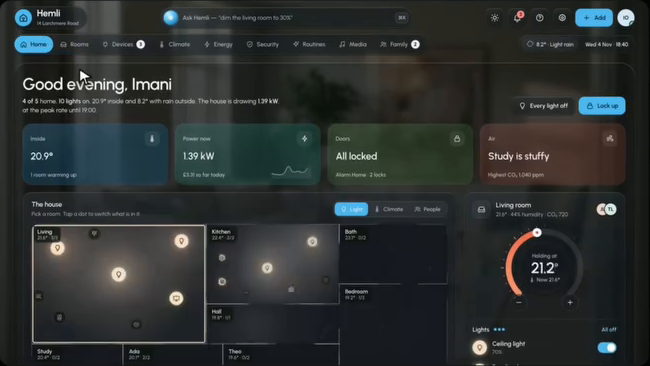
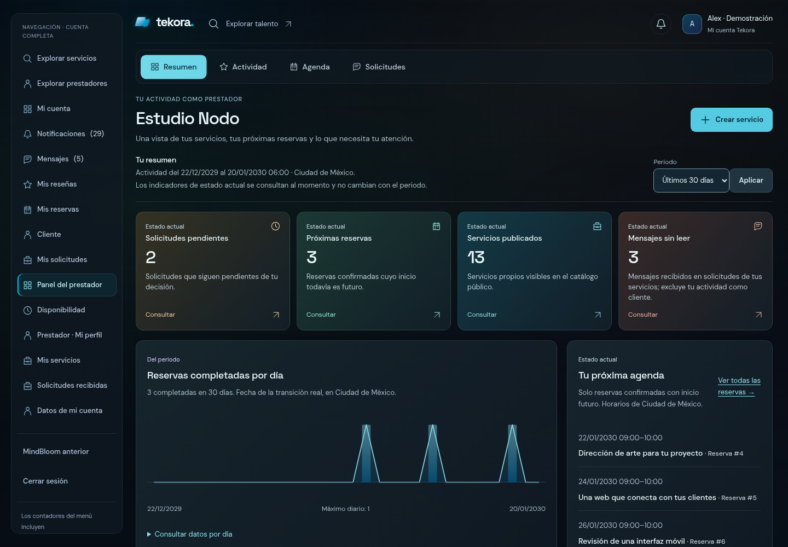
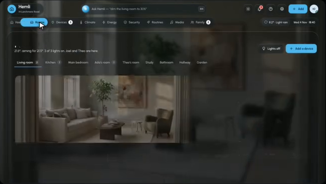
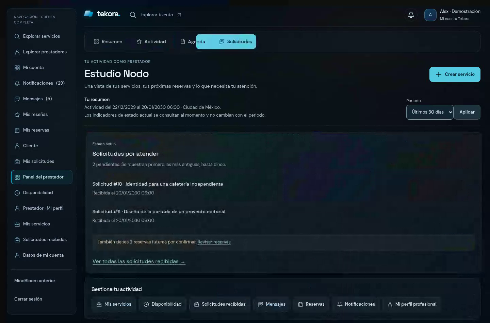
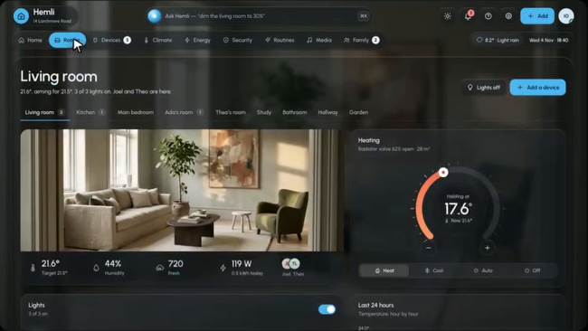
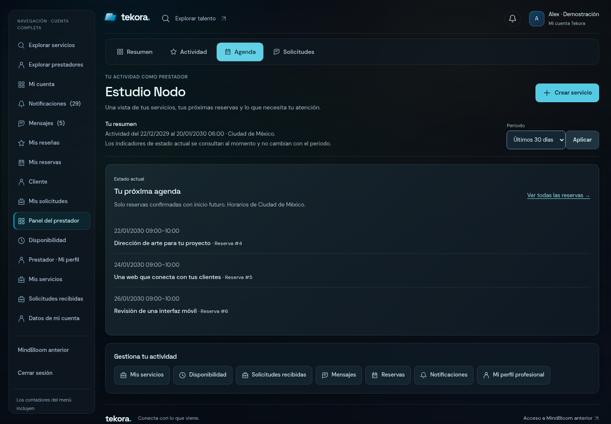
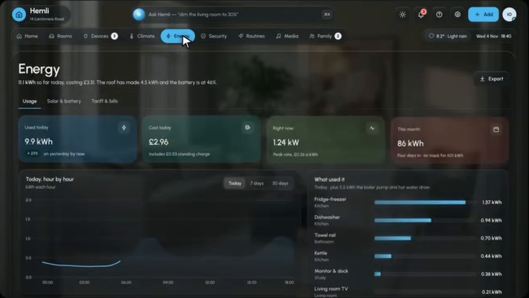
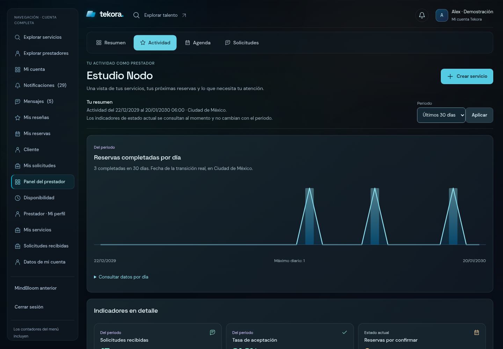
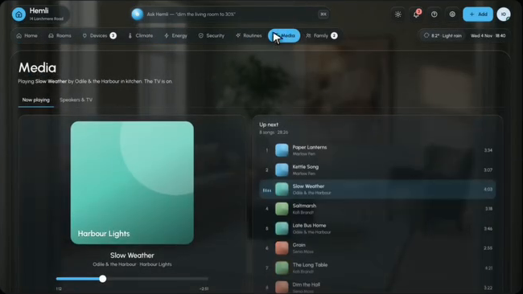
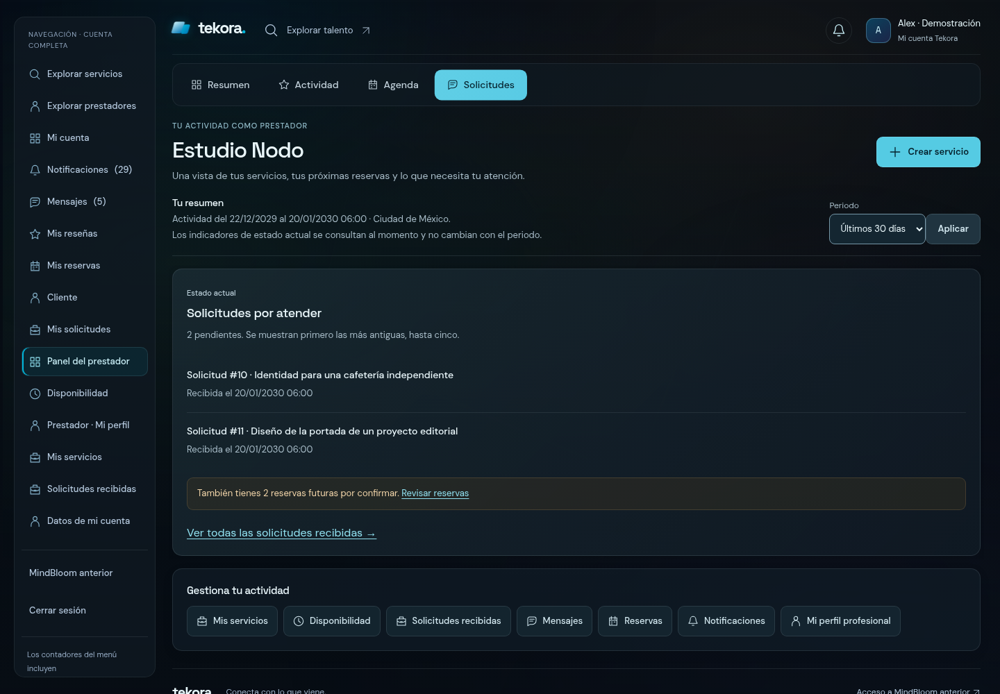

# W2.1 · Tekora Cinematic Obsidian

Iteración actual: [W2.1.1 · Sidebar Cinematic Obsidian](W211-SIDEBAR.md), con **476 pruebas / 6.551 aserciones** y baseline **456/6.081**. La evidencia visual W2.1 que sigue se conserva como referencia histórica.

Corrección posterior a la validación Windows del SHA `53d56f04452d1ce6cc089f8f084f6bf2415b097c`: [portabilidad de la prueba de assets](W21-PORTABILIDAD.md). Resultado actualizado: **464 pruebas / 6.366 aserciones** tanto en ejecución habitual como después del build real. Los resultados siguientes corresponden a la entrega visual original.

Esta iteración actualiza el mismo PR #19, sobre W2 `8749517e5ca53fc00e1240ad6cb6ade215a3ff08`. La base del PR sigue siendo `dbb919939802d16c7ebd1737dc695f6bf88fcb1d`. Se entrega en borrador para revisión visual independiente; no se fusiona ni despliega.

## Del MP4 a la implementación

La [auditoría previa](W21-REFERENCIA.md) utiliza el MP4 original, no una maqueta generada. Se extrajeron directamente cinco fotogramas de su interfaz, sin título externo, créditos o código. La procedencia, dimensiones y SHA-256 están en [invariants.json](evidence/w21/invariants.json).

| Interfaz original | Implementación real en Chromium |
| --- | --- |
|  |  |
|  |  |
|  |  |
|  |  |
|  |  |

Los fotogramas de movimiento de implementación se extraen directamente de su grabación real; [procedencia](evidence/w21/motion-frame-provenance.json). El cambio de contenido se ve también en [este fotograma](media/w21/compare-content-motion.png).

La reproducción se concentra en la barra compacta con marca/cuenta, navegación horizontal persistente, una cápsula compartida, cuatro resúmenes cromáticos, un protagonista y módulos secundarios. Se conserva la navegación global lateral exigida por Tekora, con menos peso visual. Los encabezados son de 28–34 px y las explicaciones de 13 px, en lugar del texto diminuto de la captura original.

La superficie cambia de azul uniforme a carbón y cristal gris/verde petróleo. Los resúmenes alternan azul, menta, ámbar y coral apagados; violeta identifica detalles secundarios. El cian sigue en marca, acciones y selección. El fondo reutiliza `x-tekora-ambient` y añade luz lenta azul/verde/violeta y planos geométricos originales, dibujados con CSS local. No hay fotografías copiadas, orbes, partículas, videos de fondo ni dependencias nuevas.

## Composiciones y datos

Prestador: **Resumen / Actividad / Agenda / Solicitudes**. Resumen destaca `pending`, `upcoming`, `published`, `unread`, además de la gráfica y agenda. Actividad ofrece la gráfica del periodo y los otros seis KPI, con todas sus notas y enlaces. «Indicadores en detalle» agrupa métricas actuales y del periodo sin atribuir una ventana temporal común: cada tarjeta mantiene su etiqueta original. Agenda y Solicitudes dan protagonismo a sus listas existentes.

Cliente: **Resumen / Reservas / Solicitudes**. Se conservan sus cuatro KPI, la agenda confirmada futura, las últimas solicitudes propias y seguimiento de propuestas/completadas/canceladas. Las notificaciones siguen rotuladas **Cuenta completa**. MindBloom y la activación/cambio de experiencia conservan enlaces y autorización.

Los módulos proceden de los mismos DTO del servidor. No se modificó ningún archivo de `app/`, incluidos ambos servicios de lectura, controladores, guards, roles, policies o workflows. No se añaden consultas ni cuerpos privados para decorar. Los diez `data-kpi` del prestador se renderizan una sola vez; se conservan exactamente valores, fuentes, periodos, etiquetas, notas y enlaces.

La gráfica conserva todos los rectángulos, sus coordenadas y la tabla diaria. La línea y área nuevas unen exclusivamente esos mismos puntos `(x, 150-height)`: no hay otra serie, interpolación que invente observaciones ni cambio de totales. Un recorte progresivo revela el SVG completo en 550 ms, sin cambiar su geometría.

## Cápsula y coreografía

`dashboard-pill.js` mide los rectángulos reales de cada opción y del track. Un único `clip-path: inset(...)` recorta el fondo compartido. Hacia la derecha se adelanta el borde derecho; hacia la izquierda, el izquierdo. El borde delantero usa **360 ms** y el trasero **550 ms**, ambos con salida cúbica. La cápsula se estira y vuelve al ancho real de su destino, sin reaparecer por fade.

Se recalcula con ResizeObserver, cambios de viewport y fuentes. La opción seleccionada se desplaza al área visible del scroller móvil. Las pulsaciones rápidas cancelan los tweens anteriores desde sus posiciones actuales. Las copias decorativas de iconos/textos dentro del mismo recorte mantienen texto oscuro sobre el cian durante todo el recorrido; están bajo `aria-hidden`, no son controles duplicados y no bloquean clics. Los botones reales conservan su foco y semántica.

La salida de módulos dura **140 ms**, con 10 px direccionales y 4 px verticales. Después se actualiza la composición: los módulos que permanecen visibles se desplazan con FLIP por traslación durante **360 ms**; los que estaban fuera del pliegue entran cerca de su destino, sin recorrer una pantalla vacía; los que llegan usan 16/6 px, escala 0,99→1 y opacidad 0,65→1 durante **320 ms**. La fase principal concluye alrededor de 460–500 ms y la cápsula se estabiliza a 550 ms. La gráfica no se escala con FLIP. El escenario acota el desbordamiento transitorio.

La cabecera, navegación, filtros y acciones no desaparecen. Un cambio de foco hacia el contenido durante una transición la finaliza inmediatamente. Escape estabiliza la selección. Los atajos con Alt/Ctrl/Meta no se interceptan. Los GET/POST siguen siendo nativos; no hay fetch de páginas, interceptores de formularios, historial simulado ni rutas convertidas en SPA.

## Accesibilidad y fallbacks

Antes de JS se entregan enlaces ancla y todos los módulos como contenido ordinario del servidor. La sidebar del dashboard llega cerrada para evitar el salto de un menú que se cerraba después de pintar; su summary nativo permite abrirla también sin JS en escritorio y móvil. Con JS se abre en escritorio sin mover el contenido y queda colapsada en móvil. Se precargan las dos fuentes locales. La sidebar utiliza transparencia sin backdrop-filter, para reducir pintura en el fondo animado. Los controles principales y enlaces de acción alcanzan 44 px en móvil/tablet y puntero táctil. La mejora progresiva crea botones `tab`, un `tablist` y un `tabpanel` persistente cuyo nombre sigue la selección. Compartir un panel permite reutilizar módulos sin duplicar KPI, SVG o formularios. Flechas/Home/End activan y enfocan opciones; Enter/Space funcionan como botones. Tab respeta el orden visual de acciones de cabecera, filtro GET y contenido.

Anime.js se carga de forma opcional. Si falla su chunk, las secciones siguen seleccionándose instantáneamente. Sin JS permanecen los enlaces ancla, cifras, tabla desplegable, sidebar nativa y filtros GET. Sin soporte de clip-path queda el estado activo CSS.

Con movimiento reducido no hay entrada, desplazamiento, elasticidad, hover con traslación ni fondo animado. La selección es inmediata. Con transparencia reducida se desactiva el arte de fondo y los paneles son opacos. Los estados de error quedan fuera de la selección de módulos; 403/422/503 conservan sus contratos.

## Verificación

PHP **8.2.28**, Composer **2.8.11**, Node **24.19.0**, npm **11.9.0**. Salidas y códigos en [commands.json](evidence/w21/commands.json).

| Comprobación | Resultado |
| --- | --- |
| Composer validate estricto, install sin scripts, requisitos de plataforma | Correctos, código 0 |
| Composer audit locked, con/sin dev | **0 avisos**, código 0 |
| npm ci / audit / build | Correctos, **0 vulnerabilidades** |
| PHPUnit completo | **463 pruebas / 6.350 aserciones** |
| Baseline excluyendo `web-w21` | **456 pruebas / 6.081 aserciones** exactas |
| Diferencia | Siete pruebas nuevas / 269 aserciones; ningún test previo modificado |
| Migraciones | **37**, idénticas byte por byte |
| API | **21 operaciones**, JSON completo idéntico a W2 |
| Dependencias y archivos persistentes | Sin cambios |

Las pruebas nuevas cubren fallback del servidor, diez KPI únicos, rectángulos/línea/tabla exactos y GET 7/30/90, cuenta dual y lectura sin escrituras, vacíos/perfil pendiente/errores, assets/CSP/logout nativo, MindBloom y exportación sin `.env` ni base persistente.

Las ejecuciones completas iniciales con el límite CLI de 128 MB agotaron memoria: [completo](evidence/w21/phpunit-128m.txt), [baseline](evidence/w21/phpunit-baseline-128m.txt). Los logs de ese intento se recortan tras el primer error, con tamaño/hash del original registrados; los logs finales están completos. Se repitieron con **`php -d memory_limit=256M`** solo para esos procesos: [completo final](evidence/w21/phpunit.txt), [baseline final](evidence/w21/phpunit-baseline.txt). Se alcanzaron 129 y 127 MB respectivamente. No se cambió php.ini, `.env`, el bootstrap de pruebas ni lógica de negocio para resolverlo.

La aceptación incluye **90 combinaciones a 320/375/768/1024/1440/1920 px**, catorce auditorías Axe sin infracciones automáticas, cinco recorridos medidos de cápsula y seis comprobaciones de zoom nativo 100→200→100. Se verifican teclado, reversas rápidas, etiquetas variables, resize, objetivos táctiles de 44 px, menú nativo sin JS, tabla/filtros, preferencias reducidas y autenticación W1.1. Cero errores de página y recursos fallidos inesperados; se bloquea deliberadamente el chunk de Anime en una prueba independiente y las secciones siguen funcionando. [Resultados completos](evidence/w21/browser-results.json), [zoom nativo](evidence/w21/native-zoom.json), [contraste](evidence/w21/contrast.json), [router seguro](evidence/w21/preview-router.json). Las auditorías automáticas de accesibilidad no certifican conformidad WCAG completa; los gradientes requieren revisión visual y de pares de color.

## Rendimiento frente a W2

Los mismos fixtures y tres peticiones calientes por panel mantienen **22 consultas HTTP en cliente**, **24 en prestador** y **11 en ProviderDashboardMetrics**. Datos completos: [antes](evidence/w21/benchmark-before.json), [después](evidence/w21/benchmark-after.json). La diferencia de latencias locales pequeñas no constituye una mejora de rendimiento ni una prueba de carga de producción.

El [inventario de assets](evidence/w21/assets-comparison.json) incluye los chunks importados. CSS modular, incluido shell/fondo: **21.059→30.754 bytes**; gzip por recurso sumado, **5.595→7.558**. JS, incluido Anime: **38.937→47.177 bytes**; gzip **15.375→18.508**. El prestador además deja de solicitar los **4.388 bytes** del CSS público legacy, que permanece intacto. Las fuentes locales y los otros CSS/JS públicos se conservan. Cero paquetes nuevos.

Los recursos W2 se recompilaron desde su SHA exacto en un directorio aislado, reutilizando las mismas dependencias bloqueadas y el HTML sintético exportado de W2. Solo se adapta el origen loopback al servirlo. La comparación de layout shifts y cadencia usa esos recursos y el export W2.1, sin consultar bases o servicios externos. En las doce muestras iniciales W2.1 (dos paneles × dos anchos × tres contextos), el CLS observado es **0**. W2 mostró una carrera de carga móvil que en algunas muestras alcanzó **1**, al cerrarse el menú después de pintar; esa carrera se elimina entregándolo cerrado de inicio. La cadencia idle local está en [frontend-summary.json](evidence/w21/frontend-summary.json), con datos completos en [frontend-performance.json](evidence/w21/frontend-performance.json). Son muestras de Chromium Linux local; no equivalen a métricas de producción o de un teléfono físico.

La cápsula se mide en ambos sentidos y con etiquetas variables, con animaciones nominales de 360/550 ms y llegada al píxel de destino. Los umbrales de medio píxel pueden alcanzarse antes por el easing; no se confunden con el fin nominal de la animación. [Muestras de movimiento](evidence/w21/capsule-summary.json). Las dos repeticiones con throttling **4× sintético** verifican la selección final sin errores, pero sus percentiles de frame muestran que no se puede prometer 60 FPS bajo esa carga en compositor software.

## Evidencia real y revisión pendiente

Las capturas y los videos se generan en Chromium con los fixtures de los controladores y workflows existentes. El reloj sigue en **20/01/2030 12:00 UTC**. Alex es una cuenta dual; su cliente tiene 3/1/1/2, separados de la actividad recibida por Estudio Nodo. Nada de esa actividad sintética se codifica en vistas productivas.

La grabación muestra las opciones en ambos sentidos, cambios de composición, filtros GET 7/30/90, vacíos, perfil pendiente y movimiento reducido. Los fotogramas originales del MP4 y las capturas de implementación están separados y rotulados; no hay montajes generados como evidencia del navegador.

| Estado | Capturas |
| --- | --- |
| Cliente · Resumen | [1440 px](media/w21/client-summary-1440.png) · [375 px](media/w21/client-summary-375.png) |
| Cliente · Reservas | [1440 px](media/w21/client-reservations-1440.png) · [375 px](media/w21/client-reservations-375.png) |
| Cliente · Solicitudes | [1440 px](media/w21/client-requests-1440.png) · [375 px](media/w21/client-requests-375.png) |
| Prestador · Resumen | [1440 px](media/w21/provider-summary-1440.png) · [375 px](media/w21/provider-summary-375.png) |
| Prestador · Actividad | [1440 px](media/w21/provider-activity-1440.png) · [375 px](media/w21/provider-activity-375.png) |
| Prestador · Agenda | [1440 px](media/w21/provider-agenda-1440.png) · [375 px](media/w21/provider-agenda-375.png) |
| Prestador · Solicitudes | [1440 px](media/w21/provider-requests-1440.png) · [375 px](media/w21/provider-requests-375.png) |
| Vacíos y perfil pendiente | [Cliente](media/w21/client-empty-375.png) · [prestador](media/w21/provider-empty-1440.png) · [sin perfil](media/w21/provider-setup-375.png) |
| Movimiento/transparencia reducidos | [Cliente](media/w21/client-reduced-1440.png) · [prestador](media/w21/provider-reduced-1440.png) |
| Zoom nativo 200% | [Cliente](media/w21/client-native-zoom-200.png) · [prestador](media/w21/provider-native-zoom-200.png) |

Videos originales: cliente [escritorio](media/w21/client-1440.webm) / [móvil](media/w21/client-375.webm); prestador [escritorio](media/w21/provider-1440.webm) / [móvil](media/w21/provider-375.webm); [movimiento reducido](media/w21/reduced-motion.webm). Las grabaciones móviles usan viewport de 375 CSS px; VP8 alinea la salida a 374 px, según [videos.json](evidence/w21/videos.json).

**Compromisos:** la sidebar se conserva por permisos y navegación global; las explicaciones reales necesitan más altura que el texto diminuto del video. No se copian viviendas, fotos, reproductores, consumos ni estados domésticos. La línea es recta entre observaciones diarias para no inventar datos. El panel compartido preserva formularios y foco, con una selección accesible en lugar de cambiar rutas protegidas.

La GPU física, Windows/Laragon, Safari/Firefox y lectores de pantalla quedan para revisión independiente. Chromium utiliza compositor software; el throttling sintético de CPU no acredita un dispositivo modesto real. Se comprueba reflow a 720 CSS px y zoom nativo al 200% en Chromium Linux: ventana de 1440, viewport de 720 CSS px, DPR 2 y retorno al 100%, sin emulación de viewport o CSS zoom. El control se aplica mediante la API de ajustes del navegador en un perfil temporal nuevo que se elimina al terminar. La validación de Windows sigue siendo independiente: [guía W2.1](W21-LARAGON.md).
