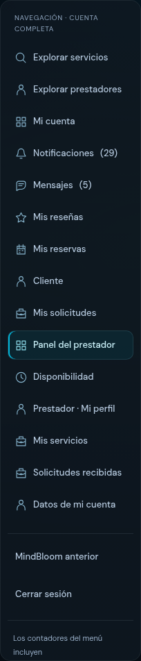
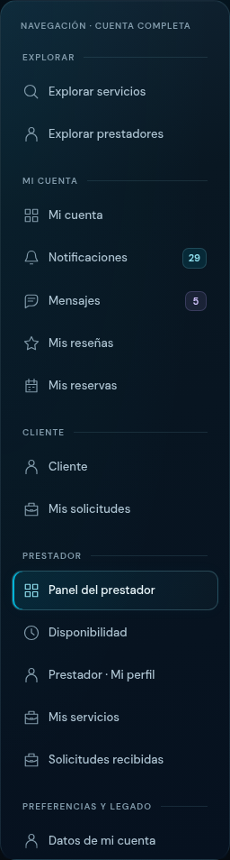
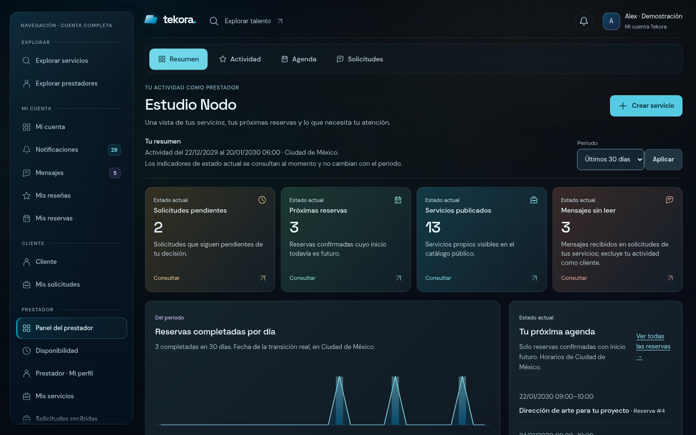

# W2.1.1 · Sidebar Cinematic Obsidian

Refinamiento del mismo PR **#19**, sobre el SHA validado en Windows `d4081822a626ef27e3a1f30b5535ec67dd659547`. La navegación de cuenta adopta la superficie obsidiana de W2.1, con grupos discretos, iconos alineados, badges independientes y scroll nativo sin la barra blanca. El PR permanece en borrador, sin merge ni despliegue, pendiente de aprobación visual independiente.

## Antes y después

La captura Windows aportada por el usuario es la referencia del defecto. Las imágenes siguientes son capturas directas de Chromium Linux: la anterior reproduce el ancho de 204 px y el markup anterior; su scrollbar depende de Linux y no pretende reproducir la barra blanca de Windows.

| Antes · SHA validado anterior | W2.1.1 · mismos fixtures 29 / 5 |
| --- | --- |
|  |  |

La navegación deja de ser una lista plana. **Explorar**, **Mi cuenta**, **Cliente**, **Prestador**, **Administración**, **Preferencias y legado** y **Salir** orientan la lectura. Administración solo aparece con su permiso; Cliente solo con enlaces autorizados. Activar prestador se conserva en el grupo Prestador para quien no tenga ese rol. No se imprimen grupos vacíos.

Los enlaces tienen tres columnas: **18 px de icono / texto flexible / badge automático**, altura mínima de **44 px**, tipografía de **13 px** y radios de 11 px. «Notificaciones», los contadores y las etiquetas habituales caben en una línea en desktop; en móvil/zoom se permiten saltos entre palabras. No se truncan valores ni se corta dentro de palabras. El activo combina una superficie cian tenue, borde fino y línea lateral; el foco utiliza un anillo independiente. Los badges 29 y 5 representan toda la cuenta, igual que antes. El aviso `null` conserva una explicación accesible y no inventa un cero.

[Prestador 1280](media/w211/provider-1280.png) · [Cliente 1440](media/w211/client-1440.png) · [Cuenta dual con administración](media/w211/dual-admin-1440.png) · [Móvil 375](media/w211/mobile-375.png) · [Móvil 320](media/w211/mobile-320.png) · [Landscape](media/w211/mobile-landscape.png) · [Badges de tres dígitos](media/w211/large-counts-1440.png) · [Contador no disponible](media/w211/unavailable-375.png).

## Causas y cambios

| Causa anterior | Resolución |
| --- | --- |
| `dashboards.css` imponía una columna de 204 px sobre el shell de 248 px | Token único `--tk-sidebar-width`: **240 px** a 1100–1279, **256 px** a 1280–1599 y **264 px** desde 1600. Por debajo de 1100 se mantiene el menú nativo desplegable |
| `.tk-account-shell` hereda `overflow-wrap: anywhere` | La región de navegación y sus ítems usan `overflow-wrap: normal` y `word-break: normal` |
| `.sidebar` y `.sidebar .menu` recibían límites/overflow de `home.css`, `account.css` y overrides Tekora | Una sola región `.tk-sidebar-scroll` se desplaza; la lista interior tiene `max-height: none` y `overflow: visible`. La superficie reinicia inset, z-index, max-height y transición heredados de MindBloom para evitar desplazamiento lateral o recorte en landscape |
| Icono, etiqueta y contador compartían un flujo flex sin separar texto y badge | Componentes de enlace/grupo, columnas fijas/flexibles y cápsulas numéricas sin encogimiento |
| Overrides de superficie, tamaños y estado activo duplicados en `dashboards.css` | Presentación unificada en `account-shell.css`; se eliminan los overrides contradictorios del dashboard |

Los colores reutilizables están en tokens `--tk-nav-*`, junto a los tokens Tekora existentes. La superficie es azul petróleo casi negro, con un reflejo ambiental mínimo y sin `backdrop-filter`. Las transiciones de superficie/icono duran 180 ms; no se reutiliza la cápsula elástica del dashboard.

Archivos de interfaz:

- `resources/views/components/account-navigation.blade.php`: grupos y slots de badges; conserva las expresiones originales `@auth`, `@can`, servicios de conteo, rutas y formulario POST con CSRF.
- `resources/views/components/account-navigation-group.blade.php`: grupo etiquetado solo cuando su slot contiene opciones; sin IDs generados ni consultas de autorización adicionales.
- `resources/views/components/account-navigation-link.blade.php`: icono/etiqueta/badge y `aria-current="page"` cuando corresponde.
- `resources/views/components/account-layout.blade.php`: región desplazable con nombre accesible y la aclaración de cuenta completa intacta.
- `resources/css/tekora/account-shell.css`: dimensiones, superficie, enlaces, badges, foco, scroll y preferencias del sistema.
- `resources/css/tekora/dashboards.css`: distribución coordinada con el token y retirada de overrides del sidebar; el contenido y las animaciones aprobadas se conservan.
- `resources/js/tekora/account-shell.js`: indicadores de extremos y revelado del foco. Conserva sincronización de breakpoint, Escape y cierre móvil tras seguir enlaces.

Pruebas/herramientas nuevas: `tests/Feature/TekoraW211SidebarTest.php`, `tools/tekora-w211-preview.php`, `tools/tekora-w211-browser-checks.py` y `tools/tekora-w211-zoom-check.py`. El router estático histórico responde 204 al favicon vacío del repositorio, evitando un 404 incidental; no se ignoran errores de assets de la interfaz. Documentación: este informe, `W21-LARAGON.md`, referencia desde `W21.md`, capturas, videos y evidencia bajo `evidence/w211`.

## Scroll y accesibilidad

La barra se oculta exclusivamente en `.tk-sidebar-scroll` mediante `scrollbar-width: none`, `-ms-overflow-style: none` y el pseudo WebKit. La región conserva `overflow: auto`: no se simula el desplazamiento ni se interceptan rueda, touch o teclas de scroll. La página, las tablas, el scroller horizontal de tabs y MindBloom conservan sus barras. En colores forzados se devuelve la barra nativa del sistema para facilitar orientación y contraste.

Dos overlays de **18 px**, con `pointer-events: none`, indican contenido anterior/posterior. Un listener **pasivo**, ResizeObserver y los eventos nativos de apertura actualizan el estado; los atributos solo cambian al cambiar el extremo. No hay un bucle de animación nuevo. El padding y el revelado de foco reservan **24 px** en los extremos, fuera del fade. Tab puede alcanzar todos los controles y salir del menú; no se aplica `overscroll-behavior: contain` ni una trampa de foco.

[Inicio](media/w211/scroll-start.png) · [Mitad](media/w211/scroll-middle.png) · [Final](media/w211/scroll-end.png) · [Hover](media/w211/hover-notifications.png) · [Foco en avisos](media/w211/focus-notifications.png) · [Foco en logout](media/w211/focus-logout.png).

El `
` externo y MindBloom funcionan sin JS. En móvil la región mide como máximo `min(70dvh, 600px)` con fallback `vh`; el panel queda en el flujo y el contenido principal sigue disponible. Se mantiene sticky en desktop. El foco visible no depende del hover. Movimiento reducido elimina las transiciones; transparencia reducida entrega superficie opaca. La marca interior sigue oculta en dashboards, donde ya está en la barra superior. Todo el shell entrega el menú cerrado en SSR y deja visible su summary nativo hasta la mejora de JS: se elimina el salto móvil de las páginas centrales que antes lo enviaban abierto y lo cerraban tras pintar. Ambas fuentes locales se precargan también en esas páginas para estabilizar la tipografía.

[Sin JavaScript](media/w211/no-js-mobile.png) · [Cuenta central sin JS, desktop/móvil](evidence/w211/native-fallback.json) · [PageDown/Home/End nativos](evidence/w211/keyboard-scroll.json) · [Preferencias reducidas](media/w211/reduced-preferences.png) · [Árbol accesible de navegación](evidence/w211/navigation-accessibility.yml).

Las variantes sin `tekora` y las horizontales siguen siendo planas, con contadores entre paréntesis. La combinación horizontal con `tekora` conserva sus iconos. No se cargan estilos nuevos en layouts MindBloom.

## Validación

PHP **8.2.28**, Composer **2.8.11**, Node **24.19.0**, npm **11.9.0**. PHPUnit usa **256 MB** únicamente para el proceso. [Comandos y códigos](evidence/w211/commands.json).

| Comprobación final | Resultado |
| --- | --- |
| `composer validate --strict` y `composer check-platform-reqs` | Código **0** |
| `composer audit --locked`, con y sin dev | **0 avisos**, ambos código **0** |
| `npm ci`, `npm audit`, `npm run build` | Código **0**, **0 vulnerabilidades** |
| PHPUnit completo, con build real y sin hotfile que lo oculte | **476 pruebas / 6.551 aserciones**, **129 MB** |
| Baseline `--exclude-group web-w21` | **456 pruebas / 6.081 aserciones**, **127 MB** |
| Nuevas regresiones `--group web-w211` | **12 pruebas / 185 aserciones** |
| Listado API JSON | **21 operaciones**, idéntico al anterior |
| Migraciones | **37**, idénticas byte por byte |
| `git diff --check` | Código **0** |

El total aumenta **12 pruebas y 185 aserciones** respecto de **464/6.366**. Se cubren seis combinaciones de roles (cliente, prestador, dual, admin, los tres roles y sin rol de negocio), enlaces completos/autorizados y prohibidos, grupos vacíos, IDs y enlaces duplicados, activo, logout/CSRF, MindBloom, cero/positivo/125/`null`, conteos reales 29/5 sin escrituras, variantes horizontales/heredadas y el menú SSR cerrado antes de la sincronización móvil. Las pruebas anteriores permanecen sin cambios, incluidas las de portabilidad Vite con y sin build. El nuevo grupo también pertenece a `web-w21`, de modo que la baseline previa excluye toda esta iteración visual.

Logs: [completo](evidence/w211/phpunit.txt) · [baseline](evidence/w211/phpunit-baseline.txt) · [sidebar](evidence/w211/sidebar-tests.txt) · [Composer](evidence/w211/composer-audit.txt) · [Composer sin dev](evidence/w211/composer-audit-no-dev.txt) · [npm audit](evidence/w211/npm-audit.json) · [build](evidence/w211/npm-build.txt).

La matriz de Chromium comprueba **64 combinaciones**: ocho anchos obligatorios × ocho estados de cuenta. Las **10 auditorías Axe** no detectan infracciones automáticas. La matriz mide **CLS inicial 0** en todas las combinaciones y comprueba que ambos bordes del panel quedan dentro del viewport. Cero errores de página/consola y cero recursos fallidos inesperados. Se verifican ambos fades, scroll con rueda y touch inyectado nativo, Tab/Shift+Tab hasta logout y salida, apertura MindBloom con Enter, Space/Escape móvil, navegación real a otra página autorizada sincronización del breakpoint y altura del panel en landscape. [Resultados](evidence/w211/browser-results.json).

El zoom usa `chrome.settingsPrivate.setDefaultZoom` en un perfil temporal eliminado al terminar: **seis comprobaciones 100→200→100** entre cliente y prestador, ventana de 1440 px, viewport de 720 CSS px y DPR 2 al 200%. No es zoom CSS ni emulación del viewport. Se comprueban el último control, su foco y ausencia de overflow. [Resultados](evidence/w211/native-zoom.json) · [Prestador al 200%](media/w211/provider-zoom-200-start.png) · [Último control al 200%](media/w211/provider-zoom-200-end.png).

La regresión visual W2.1 añade **90 casos**, **14 auditorías Axe sin infracciones**, cinco recorridos de cápsula y comprobaciones de reversa rápida, filtros, teclado, fallback de Anime y autenticación W1.1. En conjunto son **24 auditorías Axe** entre sidebar y dashboards. [Resultados W2.1](evidence/w211/dashboard-regression.json).

Grabaciones directas del navegador: [sidebar desktop](media/w211/sidebar-desktop.webm) · [sidebar móvil](media/w211/sidebar-mobile.webm) · [zoom nativo 100→200→100](media/w211/sidebar-native-zoom.webm). Muestran rueda, final del scroll, hover, foco, apertura/cierre móvil y navegación entre páginas. [Procedencia de archivos](evidence/w211/media-provenance.json). El viewport móvil es de 375 CSS px; el encoder VP8 alinea el video a 374 px, sin modificar su contenido.

## Rendimiento e invariantes

El par CSS del shell y dashboards pasa de **29.069 a 32.358 bytes**; gzip por archivo sumado, **6.894→7.650** (+756). El JS del shell pasa de **406 a 1.175 bytes**, gzip **267→584** (+317). El JS compilado de dashboards conserva exactamente sus **6.777 bytes y SHA-256**; tampoco cambia su chunk de Anime. [Pesos y hashes](evidence/w211/assets-comparison.json).

Las consultas HTTP conservan **22 en cliente / 24 en prestador**, y el servicio de métricas conserva **11**. [Medición anterior](evidence/w211/benchmark-before.json) · [Medición actual](evidence/w211/benchmark-after.json). Los tiempos de tres peticiones locales no acreditan mejora de latencia ni rendimiento de producción.

Tres contextos nuevos por versión mantienen una mediana de callbacks rAF de **16,7 ms** y p95 **16,7–16,8 ms** durante un segundo de rueda; el sidebar permanece a **24 px** del borde superior tras desplazar la página. Son muestras de cadencia en compositor software, no una certificación de FPS o fluidez física. En el ensayo controlado de `/cuenta` con el mismo retraso artificial de **150 ms** en el JS del shell, CLS móvil pasa de **1 a 0**; en desktop, de aproximadamente **0,000020 a 0**. Se corrige el cierre post-pintado y se precargan las fuentes, sin presentar este ensayo como dato de campo. [Método y muestras](evidence/w211/scroll-performance.json).

El router de la guía se comprobó con montajes de solo lectura: HTML y JS 200, favicon 204, POST 405 y `.env`/API fuera del export 404. [Resultados](evidence/w211/preview-router.json). El build conserva los avisos anteriores de Sass y resolución de fuentes en compilación; todos los recursos del preview final se cargan correctamente.

No se modifica ningún controlador, servicio, guard, permiso, policy, workflow, modelo, migración, contrato API ni archivo de dependencias. `.env`, APP_KEY persistente, base SQLite y `public/hot` conservan su contenido previo; el hotfile se apartó durante las suites post-build y se restauró al terminar. El manifiesto se regenera únicamente con Vite. Tests y preview usan SQLite **`:memory:`**; el export no carga `.env` y no tiene backend POST. [Invariantes](evidence/w211/invariants.json).

## Revisión pendiente

La validación realizada aquí es **Chromium Linux headless con compositor software**. Las capturas y videos son reales dentro de ese entorno. Rueda/touch automatizados no sustituyen una prueba física de trackpad/pantalla táctil. Axe y la inspección de nombres/grupos accesibles no certifican NVDA/Narrador ni conformidad WCAG completa. Windows/Laragon, Firefox/Safari, lector de pantalla, colores forzados y GPU física requieren revisión independiente.

Seguir la [guía Windows/Laragon actualizada](W21-LARAGON.md) desde un clon nuevo fijado al SHA final de esta entrega. Revisar especialmente el defecto de scrollbar Windows, el foco en ambos extremos, los badges y el zoom al 200%. No reutilizar instalaciones ni bases anteriores. **Mantener el PR #19 en borrador. No fusionar ni desplegar.**
