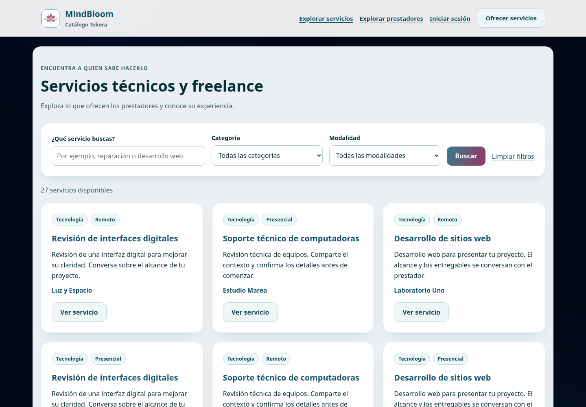
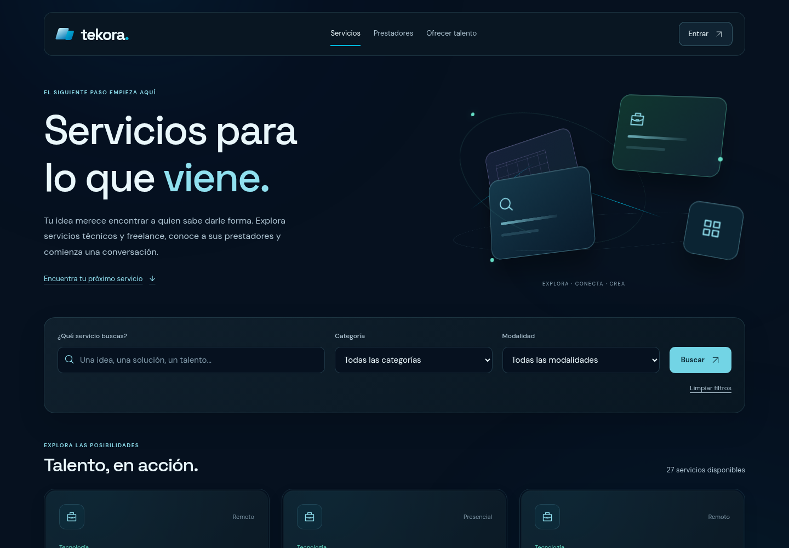

# W3 · Tekora Cinematic Marketplace

Base verificada: **`00c13ee0f9504125320f0119d29454bd503326cd`**, integración aprobada del PR #19. Rama nueva: **`codex/web-w3-cinematic-marketplace`**. W3 se entrega en un **PR nuevo en borrador**, independiente del #19; su URL y SHA final se fijan en la entrega y en su descripción. No se fusiona ni despliega.

## Del catálogo antiguo al marketplace

El layout anterior presentaba MindBloom como marca principal, con Catálogo Tekora como subtítulo. Cargaba CSS compartido con pantallas operativas y conservaba superficies claras dentro del fondo ambiental. La portada moderna también promocionaba MindBloom en el footer.

W3 retira esas referencias promocionales y construye una experiencia pública Tekora con las fuentes locales, marca vectorial, iconos y fondo ambiental existentes. Las cuatro páginas tienen composiciones propias y comparten tarjetas, etiquetas, avatares tipográficos, estados vacíos y navegación. No se rediseñan solicitudes, conversaciones, reservas, reseñas privadas, disponibilidad de gestión ni formularios operativos: pertenecen a W4.

| SHA base · catálogo | W3 · mismos fixtures |
| --- | --- |
|  |  |

Comparaciones adicionales: detalle [antes](media/before-service-1440.png) / [después](media/service-1440.png), directorio [antes](media/before-providers-1440.png) / [después](media/providers-1440.png), perfil [antes](media/before-profile-1440.png) / [después](media/profile-1440.png). Son capturas directas de Chromium Linux, sin edición/composición de imágenes; el dataset sintético es el mismo.

Se contrastan también con la [portada aprobada](media/reference-approved-home-1440.png) y el [dashboard aprobado](media/reference-approved-dashboard-1440.png), renderizados desde sus componentes existentes. Se reutiliza su identidad, no un hero idéntico para todas las páginas.

## Arquitectura visual y movimiento

- **Catálogo:** encabezado editorial y cuatro placas originales que representan exploración/conexión, formulario prominente y resultados con conteo verdadero. La entrada de escena dura 720 ms.
- **Directorio:** escena de conexiones/personas con distribución diferente, conteo real de perfiles con publicaciones y tarjetas editoriales. No se inventan fotos, especialidades o acreditaciones.
- **Detalle:** descripción completa en un plano principal, geometría contextual en perspectiva y tarjeta del prestador en una segunda capa. La solicitud mantiene sus reglas y su ruta original.
- **Perfil:** monograma derivado del nombre público, profundidad de placas alrededor de la identidad, biografía, servicios, horarios y reseñas reales. Las paginaciones `page` y `reviews_page` conservan independencia y parámetros.

La escena usa **perspective de 1000 px**, `preserve-3d`, `rotateX`, `rotateY` y posiciones Z **−50 / 5 / 65 / 100 px**. El puntero fino añade como máximo **±2° en X / ±3° en Y**. Las tarjetas tienen perspectiva propia de 850 px; solo su plano decorativo responde al puntero (**±1° / ±1,5°**), con reflejo localizado y cambio de profundidad en 260 ms. Se comprueba que la posición/tamaño de los enlaces de tarjeta se mantiene dentro de 0,2 px durante el hover. [Geometría y pruebas](evidence/browser-results.json).

Los planos de tarjetas aparecen una sola vez al entrar al viewport, en 520 ms y con escalonado de 70 ms. El texto editorial usa un fade suave de 620 ms sin traslación; los controles no se animan ni esperan a que termine una escena. Se utiliza **Web Animations API nativa**, suficiente para estas entradas; no se importa el bundle de Anime en W3 ni se añaden Three.js, WebGL, dependencias o escenas remotas.

Las escenas son decorativas y quedan fuera del árbol accesible. Sin JS, sin `Element.animate` o si falla el módulo, el HTML y las tarjetas siguen visibles. No hay interceptores de navegación o formularios. Con touch la presentación es estática. Movimiento reducido cancela animaciones y frames pendientes; transparencia reducida entrega superficies opacas. No se añade un bucle continuo de animación por tarjeta. Las fuentes existentes se precargan con `font-display: optional`: si llegan tarde, se conserva el fallback de esa visita en lugar de desplazar contenido ya pintado.

[Catálogo móvil 375](media/catalog-375.png) · [Vista móvil completa](media/catalog-full-375.png) · [320 px](media/catalog-320.png) · [Directorio móvil completo](media/providers-full-375.png) · [Entrada/puntero 3D](media/scene-pointer.png) · [Hover de tarjeta](media/card-hover.png) · [Foco](media/focus-search.png).

## Funcionalidad preservada

El buscador sigue siendo GET con `q`, `category`, `modality` y `page`, límite de 120 caracteres, categorías activas y modalidades existentes. No hay búsqueda client-side. Se conservan la búsqueda literal de `%`, `_` y `!`, consultas enlazadas, validación 422, filtros activos, limpiar, conteos y paginación. [Filtros activos](media/filters-active-1440.png), [vacío](media/empty-1440.png), [error real](media/invalid-1440.png).

Los controladores, FormRequests, scopes y policies no se modifican. Solo aparecen servicios y perfiles públicamente visibles bajo las reglas actuales. Los avatares usan una inicial del nombre público; no hay fotos ni insignias inventadas. Ningún precio, pago, contrato, número de clientes o verificación profesional se agrega para decorar.

Visitante, cliente, prestador, cuenta dual, propietario y admin conservan sus CTAs autorizados. El visitante que solicita va a login; un cliente autorizado abre la solicitud existente; el propietario no puede autosolicitarse. El GET no crea solicitudes ni reservas. Se conserva el aviso de que una solicitud no genera reservas, pagos o contratos automáticos.

Disponibilidad y reseñas reutilizan los componentes originales y sus servicios sin cambios: horarios orientativos con zona local, fecha bloqueada y advertencia de confirmación; reseñas anónimas de reservas completadas, promedio real, estados vacíos y aclaración de que su etiqueta no acredita pago ni verificación profesional. [Disponibilidad](media/availability-service.png) · [Reseñas](media/reviews-service.png) · [Sin reseñas](media/no-reviews-1440.png) · [Texto largo escapado](media/long-text-375.png).

Las cuatro rutas GET públicas agregan el **middleware ya existente `TekoraPageHeaders`**. No se cambia su política, su manejo de desarrollo local ni middleware de autorización. Se añaden al marketplace la misma CSP sin scripts inline/CDN/`unsafe-eval`, nosniff y política de referrer que usa Tekora. No se cambian URI, métodos, nombres, controladores, reglas de visibilidad ni rutas API. Esta ampliación está limitada y documentada en [el inventario](W3-MINDBLOOM-INVENTORY.md).

## Archivos y límites de alcance

| Familia | Archivos/cambios |
| --- | --- |
| Layout público | `components/catalog-layout.blade.php`; el footer de `components/tekora-layout.blade.php` cambia únicamente el enlace promocional a MindBloom por Servicios |
| Páginas | `catalog/index`, `catalog/show`, `catalog/invalid-filters`, `public-providers/index`, `public-providers/show` |
| Componentes | Adaptación de `service-card`; nuevos `provider-card`, `marketplace-scene`, `marketplace-avatar`, `marketplace-tags`, `marketplace-empty` |
| Assets | `resources/css/tekora/marketplace.css`, `resources/js/tekora/marketplace.js` y dos entradas en `vite.config.js` |
| Seguridad de presentación | Las cuatro declaraciones públicas de `routes/catalog.php` reutilizan las cabeceras existentes; el grupo privado de gestión de servicios permanece igual |
| Pruebas | `tests/Feature/TekoraW3Test.php`, grupo `web-w3`; tests anteriores sin cambios |
| Herramientas | `tekora-w3-preview.php`, `tekora-w3-preview-key.php`, `tekora-w3-preview-router.php`, `tekora-w3-browser-checks.py`, `tekora-w3-zoom-check.py`, `tekora-w3-performance.py` |
| Documentación | Este informe, inventario, guía Laragon, `evidence/` y `media/` |

Los estilos nuevos están delimitados por `.tk-mp`, exclusivo del layout del marketplace; `tk-marketplace` conserva el marcador semántico. Las hojas públicas antiguas, CSS/JS de portada, autenticación, dashboards y sidebar permanecen byte por byte iguales. Los bundles aprobados también conservan sus hashes. `catalog-pagination`, `provider-availability` y `public-reviews` mantienen su markup funcional para no acoplar W4 a W3.

## MindBloom y limpieza segura

[Inventario técnico completo](W3-MINDBLOOM-INVENTORY.md): grupo A retirado de la marca/promoción pública moderna, grupo B con candidatos y referencias estáticas por archivo, grupo C con funciones, rutas, guards, datos y servicios todavía activos.

**Archivos eliminados: ninguno.** La limpieza retira branding obsoleto y separa el bundle público de estilos antiguos todavía consumidos. Los CSS sin referencias estáticas se conservan como candidatos: no se presume que eso autorice borrar enlaces históricos o archivos dinámicos. Citas, comunidad, profesionistas, guard separado, Calendar, PDF, emociones, medios y datos antiguos permanecen intactos. El acceso privado a MindBloom anterior y el bloque funcional de acceso histórico conservan su procedencia; no se promociona como marca del marketplace.

## Validación

PHP **8.2.28**, Composer **2.8.11**, Node **24.19.0**, npm **11.9.0**. Límite de PHPUnit **256 MB**, solo en el proceso. [Comandos y códigos](evidence/commands.json).

| Control | Resultado |
| --- | --- |
| Composer validate estricto, install sin scripts, plataforma | Código **0** |
| Composer audit locked, con/sin dev | **0 avisos**, ambos código **0** |
| npm ci / audit / build | Código **0**, **0 vulnerabilidades** |
| PHPUnit completo tras build real | **501 pruebas / 6.896 aserciones**, 131 MB |
| Baseline aprobada, `--exclude-group web-w3` | **476 / 6.551**, 129 MB |
| Baseline histórica, excluyendo `web-w21` y `web-w3` | **456 / 6.081**, 127 MB |
| Grupo nuevo W3 | **25 / 345** |
| Migraciones / API | **37 migraciones y 21 operaciones**, idénticas |
| Diff | `git diff --check` correcto |

El aumento exacto frente a la versión aprobada es **25 pruebas y 345 aserciones**. Cubren las cuatro páginas, branding, metadata, XSS, visibilidad, seis estados de actor, GET de filtros/paginación, errores, vacíos, reseñas/horarios, ausencia de escrituras, compatibilidad histórica, API, CSP, assets con/sin manifiesto y seguridad del export. No se modifican expectativas anteriores para disimular fallos.

Composer install conserva un aviso de autoload de desarrollo preexistente: `AppServiceProvider` aparece también dentro de Pint y se elige primero el del proyecto. No se altera Composer/autoload para ocultarlo. El build conserva avisos anteriores de Sass y resolución de fuentes en compilación; los recursos reales se sirven correctamente, sin fallos en el navegador final. [Install](evidence/composer-install.txt) · [build](evidence/npm-build.txt) · [completo](evidence/phpunit.txt) · [baseline](evidence/phpunit-baseline.txt) · [histórica](evidence/phpunit-historical.txt).

La matriz W3 incluye **80 combinaciones**: ocho anchos × diez páginas/estados. **CLS inicial 0**, cero overflow/IDs duplicados y **12 auditorías Axe sin infracciones**. Se verifican geometría 3D real, puntero limitado, targets fijos, búsqueda/limpiar/paginación nativas, recorrido hacia perfil/login, CPU 4×, touch estático, sin JS, fallo deliberado del módulo y preferencias reducidas. [Resultados W3](evidence/browser-results.json).

Los controles visuales aprobados conservan **90 casos W2.1, 14 auditorías Axe y cinco recorridos de cápsula**, además de **64 combinaciones W2.1.1 y 10 auditorías Axe**. En conjunto: **234 combinaciones y 36 auditorías Axe sin infracciones automáticas**. [Dashboards](evidence/dashboard-regression.json) · [Sidebar](evidence/sidebar-regression.json).

Zoom **nativo 100→200→100**, cuatro páginas, **12 comprobaciones**: ventana de 1440 px, viewport de 720 CSS px y DPR 2 al 200%; sin zoom CSS ni emulación. Se revisan controles y foco. [Resultados](evidence/native-zoom.json) · [Catálogo 200%](media/catalog-zoom-200.png) · [CTA 200%](media/service-zoom-200-focus.png).

Grabaciones directas: [desktop](media/marketplace-desktop.webm) · [móvil](media/marketplace-mobile.webm) · [movimiento reducido](media/marketplace-reduced-motion.webm) · [zoom nativo](media/marketplace-native-zoom.webm). Muestran entrada, puntero, hover, búsqueda, filtros y navegación entre servicio y prestador. La codificación VP8 alinea el viewport móvil de 375 CSS px a 374 px en video. [Procedencia y hashes](evidence/media-provenance.json).

## Rendimiento y estabilidad

Presupuesto inicial: **CSS nuevo ≤24 KiB**, **JS nuevo ≤5 KiB**, sin dependencias nuevas, texturas remotas, fotos ficticias ni bundles 3D. [Pesos y hashes](evidence/assets.json).

| Asset nuevo | Minificado | Gzip por archivo |
| --- | --- | --- |
| Marketplace CSS | **24.550 bytes** | **5.602 bytes** |
| Marketplace JS | **2.556 bytes** | **1.071 bytes** |

El CSS nuevo sustituye los archivos legacy en estas páginas: diferencia neta de **+11.684 bytes** para catálogo/directorio y **+8.606 bytes** para detalle/perfil, antes de compresión; el fondo ambiental común permanece igual. El JS añade 2.556 bytes. Las dos fuentes locales ya existentes suman **59.220 bytes** en una visita fría directa al marketplace y comparten URLs con la portada; no se agregan archivos de tipografía. El logo PNG antiguo deja de solicitarse en el layout moderno, pero se conserva para sus consumidores históricos.

En **36 muestras locales** con los mismos fixtures, el LCP mediano normal pasa de **274 a 282 ms**; máximos **352→388 ms**. Con CPU 4×, W3 observa **488/560/540/536 ms** en catálogo/detalle/directorio/perfil. **CLS final 0 en todas las muestras**, también con CPU 4×. [Método y datos](evidence/performance.json) · [Resumen](evidence/performance-summary.json).

La primera medición detectó CLS de 0,0153 en dos casos CPU 4×. Una prueba con retraso explícito de fuentes observó un pequeño desplazamiento de marca/navegación por carga tardía. La política `optional` y el texto de entrada sin traslación priorizan la estabilidad; se conservan los [datos iniciales](evidence/performance-before-font-policy.json) y la [prueba instrumentada](evidence/cls-font-delay.json). La escena mantiene su movimiento tridimensional y el contenido sigue visible si falla cualquier mejora.

Las consultas por GET se conservan exactamente: **5 catálogo / 11 detalle / 2 directorio / 13 perfil**, con **0 escrituras** en cada snapshot. [Comparación](evidence/query-comparison.json). Ningún contador o dato se recalcula mediante consultas visuales nuevas.

Estos tiempos son de Chromium headless/Linux, HTTP loopback y compositor software; dos muestras por página/ancho/versión y cuatro adicionales CPU 4×. No miden red real, GPU física ni rendimiento de producción. Una diferencia de 8 ms no se presenta como una mejora ni una degradación demostrada en usuarios reales.

## Aislamiento y entrega

`.env`, APP_KEY persistente, SQLite persistente, credenciales, dependencias, modelos, servicios, controladores, FormRequests, guards, roles, policies, middleware de autorización y migraciones conservan su contenido. La única modificación de rutas añade cabeceras existentes a cuatro GET públicos; rutas históricas y API permanecen intactas. [Invariantes](evidence/invariants.json).

El preview arranca sin leer `.env`, exporta GET reales en SQLite `:memory:` y se sirve después sin Laravel ni backend POST. El router PHP se comprueba con montajes de solo lectura: HTML/assets/HEAD 200, error exportado 422, consultas desconocidas/arrays y `.env`/API 404, POST 405. No finge que una consulta desconocida devolvió todos los resultados. [Controles](evidence/router-results.json).

La [guía Windows/Laragon](W3-LARAGON.md) usa un clon nuevo fijado al SHA final, puerto libre y carpeta temporal única. Incluye ambos escenarios Vite, suites, safety.json, consultas de fixture, revisión manual, herramientas externas opcionales y limpieza exclusiva del export creado.

Pendientes de revisión independiente: Windows/Laragon y GPU física, trackpad/touch físico, Firefox/Safari y NVDA/Narrador. Axe y la inspección automática no certifican WCAG completa ni lectores de pantalla. Mantener el nuevo PR W3 en borrador; no reutilizar #19, fusionar ni desplegar. Esperar revisión técnica y aprobación visual del usuario.
