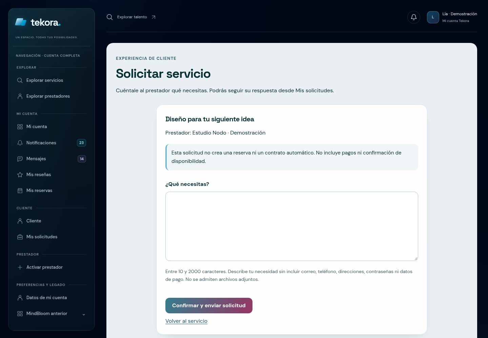
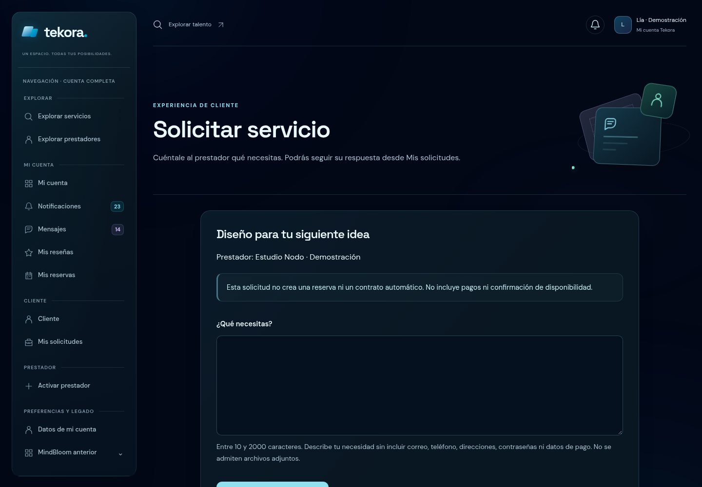
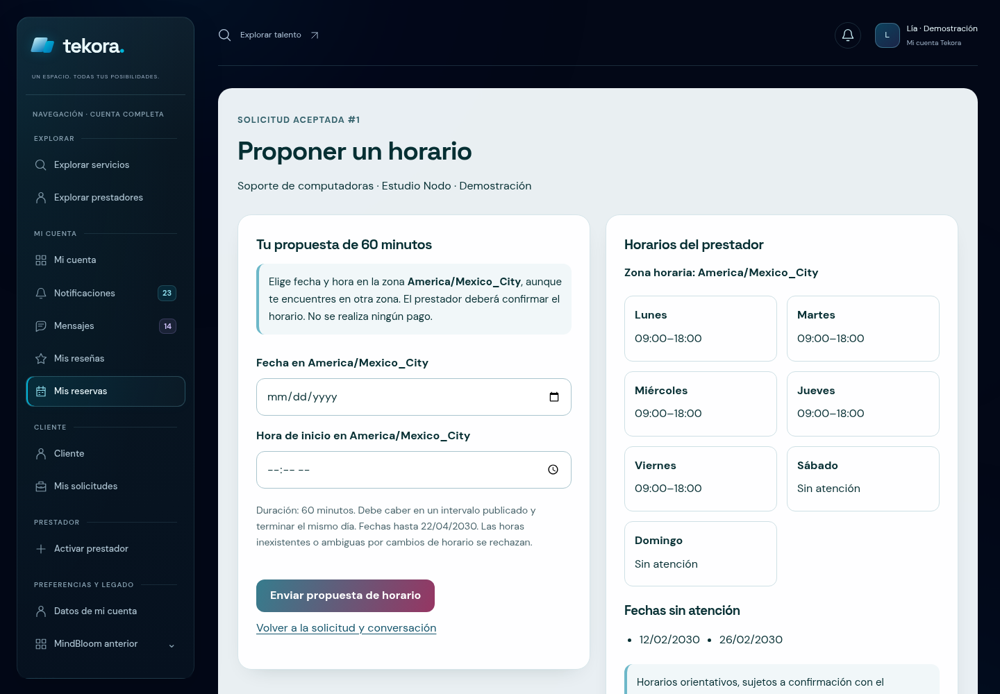
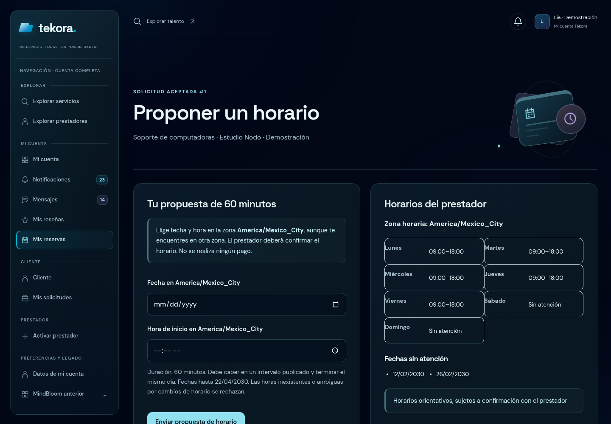
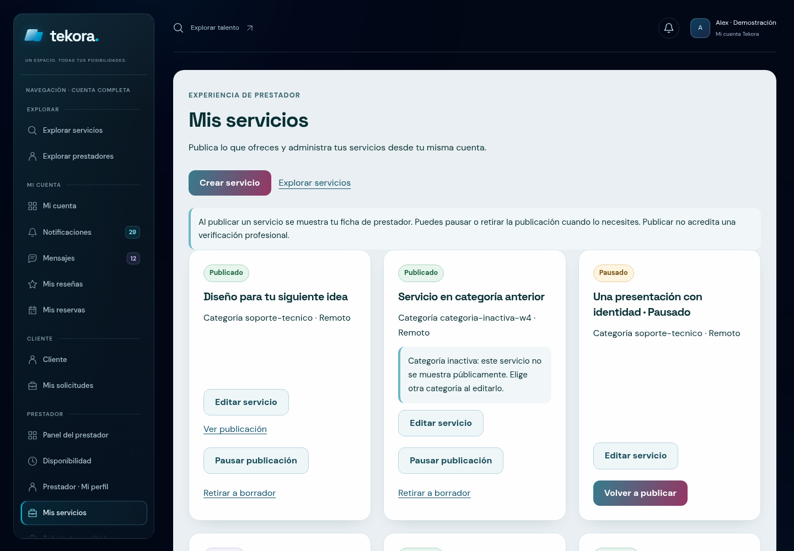
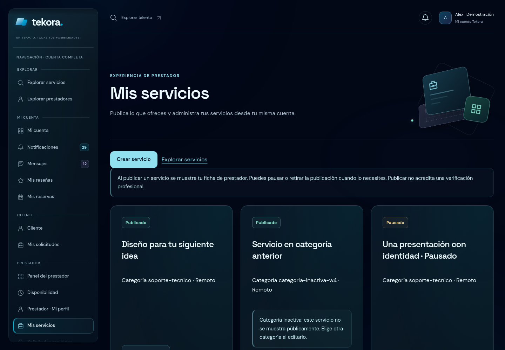

# Tekora Cinematic Experience · W4

Base verificada de `main`: **`8599cff7e95f1eecd3c6b38890e5b089feaf1f49`**, merge del PR #20. Rama nueva: **`codex/web-w4-cinematic-experience`**. Se entrega en el **[PR #21 en borrador](https://github.com/Fernando261/tekora-project/pull/21)**. SHA de implementación validada: **`77b0add4e6b3d50315663c7c50b4c51b4ae5ee92`**. El SHA final de la rama, que añade únicamente este enlace documental, queda registrado en la descripción del PR y en la entrega; también puede consultarse en [HEAD del PR](https://github.com/Fernando261/tekora-project/pull/21/commits). No se reutilizan #19/#20, fusiona ni despliega.

W4 conecta la experiencia operativa con el marketplace W3: solicitudes, conversaciones, reservas, reseñas, disponibilidad, servicios, avisos y presentación profesional. Se mantienen los formularios y operaciones reales. Las mejoras decorativas no crean estados, no marcan lecturas y no confirman decisiones.

## Antes y después

| Main aprobado · mismo fixture | W4 |
| --- | --- |
|  |  |
|  |  |
|  |  |

Referencias contrastadas: [marketplace W3 aprobado](media/reference-w3-catalog-1440.png) y [dashboard aprobado](media/reference-approved-dashboard-1440.png), capturados desde sus fuentes actuales sin modificaciones. Se comparten obsidiana, fuentes locales, cian, menta/violeta, superficies y ritmo editorial; cada flujo tiene geometría propia.

Comparativas adicionales: conversación [antes](media/before-request-detail-1440.png) / [después](media/request-detail-1440.png), reseña [antes](media/before-review-create-1440.png) / [después](media/review-create-1440.png), disponibilidad [antes](media/before-availability-1440.png) / [después](media/availability-1440.png), perfil [antes](media/before-profile-1440.png) / [después](media/profile-1440.png).

Los PNG y WebM son capturas y grabaciones directas de Chromium, sin edición ni composición de imágenes. Se comparan snapshots de los mismos fixtures sintéticos sobre el SHA base y sobre W4; dependencias bloqueadas y fuentes de negocio son idénticas. [Procedencia, tamaños y SHA-256](evidence/media-provenance.json).

## Arquitectura y alcance

**38 archivos de fuentes nuevos/modificados**, incluidos **29 Blade**, dos entradas CSS/JS, cinco herramientas, el test y Vite. [Lista exacta](evidence/changed-source-files.json). Documentación, evidencia y medios se añaden en esta carpeta.

| Pieza | Responsabilidad |
| --- | --- |
| `account-layout`, prop `operations` | Opción explícita para cargar W4 y añadir `.tk-ops`; dashboards, sidebar y páginas fuera del alcance no cargan el bundle nuevo. |
| `ops-heading` | Encabezado editorial reutilizable; conserva H1, descripciones y contenido real en el slot. |
| `ops-scene` | Tres composiciones tridimensionales locales: conexión, tiempo y herramientas. Decoración `aria-hidden`. |
| `ops-error-layout` | Fallback autónomo para nueve vistas de error: sin usuario, navegación, contadores ni consultas SQL al renderizar. |
| `operations.css` | Tokens, tarjetas, formularios, mensajes, agenda, timeline, badges, radios, avisos y estados bajo `.tk-ops`. No reglas globales de interfaz. |
| `operations.js` | Mejora progresiva nativa con WAAPI, IntersectionObserver y puntero limitado. No escucha submit, no usa fetch ni modifica campos/estados de negocio. |
| Componentes existentes | Paginación, estado/acciones de solicitudes, conversación, reservas, disponibilidad, estrellas y flashes se conservan; W4 adapta su presentación por namespace. |

El fondo ambiental, shell/sidebar W2.1.1, fuentes, marca vectorial e iconos existentes se reutilizan. Las 12 entradas anteriores del manifiesto conservan tanto nombre con hash como bytes. CSS/JS aprobados, herramientas W1/W2/W3 y recursos históricos permanecen intactos.

## Profundidad y movimiento

Las tres escenas usan **perspective 900 px**, `preserve-3d` y planos con Z diferentes: fondo **−45 px**, panel **24/30 px** y primer plano **78/85 px**. La escena de conexión usa mensaje/identidad; agenda incorpora calendario, órbita vertical y reloj circular; herramientas desplaza una placa de trabajo y una base inclinada. Se verifican matrices 3D calculadas, no solo nombres de clases.

La entrada decorativa dura **640 ms**, con retrasos de **70 ms**. El texto entra solo con opacidad **0,85→1**, durante **600 ms**, sin traslación ni invisibilidad inicial. Las tarjetas aparecen en **480 ms**, con escalonado limitado de **75 ms**. El puntero mueve únicamente la escena o el plano decorativo: máximo ±2°/±3° en escena y ±1°/±1,5° en tarjetas. Se comprueba que el enlace no cambia de bounding box.

No se inclinan campos, texto, botones o acciones importantes. El movimiento se cancela al salir el puntero, cambiar preferencias o abandonar la página. No se añaden bucles continuos. Touch y movimiento reducido mantienen una composición estática; transparencia reducida utiliza superficies opacas verificadas en Chromium. Sin JS o con el módulo bloqueado, el contenido y los controles permanecen.

## Flujos transformados

| Familia | Presentación y semántica conservada |
| --- | --- |
| Solicitudes | Composición editorial, tarjeta del servicio/prestador, listados, filtros GET, seguimiento, acciones permitidas y eventos reales. POST, CSRF, `old()`, límites, redirecciones y advertencias intactos. |
| Conversaciones | Bandeja, mensajes propios/recibidos, autor/fecha, no leídos y solo lectura. Se conservan `read_token`, límite de lectura de la página, cursor temporal, `idempotency_key`, participantes y 2000 caracteres. No se simula tiempo real. |
| Reservas | Tarjetas de agenda, fecha/hora/zona, propuesta, detalle, expiración e historial versionado. Propuesta ≠ confirmación; duración de 60 minutos, revisión, clave, versiones, conflictos y DST intactos. |
| Reseñas | Tarjetas, valoración real y cinco radios nativos, operativos sin JS. Comentario de hasta 1000 caracteres. Retirada irreversible con advertencia y tratamiento coral explícito; no edición/republicación. |
| Disponibilidad | Días, turnos agrupados, zona IANA y fechas bloqueadas. `revision`, máximo 42 intervalos, 100 fechas, `old()`, solapamientos y límites intactos. Script de añadir/quitar byte por byte igual. |
| Servicios | Publicados, pausados, borradores y categoría inactiva; edición/publicación separadas. Métodos, CSRF, validación, permisos y visibilidad intactos. |
| Avisos | Dos familias, estado de lectura, fecha, destino y estado no disponible; marcado exclusivamente POST y paginación real. |
| Perfil | Gestión y vista privada enlazada, biografía y avisos de privacidad/verificación. Creación, PUT, límites y permisos sin cambios. |

Los controladores, modelos, workflows, policies, guards, rate limits, cálculo de contadores, rutas, métodos HTTP, contratos API y migraciones **no cambian**. No se alteran expectativas anteriores para hacer pasar la suite.

## Estados y evidencia visual

Se exportan **52 pantallas/estados de revisión**, más **87 destinos adicionales**. Los **75 destinos GET distintos** enlazados desde las pantallas curadas tienen snapshot o redirección; no se sustituyen consultas desconocidas por listados falsos. [Índice de pantallas](evidence/w4-pages.json) · [Destinos adicionales](evidence/w4-linked-pages.json) · [Cobertura de enlaces](evidence/link-coverage.json).

Capturas móviles completas: [solicitud](media/request-create-full-375.png), [conversación](media/request-detail-full-375.png), [propuesta](media/reservation-propose-full-375.png), [reseña](media/review-create-full-375.png), [disponibilidad](media/availability-full-375.png), [servicios](media/services-full-375.png), [perfil](media/profile-full-375.png).

Estados representativos: [validación y old()](media/request-validation-1440.png), [vacío](media/requests-empty-375.png), [conflicto](media/inquiries-conflict-1440.png), [timeline](media/request-timeline.png), [conversación completa](media/conversation-complete.png), [mensaje propio](media/conversation-own.png), [recibido largo](media/conversation-received.png), [solo lectura](media/conversation-readonly-1440.png), [reserva pendiente](media/reservation-requested-1440.png), [confirmada](media/reservation-confirmed-1440.png), [expirada](media/reservation-expired-1440.png), [historial](media/reservation-history.png), [reseña publicada](media/review-published-panel.png), [retirada](media/review-withdrawn-panel.png), [estrellas seleccionadas](media/review-stars-selected.png), [semana](media/availability-week.png), [fechas bloqueadas](media/availability-blocked-dates.png), [42 filas](media/availability-42-rows.png), [avisos leídos/no leídos](media/notifications-read-and-unread.png), [destino no disponible](media/notifications-unavailable-1440.png), [perfil privado](media/profile-show-1440.png), [cuenta dual](media/dual-request-detail-1440.png).

Grabaciones auténticas: [desktop](media/operations-desktop.webm), [móvil](media/operations-mobile.webm), [movimiento reducido](media/operations-reduced-motion.webm), [zoom nativo](media/operations-native-zoom.webm). Muestran entrada/hover, escritura, conversación, propuesta, acciones presentes, elección de estrellas, turnos y herramientas; no envían operaciones POST ni representan decisiones confirmadas. VP8 alinea el ancho móvil de 375 CSS px a 374 px en la grabación.

## Validación funcional y de seguridad

PHP **8.2.28**, Composer **2.8.11**, Node **24.19.0**, npm **11.9.0**. PHPUnit con límite de **256 MB** solo en el proceso. [Comandos](evidence/commands.json).

| Control | Resultado |
| --- | --- |
| Composer validate estricto, install sin scripts, requisitos | Código **0** |
| Composer audit locked con/sin dev | **0 avisos**, ambos código **0** |
| npm ci / audit / build | Código **0**, **0 vulnerabilidades** |
| PHPUnit completo después del build | **548 pruebas / 7.402 aserciones** |
| Baseline, excluyendo `web-w4` | **501 / 6.896** |
| Grupo `web-w4` | **47 / 506** |
| Migraciones / operaciones API | **37 / 21**, idénticas |
| Formato y whitespace | Pint de PHP nuevo y `git diff --check` correctos |

El incremento exacto es **47 pruebas y 506 aserciones**. Se cubren 18 tipos de página, actores/propiedad, campos y POST reales, lectura explícita sin escrituras por GET, cursor y reintentos, conflictos, propuestas y decisiones versionadas, expiración, radios nativos/retirada, editor y límite de 42, estados/categorías, notificaciones de ambas familias, CSRF, `old()`, CSP, assets con/sin build, fallbacks sin consultas y compatibilidad/API. Los 501 tests anteriores y sus aserciones se conservan sin modificaciones.

Los nuevos tests de assets verifican **un script module y una hoja stylesheet reales** obtenidos del manifiesto, o las dos entradas del hotfile en un public path temporal sin build. No se borra el manifiesto original ni se reduce la comprobación a una coincidencia de texto sin relación con tags de recursos.

Composer conserva el aviso previo de ambigüedad de autoload de desarrollo de `AppServiceProvider` con Pint; se elige el del proyecto. El build conserva avisos anteriores de Sass y resolución de fuentes. No se cambian dependencias/autoload para ocultarlos. Los recursos finales se sirven sin fallos inesperados en las pruebas. [Composer install](evidence/composer-install.txt) · [build](evidence/npm-build.txt) · [suite completa](evidence/phpunit.txt) · [baseline](evidence/phpunit-baseline.txt).

## Accesibilidad y regresiones

| Matriz | Combinaciones | Axe sin infracciones |
| --- | --- | --- |
| W4 principal, 50 pantallas × ocho anchos | **400** | **100** |
| Perfil privado y detalle de cuenta dual × ocho anchos | **16** | **4** |
| Marketplace W3, scripts originales | **80** | **12** |
| Dashboards W2.1, scripts originales | **90** | **14** |
| Sidebar W2.1.1, scripts originales | **64** | **10** |
| Total ejecutado | **650** | **140** |

W4 se prueba en **320/375/768/1024/1100/1280/1440/1920 px**. Sin overflow horizontal, controles cortados, IDs duplicados, scripts inline ni errores inesperados de página/consola/recursos. CLS de las 416 combinaciones W4: **0**. Se revisan foco/Tab/Shift+Tab, targets fijos, filtros/limpiar/paginación nativos, ambas direcciones del cursor, 42 filas con nombres únicos y reactivación de controles al quitar una, ocho formularios sin JS, cinco radios nativos, touch estático, preferencias reducidas y fallo deliberado del módulo.

El zoom **nativo 100→200→100** cubre once familias, **33 comprobaciones**: outerWidth 1440, viewport 720 CSS px y DPR 2 al 200 %, sin CSS zoom ni emulación de viewport. [Resultados](evidence/native-zoom.json) · [formulario con foco al 200 %](media/request-create-zoom-200-focus.png).

[W4 principal](evidence/browser-results.json) · [suplemento](evidence/browser-supplement.json) · [W3](evidence/marketplace-regression.json) · [dashboards](evidence/dashboard-regression.json) · [sidebar](evidence/sidebar-regression.json) · [cursor de ida/vuelta y superficies opacas](evidence/additional-browser-proof.json).

La instrumentación inicial encontró dos problemas de herramientas: el binding Python de Playwright no acepta `reduced_transparency`, y el servidor temporal esperaba metadatos opcionales ausentes en el export histórico W2. Se usa CDP para preferencias y se adapta únicamente el servidor temporal. Se repiten todos los recorridos/grabaciones pendientes y las regresiones originales; no se cambia la aplicación para satisfacer esos errores. [Historial y resolución](evidence/instrumentation-history.json).

## Rendimiento

Presupuesto inicial para las nuevas entradas: **CSS ≤24 KiB**, **JS ≤4 KiB**, sin dependencias, fuentes nuevas, imágenes remotas, Three.js o WebGL. [Pesos y hashes](evidence/assets.json).

| Asset nuevo | Minificado | Gzip calculado por archivo |
| --- | --- | --- |
| CSS operativo | **22.430 bytes** | **5.255 bytes** |
| JS operativo | **2.040 bytes** | **930 bytes** |

Las páginas con `account-layout operations` añaden estos dos requests y conservan sus hojas anteriores; el incremento neto es el bundle indicado. Los fallbacks cargan solo el CSS operativo en lugar del layout de acceso anterior, sin módulo JS de W4. Las fuentes locales ya estaban precargadas en el shell. Los 12 assets previos conservan sus hashes y bytes.

Se toman **99 muestras**, con un único navegador activo: 44 de la base operativa sobre main W3, 44 de W4 y 11 adicionales CPU 4×. Son once familias × dos anchos × dos contextos fríos por versión, más los once casos CPU 4×; observación de 1200 ms tras networkidle y 1500 ms en CPU limitada.

| Medición local | Base operativa W3 | W4 |
| --- | --- | --- |
| LCP mediano normal | **306 ms** | **434 ms** |
| LCP máximo normal | **540 ms** | **696 ms** |
| CLS máximo normal | **0,00183** | **0** |
| LCP máximo CPU 4× | No muestreado | **1.016 ms** |
| CLS CPU 4× | No muestreado | **0** |

W4 añade **128 ms al LCP mediano local** en este ensayo. Es el coste observado de esta propuesta visual, pendiente de revisión; no se presenta como una mejora ni como ausencia de impacto. **CLS final 0 en las 55 muestras W4**, incluidas las de CPU limitada. La política de fuentes `optional` y la ausencia de traslación en texto priorizan estabilidad.

Diez clics nativos de radios, cinco por tasa de CPU, miden evento→segundo rAF: medianas **25,5 ms** y **26,7 ms** con CPU 4×; máximos **29,2/42,5 ms**. Es una aproximación de presentación, **no INP de campo**. En 650 ms de scroll instrumentado, intervalos rAF medios **16,3/18,8 ms**, máximos **16,8/50 ms**; no es una certificación de FPS/GPU. [Datos y método](evidence/performance.json) · [Resumen](evidence/performance-summary.json).

Las consultas de GET satisfactorios se mantienen; **0 escrituras de negocio** en todos los snapshots registrados. Los cambios de consultas se limitan al fallback: error de filtros **14→1** incluyendo autenticación, y cinco vistas que usaban shell **13→0** al renderizar. Los fallbacks que ya eran autónomos siguen en cero. [Comparación completa](evidence/query-comparison.json).

## CSP, aislamiento y compatibilidad

Las rutas y middleware permanecen intactos. W4 añade una **CSP meta** de recursos locales en las páginas opt-in y el fallback en producción/testing, con `script-src 'self'`, sin eval ni scripts inline. En local se omite esa meta para permitir el Vite de desarrollo, de forma coherente con el tratamiento local existente. Una CSP meta no ofrece `frame-ancestors`; no se afirma haber añadido esa protección HTTP a las rutas privadas. Las cabeceras existentes de otras rutas no se alteran. El servidor estático del preview conserva la política HTTP que ya usaba el export anterior.

El fallback se comprueba también con manifiesto en testing y hotfile en local, sin consultas SQL. [Diagnóstico CSP/Vite](evidence/local-csp.json).

`.env`, APP_KEY persistente, SQLite persistente, credenciales, locks, configuración, app, rutas, migraciones, pruebas anteriores y assets aprobados conservan contenido. Se auditan invariantes sin publicar hashes de archivos privados. [Invariantes](evidence/invariants.json) · [21 operaciones API](evidence/api-routes.json).

El export reutiliza W3 sin modificar sus herramientas, crea datos con workflows reales en **SQLite `:memory:`**, omite el `.env` del checkout y descarta la conexión. El router posterior no arranca Laravel ni tiene backend POST. Se verifican **13 controles HTTP** con PHP 8.2.28 y workspace de solo lectura: HTML/HEAD/assets, errores 422/409, desconocidos/arrays 404, POST/PATCH 405, `.env`/API 404 y favicon 204. [Controles](evidence/router-results.json) · [Safety](evidence/safety.json).

**Ningún archivo histórico eliminado y ninguna base persistente modificada.** La limpieza de lenguaje se limita a gestión y vista privada del perfil y formulario de servicios; el historial conserva su procedencia. [Inventario W4](W4-MINDBLOOM-CLEANUP.md).

## Validación independiente

[Guía Windows/Laragon](W4-LARAGON.md): clon nuevo fijado al SHA entregado, sin `.env`, puerto libre, carpeta temporal única, ambos escenarios Vite, suites, safety.json y revisión manual. POST/PATCH se prueban en PHPUnit; la preview solo permite inspección y navegación.

Limitaciones: Chromium headless/Linux con compositor software SwiftShader, HTTP loopback y muestras limitadas. No certifica producción, GPU física, Windows/Laragon, trackpad/touch físico, Firefox/Safari o lectores de pantalla. Axe no equivale a una certificación WCAG completa. Permanecen pendientes la revisión técnica independiente y la aprobación visual del usuario. **Conservar el PR en borrador; no fusionar ni desplegar.**
