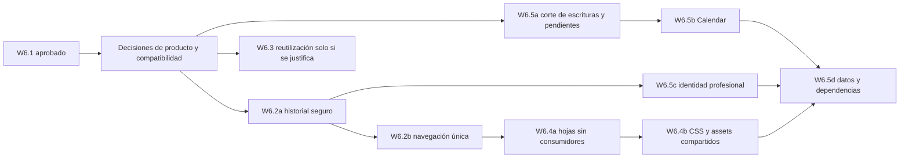

# W6.1 · Secuencia de corte propuesta

Base auditada: `576c937fa3cbd31e6af95eedc1651cb59a16d898`. **Ninguna fase siguiente está implementada ni autorizada por esta auditoría.** Cada fila es un PR separado y revisable, con aprobación propia. No mezclar cambios de presentación con migración de identidad, archivos o efectos Google.

## Orden por dependencia

La numeración identifica líneas de trabajo, no obliga a ejecutar W6.5 después de todos los cambios visuales. Si se decide cerrar escrituras antiguas, W6.5a debe preceder a retirar sus interfaces. La transición de Calendar y del guard puede bloquear parte de W6.2b; no se considera terminada la unificación por haber ocultado un menú.

## PRs delimitados

| PR futuro | Qué elimina / sustituye | Qué mantiene | Prerrequisitos y autorización adicional | Pruebas necesarias | Reversión |
| --- | --- | --- | --- | --- | --- |
| **W6.2a · Acceso a historial** | Sustituye accesos dispersos de Cita por lectura histórica dentro de Tekora, con procedencia; D02/D12/D13/D18 | Tablas/IDs/fechas/estados/event IDs; no mezcla con reservas; handlers compatibles mientras se prueba | Política para propietarios web sin rol y profesionales; todos los estados, no solo pendientes; diseño de prueba de identidad aprobado. Si requiere conocer registros reales, autorizar revisión aparte | Fixtures sintéticos con dueño/ajeno, sin roles y cada guard; GET `/citas`, `/consultas`, `/cuenta/citas`; 403/404 sin filtración; historial profesional completo; métricas sin Cita; ningún autoenrolamiento | Restaurar enlaces y rutas previas; conservar esquema/datos. Sin escrituras de conversión que deshacer |
| **W6.2b · Una navegación Tekora** | Retira grupo/footer “MindBloom anterior”, tarjetas, selector de producto y enlaces a inicio/conferencias; sustituye destinos por historial o rutas nativas acordadas; D01–D05/D19–D22 | Perfil/foto/nombre, roles/can, counters, operaciones, logout POST/CSRF y vías de acceso histórico necesarias | W6.2a o alternativa aprobada; contratos GET y login profesional resueltos. No esconder rutas activas y declarar retirado el producto por ello | Matriz de todos los consumidores, roles y guards; CSP, assets Vite con/sin build, teclado/móvil/sidebar W2.1.1, W1–W5; enlaces antiguos y permisos; ausencia de accesos alternativos | Revertir solo navegación/plantillas; contratos y datos siguen intactos |
| **W6.3a · Reutilización justificada** (opcional) | Extrae una capacidad concreta con consumidor nativo y necesidad aprobados; elimina duplicación solo en ese ámbito | Workflows nativos como fuente de verdad; no portar Cita/feed/likes por disponibilidad de código | Caso de uso y criterio de aceptación del propietario. Si no hay necesidad, omitir PR. Comunidad no queda aprobada implícitamente | Regresión del caso real y ausencia de duplicación; propiedad, políticas, idempotencia, versionado, métricas y API | Revertir adaptación; no escribir sobre operaciones previas ni activar código auxiliar |
| **W6.3b · Medios** (solo si se conservan escrituras) | Sustituye duplicación insegura de upload/borrado de comunidad por un contrato probado; D07/D08 | Audiencia y contenido sin traslado masivo; lifecycle W5.1 independiente | Decisión de conservar función; especificar raíz pública, referencias, compensación, límites/MIME y comportamiento de contenido borrado. No requiere ni habilita inventario real | `public_path` temporal, archivos sintéticos, SQL/storage failures, referencias compartidas, soft deletes, permiso ajeno, render de adjunto propio del comentario. Storage::fake solo no aísla esta raíz | Conservar originales y referencias; revertir contrato de código únicamente. Movimiento real necesitaría plan y autorización distintos |
| **W6.4a · Hojas demostradas sin consumidores** | Retira vistas/controladores/assets realmente huérfanos, en lotes pequeños; D26/D27/D30 | Aliases públicos con contrato, Vite entrypoints, archivos de datos, licencias y migraciones; Reminder model/relación hasta decisión | Resolver candidatos dinámicos/transitivos/externos con evidencia; no ejecutar controladores auxiliares para “probar” si se usan | Instanciación/installation, rutas, auth/password reset, FrontendCsrfHeadersTest, build; nuevo inventario de consumidores por lote; no escrituras/medios | Revertir commit de archivos; no borrar tabla ni backups junto con código |
| **W6.4b · CSS y assets compartidos** | Extrae base usada por shell antes de retirar galería/estilos viejos; limpia Vite/deps frontend solo si consumidor resuelto; D25/D28/D32 | Apariencia W1–W5, tipografías y OFL; availability.js y políticas CSP | W6.2 y retirada de vistas consumidoras; comparación visual y de imports. Cero referencia de una licencia nunca habilita borrado mientras se distribuye la fuente | Build con manifiesto y PHPUnit, render sin build aislado, screenshots responsive/teclado, errores 403/419/422, CSP/sin inline no autorizado | Revertir extracción junto con imports. Fuente y licencia permanecen juntas |
| **W6.5a · Congelación antigua y pendientes** | Cierra creación/edición de citas o comunidad si se aprueba; retira formularios solo tras contrato; D06–D15/D29 | Historial, pendientes hasta resolución, propiedad, archivos, IDs de eventos y acceso de usuarios | Decidir fecha, avisos, respuesta por método/JSON, archivo/audiencia/retención. Revisión de datos o tratamiento de pendientes reales requiere autorización y alcance separados | POST/DELETE/PATCH sin replay, idempotencia de rechazos, ningún ID convertido, propietario sin rol, estados dobles, enlaces públicos; fixtures sin datos reales | Reabrir handlers si seguro y aprobado. Restauración de datos/medios no se presume; no hay borrado en el corte de UI |
| **W6.5b · Desacoplar Calendar** | Retira conexión nueva/callback/desconexión y escritor antiguo solo cuando no quedan consumidores pendientes, o crea adaptador nativo si se justifica; D10/D13/D16/D17 | Trazabilidad de Cita→evento y acceso histórico; nunca usar controlador auxiliar como reemplazo directo | Política de eventos existentes, scopes, token owner, callbacks en vuelo/URI, refresh y fallo externo. Conectar cuentas, copiar/revocar tokens o editar/borrar eventos requiere autorización explícita distinta | Fake de proveedor HTTP, state/mismatched/expired callback, refresh sin refresh_token, doble aceptación, fallo SQL tras evento, timeout/reintento, reconciliación; nunca OAuth real en suite | Feature flag/adaptador anterior solo si seguro; un revert Git no restaura tokens revocados ni eventos borrados. Evitar efectos irreversibles durante corte |
| **W6.5c · Retirar guard profesional** | Sustituye acceso profesional antiguo por historial nativo con mecanismo de propiedad aprobado; después retira formulario/guard/config asociado; D04/D18/D23 | Identidad central, broker users, roles/policies y trazabilidad del dueño original | W6.2a y W6.5a/b resueltos. Claim con verificación, consentimiento, colisiones/recuperación y casos sin cuenta. No matching automático por email | Guards web/prof separados, ambos logouts/global invalidation, intended/session/state, CSRF, acceso ajeno, emails iguales y usuarios no vinculados, registro cerrado y recuperación | Mantener adaptador de lectura previo hasta aceptación. Si hubo vinculación autorizada, registro reversible sin sobrescribir propietarios, con plan específico |
| **W6.5d · Esquema, archivos y paquetes** | Solo después de desacoplar, propone retirada física por lotes de tablas/columnas/medios/dependencias; D09/D20/D21/D24/D29/D31/D32 | Historial/archivo aprobado, restaurabilidad y instalación; no reescribir las 37 migraciones para ocultar el pasado | Inventario de referencias reemplaza consultas W5.1 a posts/comments/emotions; política de conservación y de URLs públicas; mapa de FK/cascadas/morfos y paquetes transitivos. Revisión/backup/movimiento/borrado de datos reales y revocaciones requieren autorización expresa de operaciones | SQLite en memoria/nueva instalación, Upgrade path aislado, shared-ref/cleanup compensation W5.1, morfos, exportación/archivo y restauración sintéticos, Composer install/platform/audits y npm/build; suite completa y API | No ejecutar rollback destructivo como reversión. Separar cambio de código de operación de datos; backup/restauración probados y aprobados antes de cualquier borrado |

Si se decide no conservar comunidad, no implementar W6.3b por iniciativa técnica: preferir corte de escrituras autorizado y archivo seguro. Si se decide no tener Calendar nativo, W6.5b es de cierre compatible, no de integración nueva. PDF, emociones y recordatorios tampoco generan módulos nuevos por defecto.

## Puerta de entrada común a cada PR funcional

1. W6.1 revisado y aprobado; fila de matriz, decisión producto y consumidores afectados explícitos.
2. Base vigente, archivos delimitados y contrato de compatibilidad por método, guard y dueño. No mezclar auth/migración/diseño para conseguir pruebas verdes.
3. Pruebas sintéticas de fallos y casos negativos relevantes, suite previa conservada salvo cambio de intención justificado; informar conteos reales y motivo de cualquier cambio.
4. API v1, historial, migraciones, W5.1, sesiones y ausencia de falsa atribución verificadas. Pruebas con build y sin build cuando cambien assets/vistas.
5. Reversión revisada antes de retirar código y autorización operativa separada para datos/OAuth/producción. PR en borrador, validación independiente y fusión exclusivamente por el usuario.

La baseline conocida es 626 pruebas / 8.258 aserciones en Windows; no se ejecutó de nuevo en W6.1. Los conteos de futuras suites se reportarán por ejecución, sin usar el número anterior como evidencia nueva.
