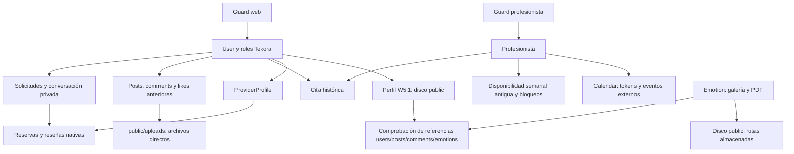

# W6.1 · Mapa de dependencias y compatibilidad

Procedencia: `576c937fa3cbd31e6af95eedc1651cb59a16d898`. Lectura estática de fuentes; no se cargó la aplicación. Las referencias siguientes están fijadas a esa base. La [matriz](W61-DECISION-MATRIX.md) añade consumidores, pruebas, riesgos y reversión por elemento.

## Núcleos y raíces de almacenamiento

No hay una arista de identidad `Profesionista → ProviderProfile` ni una conversión `Cita → ServiceReservation`. El esquema no prueba que sean la misma persona u operación. El diagrama resume dependencias de código, no filas existentes ni actividad real.

| Núcleo | Relaciones/consumidores reales | Consecuencia para retirar |
| --- | --- | --- |
| `User` | Relaciones de roles y providerProfile; también posts, comments, likes, reminders: [modelo](https://github.com/Fernando261/tekora-project/blob/576c937fa3cbd31e6af95eedc1651cb59a16d898/app/Models/User.php#L56) | Es compartido. No eliminar identidad central ni relaciones por el nombre del producto. |
| `Profesionista` | Authenticatable separado, disponibilidad, Cita y tokens OAuth: [modelo](https://github.com/Fernando261/tekora-project/blob/576c937fa3cbd31e6af95eedc1651cb59a16d898/app/Models/Profesionista.php#L18) | `$hidden` evita serialización, no demuestra cifrado de tokens. No se consultaron valores. |
| `Cita` | `user_id`, `profesionista_id`, parejas de fechas/estados y `google_event_id`: [modelo](https://github.com/Fernando261/tekora-project/blob/576c937fa3cbd31e6af95eedc1651cb59a16d898/app/Models/Cita.php#L12) | Mantener procedencia, estado y propiedad; las FK/cascadas importan para cualquier archivo futuro. |
| `Post` / `Comment` | User, media_path/type, SoftDeletes, comentarios y likes morfos: [Post](https://github.com/Fernando261/tekora-project/blob/576c937fa3cbd31e6af95eedc1651cb59a16d898/app/Models/Post.php#L13), [Comment](https://github.com/Fernando261/tekora-project/blob/576c937fa3cbd31e6af95eedc1651cb59a16d898/app/Models/Comment.php#L9) | Soft delete SQL no restaura un archivo ya desvinculado. Audiencia global web no equivale a conversación privada. |
| `Like` | `morphTo`, antigua `post_id` y migraciones que agregan `likeable_id/type`: [modelo](https://github.com/Fernando261/tekora-project/blob/576c937fa3cbd31e6af95eedc1651cb59a16d898/app/Models/Like.php#L9), [esquema](evidence/schema-inventory.json) | No se observa backfill en esas migraciones ni morphMap en app/config. Renombrar clases puede afectar tipos persistidos. La relación morphMany establece sus claves; no se deduce un fallo por `$fillable`. |
| `Emotion` | Home, detalle público, PDF y guardia de referencias de foto: [modelo](https://github.com/Fernando261/tekora-project/blob/576c937fa3cbd31e6af95eedc1651cb59a16d898/app/Models/Emotion.php#L9) | `image_path` puede señalar archivos no enumerables desde assets de código. Tabla aún requerida por W5.1. |
| `Reminder` / bloqueos | User.reminders; controlador sin ruta localizada; tabla `profesionista_bloqueos` sin consumidor literal productivo localizado | INVESTIGAR, no borrar por ausencia de UI. Bloqueo antiguo por intervalo no equivale a blocked_dates nativo. |

Las 37 migraciones, sus declaraciones de creación/modificación y nombres exactos están en [schema-inventory.json](evidence/schema-inventory.json). Es esquema versionado, no inspección de una base instalada.

## Contratos HTTP anteriores y transición propuesta

Fuente principal: [routes/web.php](https://github.com/Fernando261/tekora-project/blob/576c937fa3cbd31e6af95eedc1651cb59a16d898/routes/web.php#L43). La tabla describe contratos actuales y propuestas condicionadas; no los cambia. `GET` no significa ausencia de efectos: disponibilidad puede renovar credenciales y PDF lee archivos.

| Método y ruta actual | Guard / handler / consumidores | Tratamiento futuro propuesto y condición |
| --- | --- | --- |
| GET `/` | Público; TekoraHomeController, `tekora.home` | Preservar la entrada nativa. No confundir con route `home`. |
| GET `/mindbloom/inicio` | web; HomeController, route `home`; sidebar/footer/old menus | Retirar portada alternativa; GET podría redirigir a `/` tras resolver enlaces a historial/PDF. No cambiar `home` globalmente sin revisar sus consumidores. |
| GET `/emociones/{slug}` | Público; closure Emotion + emotion.show | Decidir conservación temporal de deep links o retirada explícita. No convertir slug emocional en servicio. Preservar archivos hasta política aprobada. |
| GET `/pdf/emociones/tarjetas` | web; PdfController, links Home 6/9 tarjetas | Exportación histórica temporal si se aprueba, o aviso de retirada. Conservar autenticación, contenido y nombre durante W6.1. |
| GET `/conferencias` | web; closure a maqueta; sidebar/perfil/menús | Retirar enlaces y luego endpoint con respuesta explícita acordada. No prometer una agenda, chat o videollamada equivalente. |
| GET `/comunidad` | web; ComunidadController.index; menú/perfil | Decisión producto/audiencia previa. Si no se conserva, archivo aprobado y transición de lectura; no sustitución automática por mensajes privados. |
| POST `/comunidad`, `/posts/{post}/like`; DELETE `/posts/{post}` | web; ComunidadController; feed y formularios con CSRF | No redirigir escrituras a otros workflows. Si se congela, respuesta de corte documentada sin repetir acción; resolver propiedad, medios y pendientes antes de retirar handlers. |
| POST `/comments`, `/comments/{comment}/like`; DELETE `/comments/{comment}` | web; CommentController / CommentLikeController; feed | Mismo corte explícito; conservar permisos/propiedad y semántica de contenido eliminado. No reutilizar IDs como mensajes/reseñas. |
| GET `/profesionistas` | web; ProfesionistaController.index; antiguo directorio | Puede ofrecer acceso a `/prestadores` como catálogo nuevo, sin equivalencia de fichas/IDs ni traslado de credenciales. Historial primero. |
| GET `/consultas` | web; alias 302 a `/citas`, route user.citas | Mantener cadena de compatibilidad y ownership hasta sustituto de historial probado. |
| GET `/citas` | web; UserCitaController.index; citas.mis-citas | Listado propio de todos los estados. Adaptar a historial Tekora; no mezclar con `/cuenta/reservas`. |
| GET `/cuenta/citas` | web **y can:client.appointments.view**; mismo controlador; tarjeta cliente | No es un reemplazo seguro para todo usuario de `/citas`: puede devolver 403 a propietario sin rol. Resolver política sin autoasignar rol. |
| GET `/citas/create/{profesionista}`; GET `/profesionistas/{profesionista}/availability` | web; CitasController; formulario de Cita y JSON | Retirar nuevas contrataciones antiguas después de decidir pendientes y destino informativo. El JSON no puede convertirse en redirect HTML por sorpresa. No mapear prof IDs a providers. |
| POST `/citas` | web; CitasController.store | Congelar solo por PR autorizado, con resultado no ambiguo para formulario/JSON. No reenviar body a reservas nativas. |
| GET `/dashboard-profesionista` | profesionista; closure; antiguo menú y aviso | No conservar como producto alternativo. Historial seguro y login/recuperación resueltos antes del cierre. Sus métricas actuales son placeholders. |
| GET/POST `/profesionista/disponibilidad` | profesionista; ProfesionistaDisponibilidadController | GET y escritura tienen planes distintos. Conservar lectura necesaria y bloquear escritura solo tras corte; no convertir rangos automáticamente al sistema nativo. |
| GET `/solicitudes-citas`; POST `/citas/{id}/aceptar`, `/rechazar` | profesionista; ProfesionistaCitaController, own prof | Resolver pendientes y eventos antes de congelar. La lista actual solo muestra pendientes/null; no basta como historial profesional. No retirar ownership ni aceptar en otro workflow. |
| GET `/google/connect`, `/google/callback`; POST `/google/disconnect` | profesionista; **ProfesionistaGoogleController** | Congelar nuevas conexiones con plan propio; callback en vuelo requiere compatibilidad/state/sesión, nunca redirect genérico que pierda el intercambio. Desconexión local no revocación remota. |
| GET `/login-profesionista`; POST `/login-profesionista` | Público; ProfAuth; GET redirige a `/login?role=prof`, POST autentica guard separado | Conservar login/CSRF/throttle/intended mientras haya historial profesional. Eliminar formulario visible solo con una vía de acceso aprobada. |
| GET `/registro-profesionista`; POST `/registro-profesionista` | GET redirige a registro central con intent=provider; POST ProfController.store | POST ya está cerrado: JSON410 o web303 con información, sin crear profesión. Preservar semántica y probar clientes antiguos. |
| POST `/logout`; POST `/logout-profesionista` | Sesión web / profesional; CSRF; ambos invalidan sesión | Preservar método y aislamiento esperado. No sustituir por enlace GET; probar efectos con ambos guards. |
| GET `/login`, POST `/login`, GET `/registro`, POST `/registro` y reset de contraseña | AuthController central / password controllers; público | Conservar Tekora, validación, CSRF, throttle y broker users. No activar scaffolding Auth duplicado. |
| GET `/perfil`, POST `/perfil/foto`, GET `/perfil/editar-nombre`, PUT `/perfil/actualizar-nombre` | web; perfil W5/W5.1 | Preservar endpoints y lifecycle; solo los enlaces al producto anterior se reemplazan en un PR futuro. |

La [evidencia de declaraciones](evidence/web-route-declarations.json) es textual para web/identities: no simula middleware ni registra rutas de todos los ficheros. La interpretación de grupos/guards es la tabla anterior. Las **21 operaciones `/api/v1`** están en [api-static-inventory.json](evidence/api-static-inventory.json) y permanecen fuera del corte.

No proponer 301/302/307/308 indiscriminados para POST/DELETE: pueden cambiar método, perder significado o repetir una acción sobre otro recurso. Un 410 futuro requiere decisión explícita de contrato, conservación y aviso; no se implementa aquí. Cada redirect GET debe conservar autorización, query relevante y audiencia sin exponer contenido a otro usuario.

## Autenticación y navegación

[config/auth.php](https://github.com/Fernando261/tekora-project/blob/576c937fa3cbd31e6af95eedc1651cb59a16d898/config/auth.php#L38) separa guards/providers; el broker configurado es users. [AuthController](https://github.com/Fernando261/tekora-project/blob/576c937fa3cbd31e6af95eedc1651cb59a16d898/app/Http/Controllers/AuthController.php#L23) crea usuarios con RoleMemberships y el [controlador profesional](https://github.com/Fernando261/tekora-project/blob/576c937fa3cbd31e6af95eedc1651cb59a16d898/app/Http/Controllers/ProfesionistaAuthController.php#L10) mantiene otra autenticación. Sus logouts llaman `session()->invalidate()`: distinguir guards no garantiza cookies, intended o estado OAuth independientes.

El permiso [ViewClientAppointments](https://github.com/Fernando261/tekora-project/blob/576c937fa3cbd31e6af95eedc1651cb59a16d898/app/Enums/Permission.php#L7) sigue sirviendo al dashboard cliente. Su nombre histórico no autoriza retirarlo. Gates/policies requieren User real, roles y ownership; no deben relajarse para encajar datos viejos.

| Superficie de experiencia | Consumidores concretos | Sustitución propuesta |
| --- | --- | --- |
| `account-navigation`, grupo Preferencias y legado / “MindBloom anterior” | account-layout y vistas históricas que incorporan el componente; enlaces a home/comunidad/conferencias/citas/directorio | Un solo menú Tekora; historial cuando esté autorizado. Conservar navegación nativa, counters, can, teclado, logout POST/CSRF. |
| `account-layout` footer | Dashboards, identidad y operaciones W2–W5 | Retirar acceso a producto alternativo sin eliminar shell ni carga de assets modernos. |
| `account/client` tarjeta de actividad anterior | Dashboard cliente → identity.citas | Historial con procedencia, separado de métricas actuales; resolver gate distinto antes. |
| `perfil` details histórico | Perfil W5 → citas/comunidad/conferencias | Mantener perfil, nombre y foto; sustituir destinos solo tras decisión individual. |
| `login` details de acceso profesional y `auth/registro` enlace antiguo | Entrada pública, role=prof y sesión legacy_login | Transición de acceso histórico antes de retirar formulario; no cerrar sesión ni reclamación de identidad. |
| `legacy-account-notice` | dashboard-profesionista, profesionistas/disponibilidad, profesionistas/solicitudes-citas | El aviso no convierte las pantallas en módulos nativos. Retirarlas después del historial y corte funcional. |
| Menú profesional | Dashboard/disponibilidad/solicitudes, Google y logout | Debe desaparecer como experiencia alternativa tras resolver sus dependencias; no solo cambiar su logo. |
| Títulos, logos, texto editorial y PDF | Home, comunidad, citas/create/mis-citas, profesionistas, profesional, conferencias, PDF | Inventario de marca por fuente y línea; no reemplazo global que falsee procedencia o cambie eventos existentes. |

La activación de prestador central explica que no crea identidad anterior ni verificación; conservar esa verdad aunque cambie la redacción. El [inventario de branding](evidence/branding-occurrences.json) incluye también comentarios, pruebas y metadatos de eventos Google: no todo es UI visible. `APP_NAME`, descripciones e image_path en datos no se inspeccionaron y requieren validación autorizada si son relevantes.

## Citas y Calendar frente a los workflows nativos

| Aspecto | Anterior | Tekora nativo | Regresión necesaria antes de sustituir |
| --- | --- | --- | --- |
| Dueño profesional | Profesionista, guard separado | User → ProviderProfile | Propiedad/claim, no igualdad de email/ID. |
| Entrada de reserva | Cita directa al profesional | Solicitud aceptada y propuesta de reserva | No omitir consentimiento, estados ni policies de Inquiry. |
| Tiempo | Slots 50 min, America/Mexico_City, dayOfWeek domingo0 | ReservationTime 60 min, UTC e ISO días1–7, control DST | Rangos, solapamientos, zonas y ambigüedad DST. |
| Disponibilidad | `profesionista_disponibilidades`, reemplazo de rangos sin TX/version observadas; bloqueos en otra tabla | Revisión CAS, transacción, owner y blocked_dates | No copiar filas ni intervalos como días completos. |
| Estados/concurrencia | status/estado y pares datetime; unique prof+inicio no cubre todo solapamiento | Versionado, idempotencia, eventos y transiciones | Reintentos/doble aceptación y no atribución falsa de actividad. |
| Calendar | Tokens en Profesionista; aceptación inserta evento y luego actualiza Cita | Ninguna referencia directa a Google en servicios nativos auditados | Solo nueva integración justificada con outbox/reconciliación e idempotencia; no importar efectos externos a ciegas. |

Fuentes: [CitasController::availability/store](https://github.com/Fernando261/tekora-project/blob/576c937fa3cbd31e6af95eedc1651cb59a16d898/app/Http/Controllers/CitasController.php#L66), [ProfesionistaCitaController::aceptar](https://github.com/Fernando261/tekora-project/blob/576c937fa3cbd31e6af95eedc1651cb59a16d898/app/Http/Controllers/ProfesionistaCitaController.php#L83), [ReservationTime](https://github.com/Fernando261/tekora-project/blob/576c937fa3cbd31e6af95eedc1651cb59a16d898/app/Services/ReservationTime.php#L12), [ProviderAvailability](https://github.com/Fernando261/tekora-project/blob/576c937fa3cbd31e6af95eedc1651cb59a16d898/app/Services/ProviderAvailability.php#L19), [ReservationWorkflow](https://github.com/Fernando261/tekora-project/blob/576c937fa3cbd31e6af95eedc1651cb59a16d898/app/Services/ReservationWorkflow.php#L50).

`CitasController::store` valida existencia/orden de fechas, comprueba cierto solapamiento aceptado y crea estado pendiente; no se observa validación completa en servidor contra la duración/rangos que presenta su UI. Disponibilidad usa Calendar READONLY, refresh y fallback FreeBusy vacío ante fallo externo. La aceptación profesional exige propietario, pendiente y token; usa CALENDAR, crea evento con resumen/description MindBloom, después guarda SQL. Estos riesgos no autorizan corregir comportamiento en W6.1.

El controlador activo es [ProfesionistaGoogleController](https://github.com/Fernando261/tekora-project/blob/576c937fa3cbd31e6af95eedc1651cb59a16d898/app/Http/Controllers/ProfesionistaGoogleController.php#L11): Socialite, scopes calendar/calendar.events, offline/consent, callback con estado de sesión, preservación de refresh si falta, expiración y desconexión local. `config/services.php` sí tiene configuración Google por variables de entorno; no se leyeron valores. No comprobar salud mediante solicitudes reales.

[GoogleCalendarController](https://github.com/Fernando261/tekora-project/blob/576c937fa3cbd31e6af95eedc1651cb59a16d898/app/Http/Controllers/GoogleCalendarController.php#L11) es auxiliar sin consumidor de ruta localizado: usa SDK, callback por code sin state explícito ahí, Auth genérico y access token codificado JSON, diferente del contrato activo. No activarlo como atajo. Dependencias Google/Socialite, Dompdf, DBAL y laravel/ui requieren mapa transitivo y de instalación antes de retirarlas.

## Comunidad, archivos y W5.1

[ComunidadController](https://github.com/Fernando261/tekora-project/blob/576c937fa3cbd31e6af95eedc1651cb59a16d898/app/Http/Controllers/ComunidadController.php#L14) carga todo el feed con usuarios/comentarios/likes, sin paginación observada; sus uploads y los de CommentController duplican lógica de MIME/extensión, directorios y validación. Escriben antes de crear fila y borran directamente antes del soft delete del registro propio. La propiedad se comprueba y debe conservarse. No se observa compensación ante fallo SQL ni una comprobación de referencias compartidas como W5.1.

[comunidad.blade.php](https://github.com/Fernando261/tekora-project/blob/576c937fa3cbd31e6af95eedc1651cb59a16d898/resources/views/comunidad.blade.php#L173) calcula commentMediaUrl, pero el bloque de adjunto del comentario usa `$post->media_path/type` (líneas206–214). Es una discrepancia estática a probar si se decide conservar la función. No se ha corregido, y no demuestra ausencia de adjuntos guardados. `img/avatar.png` es un fallback referenciado pero no versionado en la base; no se inspeccionó si existe en instalaciones.

| Origen | Resolución actual | Riesgo y condición |
| --- | --- | --- |
| Adjuntos post/comentario | `public_path('uploads/...')`, URL directa desde raíz pública | Storage::fake('public') solo no aísla estos tests. Futuras pruebas deben redirigir public_path a temporal. Ocultar el feed no protege las URLs públicas. |
| Foto de perfil | Storage disk public, path canónico y lifecycle W5.1 | Conservar referencia anterior y compensación segura; no copiar unlink de comunidad. |
| Emociones/PDF | image_path en datos, Storage URL/path; PDF lee y embebe base64 | Conservar rutas/archivos hasta política. No inspeccionar ni generar PDF para esta auditoría. |
| Protección cruzada W5.1 | [ProfileController](https://github.com/Fernando261/tekora-project/blob/576c937fa3cbd31e6af95eedc1651cb59a16d898/app/Http/Controllers/ProfileController.php#L120), comprobación users/posts/comments/emotions | Antes de retirar tablas, crear catálogo de referencias equivalente y probar errores/referencias compartidas. No desactivar protección para pasar pruebas. |

El esquema de likes evolucionó desde post_id a morfos; ninguna conclusión sobre qué formato contienen filas reales. Retención, audiencia, contenido soft-deleted, huérfanos, compartidos y exportación requieren decisión e inventario autorizado posteriores. No copiar medios para demostrar inactividad ni restaurar filas eliminadas como contenido nuevo.

## Bienestar, PDF y conferencias

[HomeController](https://github.com/Fernando261/tekora-project/blob/576c937fa3cbd31e6af95eedc1651cb59a16d898/app/Http/Controllers/HomeController.php#L10) consulta Emotion ordenado. Home incluye galería, promoción, estadísticas editoriales 25%, 3% y 8.237/2022 no verificadas y PDF 6/9; no son métricas Tekora actuales. El enlace “Ver más” está oculto desde el JS; aun así existe la ruta pública de emoción. No inferir que no hay enlaces guardados.

[PdfController](https://github.com/Fernando261/tekora-project/blob/576c937fa3cbd31e6af95eedc1651cb59a16d898/app/Http/Controllers/PdfController.php#L12) usa Emotion y archivos del disco public para Dompdf/A4, devuelve `mindbloom-tarjetas-emociones.pdf`. Reutilizar eventualmente técnica de exportación solo para un documento nativo necesario. No hay necesidad confirmada de tarjetas de bienestar dentro del marketplace.

[conferencias.blade.php](https://github.com/Fernando261/tekora-project/blob/576c937fa3cbd31e6af95eedc1651cb59a16d898/resources/views/conferencias.blade.php#L27) es calendario fijo de junio2025, texto de ausencia de citas, placeholder de vídeo y chat que muestra alert. La ruta es closure de vista; no se observa backend de agenda/chat. `sidebar-banner.png` se referencia pero no está en el árbol Git aprobado; no se inspeccionó una instalación para confirmar disponibilidad. Propuesta: retirada de la maqueta, no implementarla como nueva funcionalidad.

## Assets, scaffolding y consumidores indirectos

[asset-reference-inventory.json](evidence/asset-reference-inventory.json) diferencia consumidores de ejecución, docs, tests, tools y seeders; registra claves literales, candidatos de import relativo y Git blob, sin leer binarios. **17 ceros no son 17 eliminaciones aprobadas.** Las licencias `DM-Sans-OFL.txt` y `Space-Grotesk-OFL.txt` se conservan mientras se distribuyan sus fuentes. Rutas almacenadas en datos/URLs externas siguen sin resolver por este método.

- `home.css` está cargado por `account-layout` además de Home; combina bases compartidas y galería anterior. Extraer y probar lo compartido antes de retirar bloques. `account.css` también tiene consumidores modernos e históricos.
- `citas2.css`, `mis-citas.css` y estilos de solicitudes/disponibilidad/directorio profesional conservan vistas activas. `consultas.css`, `auth-portal.css` y `registro.css` tienen referencias desde vistas candidatas inactivas: dependencia transitiva distinta de cero literal.
- Los candidatos `auth.portal`, `auth.registro_profesionista`, `login-profesionista`, `citas` y `layouts.app` no tienen render/include/herencia exactos localizados. No prueba ausencia de consumidores dinámicos. `Auth/*` conserva scaffolding con redirects `/home`, pero no se localizó `Auth::routes` ni cableado de esos controladores. No reactivarlo.
- [vite.config.js](https://github.com/Fernando261/tekora-project/blob/576c937fa3cbd31e6af95eedc1651cb59a16d898/vite.config.js#L7) sigue compilando `app.js` y `app.scss`; JS importa bootstrap/Axios y SCSS importa Bootstrap, variables y fuente externa Bunny. No borrar por falta de render de layouts.app. `_variables.scss` sí tiene consumidor por import parcial de Sass.
- `public/js/availability.js`, bundles Tekora, tipografías locales y componentes nativos siguen activos. Logo e imágenes editoriales se revisan por uso, no por nombre genérico. No se abrieron imágenes.
- Pruebas, documentos y `tools/tekora-w2-preview.php` conservan referencias históricas. Son contratos/evidencia, no tráfico de usuarios. Cambiar expectativas antiguas pertenece al PR funcional correspondiente, con pruebas de la nueva intención; nunca a un reemplazo global de marca.

Los [candidatos dormidos](evidence/dormant-candidates.json) no equivalen a código muerto demostrado. Los hallazgos y límites anteriores alimentan D25–D34 y las condiciones del roadmap.
