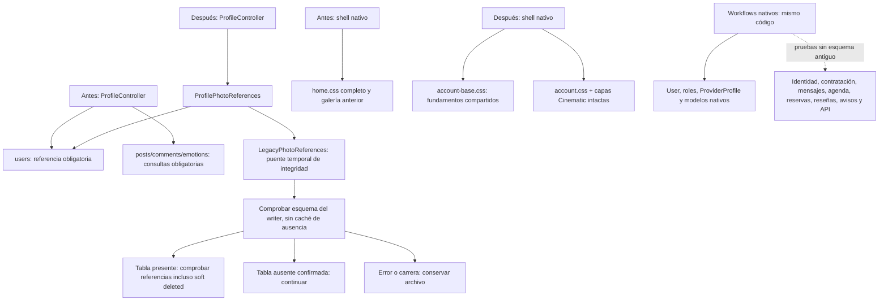

# W6.2a · Desacoplamiento técnico para una sola Tekora

Base aprobada: `2d7e3c05fb3c38857dfe8102e9c5a1c6c70dfe43`. Rama: `codex/w62a-tekora-legacy-decoupling`. Entrega funcional limitada al desacoplamiento; PR en borrador, sin fusión ni despliegue.

## Decisión vigente y alcance

**El destino es eliminar MindBloom, su código exclusivo y finalmente sus datos exclusivos. No se crea archivo de producto, pantalla de historial, conversión de citas ni funcionalidad social nueva.** Esta decisión sustituye las propuestas de conservación/historial condicional de la auditoría W6.1. La auditoría y su matriz de 34 decisiones permanecen como evidencia de procedencia; no constituyen el plan de producto vigente.

W6.2a resuelve dos dependencias demostradas: la comprobación de referencias de fotografías y la carga de estilos antiguos por el shell nativo. Prueba además los módulos propios sin nueve tablas antiguas, sin configuración del guard/proveedor profesional y sin Google en los fixtures. No retira rutas, pantallas, marcas, modelos, cuentas o paquetes en este PR. W6.2b y W6.2c están preparados documentalmente y no se han iniciado.

## Mapa antes/después

El [mapa exportable](evidence/W62A-dependencies.json) registra el antes/después y sus pruebas. El puente no importa ni instancia Post, Comment, Emotion, Cita, Profesionista o clientes Google: usa únicamente la conexión de User y las columnas conocidas que todavía pueden proteger un archivo compartido. Su existencia es temporal, sin crear una capacidad de producto ni una nueva tabla.

## Cambios exactos de código

| Archivo | Cambio | Garantía |
| --- | --- | --- |
| `app/Http/Controllers/ProfileController.php` | La comprobación `photoMayBeReferenced` delega en `ProfilePhotoReferences` | Se conservan validación, verificación de bytes, propiedad, ruta canónica, transacción exterior, confirmación de commit, rollback/compensación y logging seguro de W5.1 |
| `app/Services/ProfilePhotoReferences.php` | Referencias nativas `users.profile_photo_path` obligatorias; consulta primaria y patrón conservador de URL/case | Una referencia de otro User sigue impidiendo borrar; no depende de sus roles ni de modelos antiguos |
| `app/Services/LegacyPhotoReferences.php` | Adaptador de integridad con comprobación de existencia de tablas en el writer; consulta solo las presentes | Tabla ausente no bloquea una limpieza segura; fallo de esquema/columna/consulta no se trata como ausencia; excepción asciende al manejo conservador de W5.1 |
| `public/css/tekora/account-base.css` | Extrae 22 nodos de estilos compartidos, manteniendo orden, selectores y declaraciones | Incluye reset/variables, estructura, navegación, contenido y reglas responsive usadas por el shell; no copia galería, equipo, estadísticas, promociones ni widgets exclusivos |
| `resources/views/components/account-layout.blade.php` | Sustituye el enlace a home.css por account-base.css | Mantiene account.css y todos los bundles/condiciones/CSP/DOM/formularios Cinematic |
| `tests/Feature/LegacyPhotoDecouplingTest.php` | 20 casos nuevos de integridad sin esquema completo | Ocho combinaciones de ausencia, referencias nativas/antiguas compartidas, errores y uso del writer |
| `tests/Feature/NativeLegacyIndependenceTest.php` | Cinco recorridos nuevos sin nueve tablas, guard profesional ni configuración Google | Identidad, workflows, permisos negativos, tokens móviles, recursos de shell; cero consultas de dominio a tablas retiradas |
| `tests/Support/WithoutLegacySchema.php` | Fixture que elimina nueve tablas únicamente de SQLite `:memory:` tras comprobar el aislamiento | No es una migración ni comando de limpieza; no se usa fuera de pruebas |

No cambian controladores/servicios de contratación, policies, permisos, roles, rutas, middleware, API, config de autenticación, 37 migraciones, dependencias, lockfiles, tests anteriores ni bootstrap. Los modelos y rutas anteriores continúan presentes hasta el PR de retirada autorizado. Las relaciones perezosas `User::posts/comments/likes/reminders` todavía existen; las pruebas confirman que no son necesarias para operar los módulos nativos.

Fuentes posteriores: [comprobación nativa](../../../app/Services/ProfilePhotoReferences.php), [puente de integridad](../../../app/Services/LegacyPhotoReferences.php), [controlador W5.1](../../../app/Http/Controllers/ProfileController.php), [base CSS](../../../public/css/tekora/account-base.css), [pruebas de fotos](../../../tests/Feature/LegacyPhotoDecouplingTest.php) y [recorridos nativos](../../../tests/Feature/NativeLegacyIndependenceTest.php). Para la situación anterior, las mismas rutas existentes se pueden contrastar con el SHA base; el mapa W6.1 conserva además símbolos y líneas fijados a su procedencia original.

Quedan dependencias de render de los nombres antiguos en los fragmentos de navegación/login y en la tarjeta cliente. W6.2b debe retirar esos consumidores junto con sus rutas. Esta entrega demuestra independencia de datos/guard/integración antigua en los workflows nativos; no afirma que ya se hayan eliminado nombres de rutas, branding o todas las clases anteriores.

## Integridad de fotografías sin tablas anteriores

Antes, W5.1 conservaba correctamente el archivo ante cualquier error de consulta, pero una tabla retirada hacía fallar la comprobación incluso si no quedaba ninguna referencia antigua. Esto podía impedir limpieza de la foto anterior o compensación de una escritura fallida.

Ahora `users` sigue siendo obligatorio y autoritativo. El adaptador consulta existencia de `posts`, `comments` y `emotions` sobre el writer, incluyendo conexiones con réplicas. No cachea el resultado entre solicitudes. Si una tabla existe, su contenido sigue participando en la protección, también soft deletes, prefijos y URLs con query/fragment/case distinto. Si no existe, continúa con las restantes. Cualquier error de metadata, columna, permisos de lectura o retirada entre comprobación y consulta conserva el archivo; no se captura como falso negativo.

No se cambió el alcance de limpieza: solo rutas gestionadas válidas de `avatars/` o `historical/`, dueño correcto y dentro de la raíz pública del disco. No se añade un recolector de huérfanos, barrido de directorios ni tratamiento de `public/uploads`. El fallo de borrado conserva la referencia nueva ya confirmada y registra atención; nunca deshace un commit válido ni borra la foto anterior por anticipado.

El puente **no autoriza retirar tablas ni elimina la necesidad de resolver medios compartidos en W6.2c**. Su eliminación futura requiere demostrar que las referencias antiguas ya no existen y que ningún archivo nativo perderá protección. No reemplazarlo ahora por `false`, una feature flag desactivada o un catálogo vacío.

## Dependencias nativas y mixtas

| Dependencia | Resultado | Pendiente de retirada |
| --- | --- | --- |
| User / roles / ProviderProfile / Sanctum | Propios de Tekora; mismo código y ownership | Proteger tablas, registros, tokens, credenciales y relaciones nativas. No deducir cuentas exclusivas por email, ausencia de rol, edad o ID |
| Solicitudes, mensajes, disponibilidad, reservas, reseñas y avisos | Operan sin tablas anteriores; tests crean, deciden, proponen, confirman, completan y reseñan con fixtures | Ningún traslado Cita→reserva, Profesionista→ProviderProfile o comentario→mensaje |
| Guard `profesionista` y Google | Solo consumidores anteriores localizados: login/panel, disponibilidad/citas y conexión/callback/desconexión; controlador auxiliar sin ruta localizada | W6.2b retira el conjunto; sin migrar identidades, tokens ni crear Calendar nativo. Evaluar callbacks en vuelo y compromisos externos con autorización separada |
| `account.css`, fuentes y componentes de cuenta | Compartidos y necesarios; base home.css desacoplada | Retirar solo fragmentos exclusivos. Conservar licencias OFL, availability.js y capas W1–W5 |
| `User` con relaciones antiguas | Relación de código compartida, perezosa; no es prueba de uso nativo de tablas antiguas | Quitar únicamente cuatro métodos al retirar sus consumidores/modelos en W6.2b; no borrar User |
| Referencias de archivos | Las tablas antiguas todavía pueden referenciar fotos nativas; raíces distintas entre perfil y comunidad | El código demuestra posibilidad de mezcla; no conocemos qué usuarios/filas/archivos reales la presentan. Se requiere inventario posterior autorizado |

`config/auth.php`, `bootstrap/app.php`, rutas profesionales y ambos controladores Google se revisaron estáticamente. El flujo activo usa `ProfesionistaGoogleController`; el auxiliar `GoogleCalendarController` no tiene un consumidor de ruta localizado y posee otro formato de token. No se ejecutaron esos flujos. La desconexión local no revoca Google ni elimina eventos remotos; no se debe ejecutar como efecto lateral de quitar branding.

## Inventario preparado para W6.2b

La [lista exacta de código](evidence/W62A-removal-code.json) contiene **75 candidatos de archivo**, **18 fragmentos en archivos compartidos**, **32 operaciones de ruta con nombres/procedencia** y **10 candidatos de dependencias**. Cada entrada tiene consumidores localizados, condición pendiente, riesgo y pruebas. Candidato no significa eliminación ejecutada ni prueba de ausencia de consumidores dinámicos.

| Lote propuesto | Qué retirar en W6.2b | Prerrequisitos / pruebas |
| --- | --- | --- |
| Experiencia y enlaces | Grupo/footer anterior, tarjeta cliente, details de perfil, acceso profesional de login/registro y branding exclusivo | No añadir historial. Probar todas las experiencias/roles, CSRF/POST logout, keyboard/móvil/CSP y W1–W5 |
| Bienestar/social/conferencias | Blade, handlers y modelos exclusivos de inicio, emociones/PDF, feed/likes/comentarios, recordatorios y maqueta de junio2025 | Cierre explícito de contratos; no redirigir POST/DELETE a operaciones nuevas ni fingir capacidad equivalente. Conservar protección de medios mientras existan referencias |
| Citas/profesional/Google | Creación y consultas antiguas, decisiones, directorio/panel/disponibilidad, guard/login profesional y OAuth activo/auxiliar | Política de cierre de escrituras/pendientes y callback. No hay compatibilidad indefinida ni interfaz alternativa. No asignar roles ni reclamar cuentas por email |
| Recursos y scaffold | Vistas huérfanas, Auth/* sin cableado localizado, CSS/JS/entrypoints exclusivos | Resolver imports/Vite, referencias dinámicas y tests. `home.css` solo se elimina después de retirar Home; account-base/account.css se conservan |
| Imágenes | Solo assets cuya exclusividad se demuestre | Cero literal no basta. Posibles rutas en datos y medios compartidos bloquean eliminación física; pasar a inventario W6.2c autorizado si es ambiguo |
| Composer/npm | Google/Socialite/Dompdf/laravel-ui y scaffold Bootstrap/Popper/Sass; investigar DBAL y Axios | Verificar transitivos, auto-discovery, instalación con las 37 migraciones, build y regresiones. Resolver locks con herramientas; no editar hashes ni quitar paquetes en W6.2a |

Los tests de funciones retiradas deben cambiar de intención o eliminarse explícitamente en W6.2b; las pruebas de autorización/CSRF/seguridad de funciones nativas se conservan. `RoutesAndGoogleSafetyTest` y `ComposerDependencyCompatibilityTest` mezclan contratos: no retirar una clase completa sin revisar sus métodos. No eliminar `client.appointments.view` por su nombre: todavía protege el dashboard nativo. No eliminar fuentes/licencias por cero referencias.

W6.2b debe decidir por método si una URL deja de existir o responde un cierre explícito (por ejemplo 410 cuando se apruebe). No se prescribe un redirect global, alias eterno, replay 307/308 ni archivo de lectura. El inventario incluye `/cuenta/citas`, que debe retirarse con su tarjeta y referencias, sin crear sustituto histórico. No se alteran estos contratos en W6.2a.

## Plan independiente W6.2c: datos exclusivos, sin archivo de producto

[W62A-removal-data.json](evidence/W62A-removal-data.json) separa **nueve tablas antiguas**, **18 tablas nativas/compartidas protegidas**, **ocho de infraestructura** y **diez FK antiguas**, además de tipos morfos, raíces de medios, ambigüedades y recuperación.

- Candidatas exclusivas: `likes`, `comments`, `posts`, `reminders`, `emotions`, `citas`, `profesionista_bloqueos`, `profesionista_disponibilidades`, `profesionistas`. Sus registros no se transforman en actividad Tekora. El orden de retirada debe respetar relaciones hijo→padre; `likes` conserva además representación polimórfica sin FK.
- Proteger `users`, roles/pivotes, provider_profiles, catálogo/servicios y todas las tablas de contratación, lectura, avisos, agenda, reservas/eventos, reseñas y tokens nativos. Las FK desde datos antiguos a users no autorizan borrar users ni ejecutar cascadas desde cuentas.
- Proteger infraestructura compartida: sesiones, resets, jobs/cache y registro de migraciones. Su procedencia de filas no se deduce por fecha o por ausencia de actividad. No vaciar tablas ni declarar cuentas antiguas sin evidencia autorizada.
- Comunidad usa archivos directos en `public/uploads/...`; perfil/emociones pueden compartir referencias al disco public de Storage. Eliminar UI no despublica URLs ni demuestra exclusividad del archivo. Mantener todos los archivos con referencias nativas; no restaurar automáticamente contenido soft-deleted ni atribuirlo a otro módulo.
- Mantener las 37 migraciones históricas intactas. La propuesta de esquema final debe ser otra entrega: migraciones nuevas hacia adelante, grafo de FK/triggers y pruebas de instalación nueva (historia más cambios aprobados) y actualización existente. El código incluye SQL específico de SQLite; no se ha inspeccionado qué driver/versiones usa una instalación real ni se certifica un upgrade MySQL.
- Antes de destruir: autorización separada, inventario delimitado, clasificación cierta, límites verificables de filas/bytes, comprobación de referencias nativas y simulación de fallos en copia aislada. Si existe ambigüedad, detener el lote. No se ejecuta esta inspección en W6.2a.
- Recuperación: snapshot operativo temporal consistente, acceso restringido, checksums y restauración ensayada antes de ejecutar. Es respaldo para errores, **no archivo funcional ni módulo histórico**. Registrar alcance/puntos de parada y reconciliar referencias; un revert Git o un down no recupera medios, filas ni efectos Google. Aprobación específica antes de restaurar o modificar instalaciones.

Los nombres, conteos y relaciones anteriores proceden de código/migraciones; no de consultas a bases persistentes. No se conocen usuarios exclusivos, cantidades reales, huérfanos o medios mezclados. Ningún SQL destructivo, migración de retirada, comando de purga o limpieza de medios se incorpora al producto.

## Pruebas y evidencia

La baseline se ejecutó sobre la base aprobada: **626 pruebas / 8.258 aserciones, PHP 8.2.28**. Tras el cambio, la ejecución habitual dio **651 / 8.659 en PHP 8.2.28**. La diferencia exacta es **25 pruebas nuevas / 401 aserciones nuevas**; los 626 tests anteriores no se modificaron.

El ciclo reproducible **npm ci → npm audit → npm run build → PHPUnit completo** se ejecutó también en un clon temporal sin `.env`, hot file, uploads ni storage existente: **651 / 8.659, PHP 8.2.35**, con el manifiesto real. W5.1 por separado: **49 / 459**. Grupo W6.2a: **25 / 401**. Pint pasa sobre los seis archivos PHP nuevos/modificados. Composer audit con y sin dev y npm audit: **cero avisos/vulnerabilidades**. Composer validate estricto y requisitos de plataforma correctos. Consultar [resultados exactos y límites](evidence/W62A-validation.json).

La regresión específica de assets sin build pasa: **1 prueba / 6 aserciones**. Un ensayo complementario de toda la suite sin bundles alcanzó **651 / 8.562, dos errores y dos omisiones**: los previews CLI W2/W3 exigen build, y dos casos de manifiesto se omiten explícitamente. Los dos previews también fallan con las fuentes originales de la base (**2 pruebas / 5 aserciones / 2 errores**). No se cambiaron tests ni previews para ocultar ese requisito. Las **97 aserciones de diferencia** están desglosadas por siete casos en [W62A-assertion-delta.json](evidence/W62A-assertion-delta.json). El manifiesto se preservó y restauró con SHA256 idéntico; nunca se borró. La guía prepara bundles antes de la suite completa y usa el caso aislado para comprobar tags de desarrollo.

El entorno agotó el disco de Docker durante la verificación. Se conservaron cachés reconstruibles de herramientas en `/tmp` y se continuó en un clon aislado allí, con PHP8.2.35 y sus extensiones/tzdata completos. Hubo intentos fallidos por espacio, extensiones de subprocesos y configuración de tzdata; no se modificaron tests, reglas temporales, permisos ni negocio para resolverlos. Los resultados anteriores corresponden a ejecuciones completadas, no a esos intentos. La guía Laragon usa PHP8.2.28; la validación independiente Windows sigue pendiente.

La separación CSS se contrasta en Chromium sobre **20 páginas GET reales renderizadas con fixtures sintéticos**, sirviendo antes home.css y después la extracción sobre el mismo HTML y los mismos bundles. Se comparan estilos calculados de todos los elementos y pseudo-elementos, con animaciones congeladas y reduced motion para determinismo; dos anchos por página y ocho en cliente/prestador/perfil. [Resultados visuales](evidence/W62A-visual-comparison.json). No se han usado fotos reales ni screenshots históricos como sustituto de una ejecución.

Resultado: **58 comparaciones iguales**, sin errores JavaScript. Los nombres de propiedades se ordenan antes de comparar: el orden de enumeración del CSSOM no es una diferencia de valores. [Extracción de declaraciones](evidence/W62A-css-extraction.json). Las capturas incluidas mantienen visibles los accesos anteriores porque su retirada pertenece exclusivamente a W6.2b; no son pantallas nuevas de historial.

Las **21 operaciones API** y las **37 migraciones** se conservan byte por byte en sus fuentes. Los tests nuevos solo eliminan tablas dentro de SQLite `:memory:` tras verificar el aislamiento. Se usa Storage::fake con raíz temporal, SQL/archivos sintéticos, HTTP sin llamadas imprevistas y Socialite prohibido en los recorridos de independencia. La suite anterior incluye mocks de compatibilidad OAuth, sin cuentas reales.

No se inspeccionaron ni modificaron bases persistentes, usuarios, credenciales, sesiones, fotografías o medios reales. No se modificó `.env` ni APP_KEY persistente; el bootstrap genera una clave efímera de pruebas. No se conectaron cuentas externas, fusionó, desplegó ni activó auto-merge. W6.2b/c requieren entregas y autorizaciones propias.
