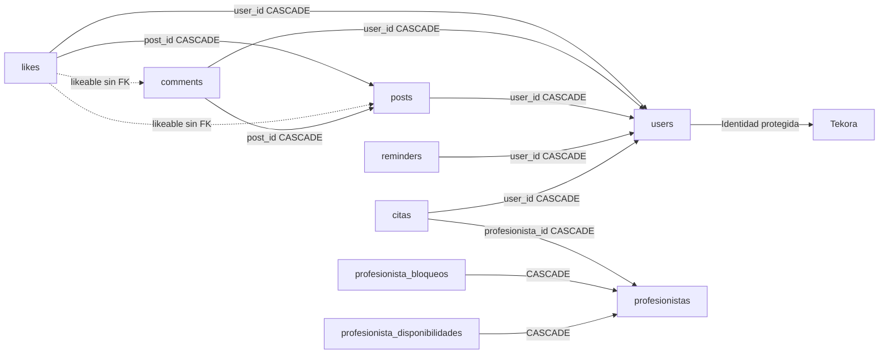

# W6.2c-a · Preflight de retirada definitiva

**SOLO TEKORA. CERO MINDBLOOM.** Esta entrega prepara el corte; no autoriza ni ejecuta una purga real. Base obligatoria: `ce7cf62670a1c559247fa6993bcd26e73a334c80` (merge #26), rama `codex/w62c-a-retirement-preflight`. Un único PR en borrador, sin merge, despliegue ni auto-merge.

## Alcance y procedencia

Antes de trabajar: 52 GiB libres y 4.120.077 inodos en `/workspace`; checkout limpio. `git ls-remote` confirmó el SHA obligatorio y después de fetch `HEAD`/`origin/main` coinciden. Se continuó en el checkout existente. Se leyeron [W62A](W62A.md), [W62B](W62B.md), [datos W62A](evidence/W62A-removal-data.json), [resolución W62B](evidence/W62B-inventory-resolution.json) y [validación W62B](evidence/W62B-validation.json).

Únicos cambios de esta entrega: pruebas nuevas y documentación/evidencias. No hay cambios de producto, dependencias, configuración, locks, medios, credenciales, migraciones o API. Las 37 migraciones siguen creando las tablas históricas; W6.2b eliminó sus writers y rutas de producto, no sus datos. La única lectura de dominio antigua restante en `app` es el puente de integridad fotográfica. Las prohibiciones de `profesionista_id` en requests nativos son defensas que deben conservarse.

Se generó el esquema desde las 37 migraciones en SQLite `:memory:`: 35 tablas de aplicación, nueve candidatas y 26 protegidas, con 34 triggers. No son conteos de filas reales. El [catálogo sintético completo](evidence/W62C-A-synthetic-schema.json) incluye tipos, nullability, defaults, PK/índices, FK y SQL de triggers. La [matriz de nueve tablas](evidence/W62C-A-nine-table-matrix.json) enlaza todas las migraciones históricas que construyen/modifican cada tabla. El esquema de una instalación puede haber divergido: su inspección es **PENDIENTE DE AUTORIZACIÓN**.

## Nine-table exit plan

Todas son candidatas por procedencia de código, no por inspección de registros. El orden evita que una FK hija sobreviva a su padre. No se debe borrar `users` ni utilizar sus cascadas como mecanismo de retirada.

| Orden | Tabla y definición histórica resumida | FK salientes; dependencias entrantes | Consumidor actual / riesgo y gate |
| --- | --- | --- | --- |
| 1 | `likes`: id, user_id, post_id nullable, likeable_id/type nullable, timestamps; únicos user/post y user/likeable | user_id→users; post_id→posts, ambas CASCADE. Morfos a Post/Comment sin FK | Sin writer de producto; fixtures y tests de migración. Verificar ambas representaciones, tipos desconocidos y huérfanos; no resolver por FK solamente |
| 2 | `comments`: id, content nullable, user_id, post_id, media_path/type, deleted_at, timestamps | user_id→users, post_id→posts CASCADE; likes puede apuntar por morfo | Puente sobre media_path; una fila soft-deleted puede proteger bytes compartidos. Clasificar antes de perder la referencia |
| 3 | `posts`: id, user_id, content nullable, media_path/type, deleted_at, timestamps | user_id→users CASCADE; entrantes comments.post_id y likes.post_id, además de morfos | Puente sobre media_path. Retirar después de likes/comments y de inventariar sus medios |
| 4 | `reminders`: id, user_id, title, description, remind_at, timestamps | user_id→users CASCADE | Sin consumidor productivo; no convertir recordatorios ni inferir autoría nativa |
| 5 | `emotions`: id, name, slug único, image_path, subtitle, description, accent, order, timestamps | Sin FK | Puente sobre image_path; puede contener URLs nativas/compartidas pese a procedencia antigua |
| 6 | `citas`: id, user_id, profesionista_id, fechas originales y starts_at/ends_at, motivo, estado/status, google_event_id, timestamps; slot único | user_id→users, profesionista_id→profesionistas CASCADE | Sin consumidor productivo; estados/fechas coexistentes y evento externo no equivalen a reserva Tekora. No borrar eventos remotos |
| 7 | `profesionista_bloqueos`: id, profesionista_id, start/end_datetime, motivo, timestamps | profesionista_id→profesionistas CASCADE | Sin writer productivo; no transferir a disponibilidad nativa |
| 8 | `profesionista_disponibilidades`: id, profesionista_id, day_of_week, start/end_time, is_active, timestamps | profesionista_id→profesionistas CASCADE | Sin writer productivo; ningún mapeo a ProviderProfile |
| 9 | `profesionistas`: id, nombre, email único, password, cedula única, remember_token, tokens/calendario/expiración Google, timestamps | Padre de citas y sus dos tablas de disponibilidad; sin FK a User | Sin guard ni writer productivo. Datos/credenciales sensibles; nunca enlazar por email/ID ni revocar OAuth como efecto lateral |

Las diez FK anteriores fueron contrastadas con el esquema sintético. No hay FK desde las 26 tablas protegidas hacia las nueve candidatas en ese esquema. La instalación real requiere buscar además FK no declaradas en código, vistas, triggers, procedimientos, colas pendientes, lectores externos y jobs de versiones anteriores. Cualquier dependencia desconocida detiene el lote; no se desactivan FK para forzar el corte.

El grafo representa dirección hija→padre; no prescribe borrar padres compartidos. `emotions` está aislada por FK, pero conectada a medios por referencias de texto.

## Protección nativa explícita

Conservar datos, claves y restricciones de `users`, `roles`, `role_user`, `provider_profiles`, `service_categories`, `services`, `service_inquiries`, `service_inquiry_messages`, `service_inquiry_reads`, `inquiry_notifications`, `provider_availability_settings`, `provider_weekly_intervals`, `provider_blocked_dates`, `service_reservations`, `reservation_events`, `service_reviews`, `activity_notifications` y `personal_access_tokens`.

Conservar también `migrations`, `password_reset_tokens`, `sessions`, `cache`, `cache_locks`, `jobs`, `job_batches` y `failed_jobs`. La ausencia de rol, edad, género, correo, ID coincidente o falta de actividad no demuestra que una cuenta o fila sea exclusiva del producto anterior. No fusionar Profesionista→ProviderProfile ni convertir Cita→ServiceReservation. El inventario de tokens/sesiones solo debe registrar metadatos mínimos aprobados, nunca valores secretos.

La simulación crea identidades con email coincidente, filas antiguas y nativas, un token móvil y referencias compartidas; compara **todas las filas de las 26 tablas protegidas y sus definiciones antes/después** de retirar las nueve tablas. Después opera mensajes, disponibilidad previamente creada, propuestas/confirmación/completado de reserva, reseña, avisos, catálogo y autenticación API. La suite W62A sin esquema anterior sigue cubriendo registro/login/logout web, ownership negativo y rotación/revocación de tokens. Las fuentes de aplicación permanecen idénticas a la base: [314 hashes de fuentes retenidos de la evidencia previa, sin recalcular](evidence/W62C-A-protected-source-integrity.json).

## Matriz de medios y diez imágenes pendientes

| Raíz / referencias | Posible cruce | Decisión de esta entrega |
| --- | --- | --- |
| `public/uploads/community/posts` y `community/comments` | Archivos servidos directamente; retirar rutas no despublica URL. Soft delete no garantiza bytes existentes | No enumerar ni leer medios reales. Inventario posterior autorizado, incluyendo referencias externas al dominio antiguo |
| `storage/app/public` y URLs `/storage/` | users.profile_photo_path frente a posts/comments.media_path y emotions.image_path; URL absoluta, case, query/fragment y prefijos | Preservar toda referencia nativa. Las rutas gestionadas W5.1 son solo avatars/historical válidos y del propietario; no ampliar a un GC general |
| `public/img/` | Assets versionados pueden estar guardados como rutas/URLs en filas desconocidas | Política vigente: metadatos Git y referencias de fuentes, sin releer bytes. Las lecturas históricas para SHA-256 se declaran abajo; no inferir exclusividad por cero literales |
| Fuentes/OFL, iconos, CSS/JS Tekora | Recursos nativos de varias pantallas | Protegidos; no borrar ni sustituir |

La [clasificación individual](evidence/W62C-A-media-matrix.json) conserva blob Git, tamaño y referencias históricas/actuales para **alex.jpg, emociones.png, esperanza.png, fondo.jpg, foto1.png, logo.png, roque.jpg, salud.jpg, tranquilidad.png y user1.jpg**. Resultado para las diez: **candidata por procedencia; exclusividad en datos no demostrada; CONSERVAR**. Derechos, referencias en filas/URLs y bytes realmente existentes: **PENDIENTE DE AUTORIZACIÓN**. No se visualizaron imágenes ni se interpretó su contenido. Sí se leyeron sus bytes para obtener los SHA-256 históricos; no fue una operación basada solo en metadatos Git. No se enumeraron medios de Storage reales. Se registra abajo una lectura accidental de bytes de medios versionados en uploads durante la verificación auxiliar de integridad.

Los fixtures verifican una fotografía usada por dos Users y por posts/comments/emotions en cinco cortes (0, 1, 2, 3 y 9 tablas retiradas). Una actualización válida de foto no borra el archivo compartido. W5.1 y W62A mantienen los casos de error SQL, almacenamiento, metadata y retención conservadora sin modificar esas pruebas ni `LegacyPhotoReferences`.

**Retirada futura del puente:** solo después de ejecutar y verificar un corte real autorizado en todas las instalaciones soportadas, resolver los medios compartidos, confirmar ausencia de writers/tablas/referencias antiguas y probar protección nativa equivalente. Haría falta otro PR revisado que retire exclusivamente el adaptador y sus llamadas, conservando errores conservadores/ownership/commit/compensación W5.1. No sustituirlo ahora por false, flags o listas vacías. Eliminar filas antes de inventariar sus rutas destruiría evidencia necesaria para clasificar archivos.

## Ensayos y puntos de parada

`tests/Feature/RetirementPreflightTest.php` contiene el simulador privado, sin autoload de producción ni interfaz genérica. Antes de cada DROP verifica testing, driver SQLite, nombre real `:memory:`, DB_URL vacío, `PRAGMA database_list` sin adjuntos y `foreign_keys=ON`. Nunca abre una conexión a un archivo para el ensayo negativo: altera solo la metadata del objeto ya conectado y exige el rechazo antes de operar.

Se comprueban: esquema de las 37 migraciones; nueve tablas pobladas; allowlist y orden hijo→padre; rechazo de dependencia entrante desconocida; columna de medios ausente; trigger antiguo inesperado; trigger cruzado asociado a users que escribe en posts; FK huérfana; FK desactivadas; conexión adjunta; estado parcial no confirmado; fallo después del tercer paso sin continuación automática; reanudación sintética explícita; rollback transaccional SQLite y restauración lógica a una **segunda base SQLite en memoria**, cotejando checksum de DDL/filas restauradas, objetos, índices/triggers y FK. Los adjuntos usados para provocar rechazo también son `:memory:`. La corrupción deliberada desactiva FK únicamente para crear el fixture negativo; la retirada no las desactiva.

Antes del primer DROP también se compara la lista completa de triggers de tablas protegidas (nombre, tabla y SQL) con la captura de las 37 migraciones al iniciar cada test. Cualquier alta, cambio o ausencia exige parar con `Unreviewed protected trigger: stop before retirement`. La prueba cruzada crea un trigger sobre `users` cuyo cuerpo inserta en `posts`: comprueba cero sentencias DROP, nueve tablas aún presentes, filas protegidas y triggers intactos. Después demuestra que el trigger sigue activo mediante una actualización sintética, sin desactivarlo ni eliminarlo. No se pretende analizar SQL con búsquedas de palabras; se rechaza cualquier cambio no revisado, incluso si pudiera ser inocuo. Esta captura es la baseline sintética conocida, no una aprobación automática de triggers de una instalación real.

Este ensayo no es un validador exhaustivo de instalaciones arbitrarias. El validador real futuro debe comparar esquema completo, tipos/defaults/índices, vistas y cuerpos de todos los triggers, no solo los ejemplos de drift cubiertos aquí. La restauración lógica sintética no sustituye una copia consistente ni el ensayo de recuperación operativo del motor objetivo. SQLite soporta rollback DDL en estos casos; **no se afirma atomicidad DDL ni compatibilidad MySQL**.

## Plan real de corte — no ejecutado

1. **Autorización de lectura e identificación.** Registrar instalación inequívoca, entorno, motor/versión, código desplegado y SHA, conexión, almacenamiento y propietario operativo, sin divulgar secretos. Confirmar que no es otra instalación por tener el mismo nombre de base. Obtener autorización separada para esquema, conteos/metadatos y medios; sin ella no consultar. Verificar despliegue W6.2b y ausencia de rutas/writers antiguos también en procesos largos, cron, workers antiguos y conexiones externas.
2. **Inventario y clasificación.** Comparar esquema instalado con las 37 migraciones, grafo completo de FK/morfos/triggers/vistas y referencias de medios. Distinguir raíz física, disco, URL canónica, symlinks, propietario, tipo y referencias nativas; no seguir URLs remotas ni symlinks fuera de raíz. Bloquear desconocidos, referencias cruzadas no resueltas y divergencia de columnas. Las nueve tablas candidatas no autorizan tocar Users, infraestructura o medios compartidos. Los efectos Google se inventarían por separado con autorización específica, nunca ejecutando OAuth durante esta entrega.
3. **Manifiesto aprobable.** Enumerar nueve tablas exactas, sus objetos y el orden, filas/IDs y conteos esperados, checksums y límites máximos por tabla; para archivos, lista exacta de rutas canónicas y bytes máximos. Hoy todos los conteos de datos/bytes reales están **PENDIENTE DE AUTORIZACIÓN**, no son cero. Un límite no puede ser ilimitado ni un comodín. Desviación, nueva referencia o cambio de checksum exige detener y volver a aprobar; no ampliar automáticamente el alcance.
4. **Respaldo antes de destruir.** En ventana de corte, detener escrituras suficientes para obtener un punto consistente entre DB y medios, drenar/bloquear writers antiguos y comprobar sus conexiones/jobs. No vaciar sesiones, colas o caché como atajo. Obtener snapshot consistente del motor más snapshot de medios y manifiesto en almacenamiento temporal, cifrado y restringido, con retención y responsable definidos. Incluir esquema, objetos, secuencias, migraciones e infraestructura; verificar hashes y que los secretos no aparecen en logs. No es archivo de producto. Restaurar primero en destino aislado con correos/colas/salidas externas bloqueados; cotejar filas, restricciones, secuencias, bytes y workflows nativos. Gate cerrado si no se ha ensayado la restauración con el motor objetivo.
5. **Corte futuro por entrega separada.** Crear después una migración nueva hacia adelante, revisada, de allowlist fija y precondiciones, sin reescribir las 37 históricas ni crear un comando general. Para cada tabla, retirar primero cualquier FK entrante aprobada y sus dependencias exclusivas; nunca retirar constraints nativas desconocidas para forzar avance. Orden lógico: likes→comments→posts→reminders→emotions→citas→bloqueos→disponibilidades→profesionistas. Si no hay FK entrantes restantes, el DROP del hijo retira sus propias FK; no hay necesidad de borrar Users. Clasificar referencias/medios antes de perder filas y ejecutar cualquier limpieza física solo como lote específico autorizado después de validar referencias. No incluir esa migración ni ese lote en este PR.
6. **Instalación existente vs nueva.** Una existente debe comprobar historia, escritores, backups y manifiesto reales antes de añadir el paso hacia adelante; nunca ejecutar migrate:fresh. Una nueva instala las 37 históricas y, en la futura release aprobada, la nueva migración: probar por separado que el resultado final y sus objetos coinciden con el upgrade. La instalación nueva de esta rama todavía tiene nueve tablas antiguas por diseño, pero ningún módulo antiguo activo.
7. **Parada y recuperación.** Ante esquema divergente, falta de permiso, writer activo, backup no restaurable, referencia nativa, fuera de allowlist o discrepancia de filas/bytes: detener antes de la operación. Ante fallo parcial, mantener la instalación aislada, registrar último paso confirmado y estado realmente observado; no reintentar automáticamente ni marcar migración completa. Elegir restauración consistente DB+medios al mismo punto o continuación con manifiesto revisado y nueva aprobación. No copiar toda una DB encima de escrituras nativas posteriores sin reconciliación y aprobación de esa pérdida. Mantener originales hasta validar. Un down no recupera filas ni bytes.
8. **Verificación posterior antes de reabrir.** Comparar todos los datos protegidos, roles/tokens/credenciales e infraestructura, FK y objetos esperados; comprobar ausencia de nueve tablas y writers antiguos, y presencia de 21 contratos API. Ejecutar login/reset/logout, catálogo, solicitudes/mensajes, horarios, reservas/eventos, reseñas, notificaciones y fotos compartidas. Revisar fallos SQL/storage y logs sin secretos. Cualquier pérdida o error bloquea reapertura. Retirar backup temporal solo según retención y autorización específica, nunca por terminar el PR.

**Revertir un commit no restaura bases de datos, fotografías ni eventos externos.** La recuperación operativa debe ser consistente y ensayada antes del corte.

### Gates que permanecen cerrados

- Autorización específica de lectura de la instalación objetivo, inventario de filas y medios privados.
- Clasificación cierta y manifiesto acotado aprobado para DB y archivos; no hay IDs, filas o bytes reales aprobados hoy.
- Verificación de writers detenidos y compatibilidad del motor/versiones instaladas. **MySQL: PENDIENTE**, instalación y upgrade sintéticos, FK, índices/triggers, semántica DDL/autocommit, privilegios y restauración con herramientas nativas.
- Backup/restauración operativos consistentes y ensayados, ventana, responsables, límites y puntos de parada aprobados.
- Aprobación separada de la futura migración hacia adelante, ejecución real, posible restauración y cualquier acción externa Google.
- Fusión, despliegue y auto-merge no autorizados para esta entrega.

## Verificación y comparación

Los resultados completos, conteos y límites se registran en [validación](evidence/W62C-A-validation.json), con logs y JUnit. Baseline Windows proporcionada por el encargo y baseline cloud actual: 669/9.026. W5.1: 49/459; W6.2a: 25/406; W6.2b: 34/586. La diferencia de cinco aserciones respecto al documento W62A original es la comprobación de clases retiradas añadida en W62B; no se alteran esas suites aquí.

La entrega original ejecutó Composer validate/plataforma, auditorías con/sin dev y npm audit/build. Esos resultados se conservan como históricos y no se atribuyen a esta corrección; aquí se repiten las pruebas afectadas, la suite completa, Pint del test y diff check. Si la API de Packagist está bloqueada, se informa como bloqueo, nunca como auditoría aprobada. PHP cloud 8.4.27; requisito Composer ^8.2 y plataforma 8.2.28 intactos. [Validación Windows/Laragon aislada](W62C-A-LARAGON.md), no ejecutada desde cloud.

### Resultados completados en este entorno

| Verificación | Resultado |
| --- | --- |
| Baseline | 669 pruebas / 9.026 aserciones |
| Preflight tras corrección de revisión | 19 / 198 |
| Suite completa tras corrección | **688 / 9.224**, cero fallos, errores u omisiones |
| W5.1 / W6.2a / W6.2b | 49/459 · 25/406 · 34/586 |
| Composer validate / plataforma | Correctos |
| Composer audit con/sin dev | Bloqueados por proxy 403; no aprobados |
| npm audit / build | Cero vulnerabilidades / correcto |
| Pint del test nuevo / diff check | Correctos |
| Fuentes protegidas | 314 entradas históricas retenidas sin recalcular; se retiran diez SHA-256 de imágenes. Producción, 37 migraciones y 21 operaciones API sin cambios en este PR |

## Incidencia de alcance de lectura — registro original conservado

Un script auxiliar temporal de integridad filtró las rutas `public/uploads/` después de leer sus bytes, en lugar de hacerlo antes. Así leyó nueve medios ya versionados bajo esa raíz. Esto excedió la restricción de lectura del encargo. No se visualizaron ni interpretaron sus contenidos, no se guardaron bytes ni hashes de esos medios en la evidencia y no se modificaron, copiaron ni borraron archivos. No se abrió ninguna base persistente. Se corrigió el filtro para excluir uploads/Storage/SQLite antes de cualquier lectura y se dejó de usar ese recorrido. Las pruebas y sus simulaciones solo operaron en memoria y Storage::fake. Esta incidencia se declara expresamente; no se presenta la ejecución como cumplimiento absoluto de cero lecturas de medios reales.

### Aclaración de revisión del HEAD 298905f

El campo original `real_media_read: false` era incorrecto: se corrige a **true** para la entrega histórica. Nueve archivos versionados de `public/uploads/` fueron leídos accidentalmente según el registro anterior; sus bytes/hashes no se guardaron en la evidencia. Separadamente, los diez archivos de `public/img/` tuvieron lectura de bytes para SHA-256 y sus hashes **sí se publicaron** en `W62C-A-protected-source-integrity.json` del HEAD revisado. Son grupos distintos: no debe extenderse a las diez imágenes la afirmación de que no se publicaron hashes de los nueve uploads.

Procedencia contrastada con el texto del script auxiliar y el registro de ejecución, sin volver a ejecutarlo: `data = Path(p).read_bytes()` leía el archivo de trabajo; `hashlib.sha256(data).hexdigest()` producía su SHA-256. Además, `git show base:path` leía los bytes del blob para comparar. El SHA-256 no se derivó del identificador de objeto Git. En cambio, `git_blob` y `bytes` de la matriz procedían de `git ls-tree -l`: ID de objeto y tamaño ya registrados en Git, sin recalcular un hash del archivo de trabajo.

Se retiran los diez SHA-256 de imágenes de la evidencia activa por no ser necesarios para esta revisión. Permanecen auditables en el commit histórico `298905f5e3009da8404ffd628335740c6e5069e9`; no se reescribe ese historial. Las otras 314 entradas se conservan desde el informe original, con procedencia explícita; **no se recalcularon**. La matriz distingue ahora lectura de bytes, visualización del contenido y lectura en esta revisión. No se abrieron ni releyeron medios en esta corrección ni se publican nuevos hashes de medios. No se afirma cumplimiento histórico de cero lecturas.

La entrega inicial pasó 18/182 y 687/9.208; los logs activos y JUnit pasan a reflejar 19/198 y 688/9.224 tras la corrección. Los resultados anteriores permanecen en el HEAD revisado y en la validación como antecedente. No se han modificado fuentes de producto, migraciones, configuración, datos, medios ni credenciales.
